# 🌐 Как устроен Интернет

> [!info] Источник
> **Видео:** «ВСЁ, ЧТО НУЖНО ЗНАТЬ ПРО ИНТЕРНЕТ» / *Просто DevOps*  
> **Ссылка:** https://www.youtube.com/watch?v=Ce-HDCrXMtQ  
> **Длительность:** ~25:36  
>
> Авторы заявляют три основные линии ролика: **история развития Интернета → как он устроен → зачем это знать DevOps-инженеру и что из этого спрашивают на собеседованиях**.
>
> Прямой покадровый доступ и полная расшифровка YouTube в текущем окружении недоступны, поэтому ниже нет выдуманных цитат или таймкодов. Конспект следует заявленной логике ролика, а технические детали проверены по общепринятым сетевым стандартам. Блоки **«Практика DevOps»** — мои дополнения для закрепления.

---

## 🖼️ Превью-кадры самого ролика

YouTube автоматически формирует несколько изображений непосредственно из видео. Они могут отображаться в Obsidian при наличии Интернета.


| Кадр 1 | Кадр 2 | Кадр 3 |
|---|---|---|
|  |  |  |

> [!note]
> Для ключевых технических моментов ниже используются **Mermaid-схемы**, потому что они лучше подходят для повторения и полностью рендерятся самим Obsidian.

---

# 1. Главная идея: Интернет — это сеть сетей

Самая важная мысль:

> [!important]
> **Интернет — не один огромный компьютер и не одна сеть.  
> Это множество независимых сетей, соединённых между собой и использующих совместимые протоколы.**

Домашняя сеть, сеть университета, дата-центр, мобильный оператор, облачный провайдер, крупная корпоративная сеть — всё это отдельные сети.

Они могут быть устроены по-разному внутри, но обмениваются IP-пакетами по общим правилам.

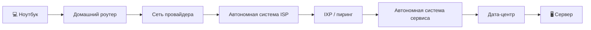

### Термины

| Термин | Смысл |
|---|---|
| **Host / хост** | устройство, подключённое к сети |
| **Network / сеть** | группа устройств, способных обмениваться данными |
| **Router / маршрутизатор** | пересылает пакеты между сетями |
| **ISP** | Internet Service Provider — интернет-провайдер |
| **Protocol / протокол** | набор правил взаимодействия |
| **Packet / пакет** | порция данных, передаваемая по сети |
| **Internet** | глобальная сеть взаимосвязанных сетей |
| **Web / WWW** | один из сервисов, работающих поверх Интернета |

> [!warning] Интернет ≠ Web
> **Интернет** — инфраструктура передачи данных.  
> **Web** — сайты и веб-приложения, которые работают поверх Интернета с использованием HTTP/HTTPS.
>
> Кроме Web поверх Интернета существуют [[SSH и передача файлов|SSH]], электронная почта, DNS, VPN, мессенджеры и множество других сервисов.

---

# 2. Как появился Интернет

## 2.1. Почему вообще появилась идея пакетной сети

Ранние системы связи часто строились вокруг выделенного канала.

В пакетной сети сообщение делится на небольшие части — **пакеты**. Каждый пакет передаётся через сеть, а на принимающей стороне данные собираются обратно.

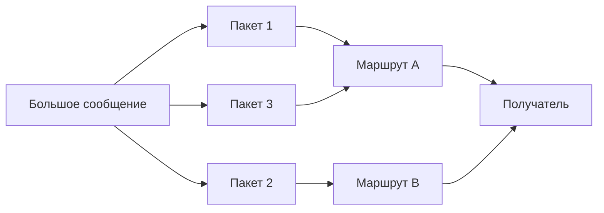

Это фундаментальная идея современных IP-сетей.

---

## 2.2. Упрощённая временная шкала

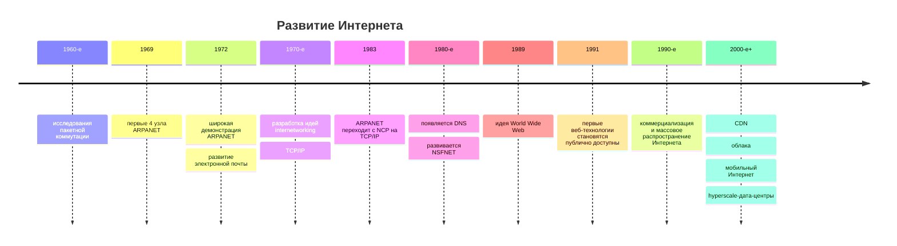

### Что важно запомнить

- В конце **1969 года** первоначальная ARPANET связывала четыре хоста.
- С ростом количества разных сетей появилась необходимость связывать **не отдельные компьютеры, а целые сети**.
- TCP/IP стал универсальным набором протоколов для такого взаимодействия.
- **1 января 1983 года** ARPANET перешла с NCP на TCP/IP — один из ключевых рубежей истории Интернета.
- Рост количества хостов сделал централизованный список имён неудобным — появился **DNS**.
- World Wide Web возник позже самого Интернета.

> [!tip] Для собеседования
> Не говори: **«Интернет появился вместе с Web»**.
>
> Правильнее: инфраструктура и TCP/IP существовали раньше, а Web стал одним из самых успешных прикладных сервисов поверх Интернета.

---

# 3. Интернет существует физически

Интернет кажется «облаком», но данные всегда передаются через физическую среду:

- оптоволокно;
- медные кабели;
- Ethernet;
- Wi‑Fi;
- мобильные сети;
- радиорелейные линии;
- спутниковые каналы;
- подводные магистральные кабели.

> [!important]
> Большая часть межконтинентального трафика передаётся не «через спутники», а через **оптоволоконные подводные кабели**.

Упрощённо:

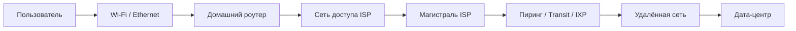

---

# 4. Домашняя сеть и первый маршрутизатор

Когда ноутбук подключается к Wi‑Fi, он ещё не становится напрямую частью всех сетей Интернета.

Обычно происходит примерно следующее:

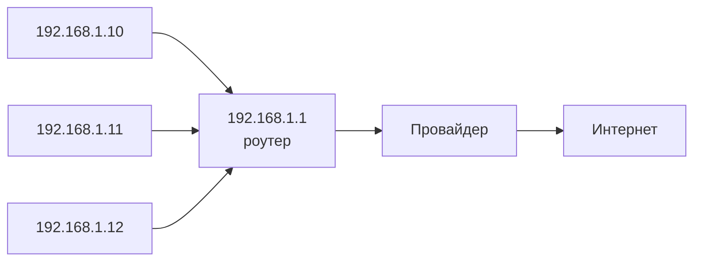

Устройства имеют адреса внутри локальной сети, а домашний маршрутизатор:

1. соединяет локальную сеть с сетью провайдера;
2. выступает **default gateway**;
3. часто выполняет NAT;
4. может раздавать адреса через DHCP;
5. часто работает как DNS-forwarder/cache;
6. обычно содержит базовый [[Firewall|firewall]].

---

# 5. IP: как понять, куда доставить пакет

## IPv4

IPv4-адрес имеет длину **32 бита**.

Пример:

```text
192.168.1.10
```

Он визуально записывается как четыре числа от `0` до `255`.

## IPv6

IPv6 использует **128-битные адреса**.

Пример:

```text
2001:db8:85a3::8a2e:370:7334
```

IPv6 появился в том числе из-за ограниченного адресного пространства IPv4.

---

## 5.1. Частные IPv4-адреса

Часто в локальных сетях используются:

```text
10.0.0.0/8
172.16.0.0/12
192.168.0.0/16
```

Такие адреса не маршрутизируются напрямую в глобальном Интернете.

---

# 6. NAT: почему дома десятки устройств, а публичный IP может быть один

**NAT — Network Address Translation.**

Домашние устройства могут использовать частные адреса:

```text
192.168.1.10
192.168.1.11
192.168.1.12
```

А наружу трафик выходит через один публичный адрес роутера.

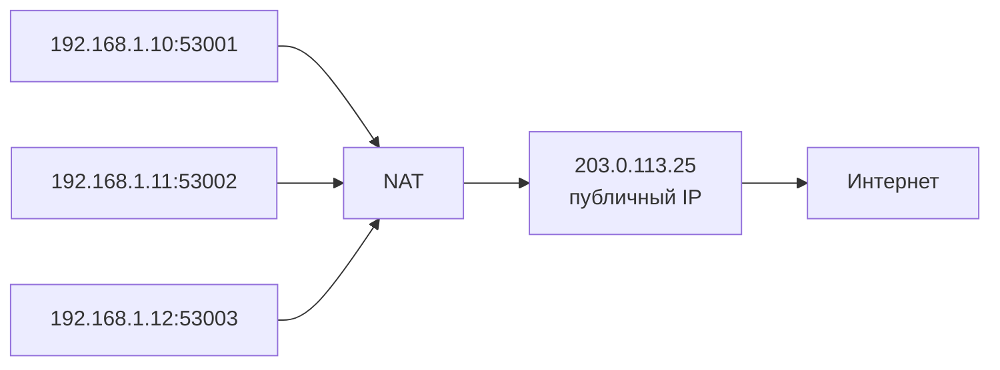

Маршрутизатор хранит таблицу соответствий соединений и понимает, какому внутреннему хосту вернуть ответ.

> [!note]
> NAT и firewall — не одно и то же.  
> NAT преобразует адреса/порты. Firewall принимает решение, разрешать или блокировать трафик.

---

# 7. Подсети и маршруты

Одного IP-адреса недостаточно. Устройство должно понимать:

- какие адреса находятся **в локальной сети**;
- какие адреса необходимо отправить через **шлюз**.

Пример:

```text
IP:      192.168.1.10
Prefix:  /24
Gateway: 192.168.1.1
```

Сеть:

```text
192.168.1.0/24
```

Хост понимает:

```text
192.168.1.25     → находится рядом, в моей подсети
8.8.8.8          → отправить через default gateway
```

---

## 7.1. Таблица маршрутизации

На [[Сеть Linux|Linux]]:

```bash
ip route
```

Пример:

```text
default via 192.168.1.1 dev wlan0
192.168.1.0/24 dev wlan0 proto kernel scope link src 192.168.1.10
```

Читается так:

- сеть `192.168.1.0/24` доступна напрямую через `wlan0`;
- для всего остального используется `192.168.1.1`.

> [!important]
> Маршрутизатор обычно не знает весь будущий маршрут пакета.
> Он выбирает **следующий hop** на основании своей таблицы маршрутизации.

---

# 8. Интернет как набор автономных систем

Крупные сети объединяются в **Autonomous Systems — AS**.

Примеры организаций, которые могут иметь собственную AS:

- интернет-провайдер;
- крупная технологическая компания;
- облачный провайдер;
- университетская сеть;
- дата-центр;
- оператор связи.

Каждая автономная система получает **ASN — Autonomous System Number**.

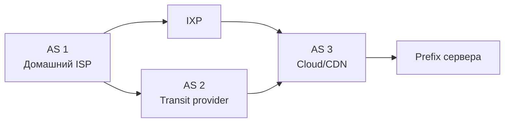

---

# 9. BGP — маршрутизация между большими сетями

**BGP — Border Gateway Protocol.**

Это протокол маршрутизации **между автономными системами**.

С помощью BGP сети сообщают друг другу примерно такую информацию:

> «Вот эти IP-префиксы доступны через меня».

Например:

```text
AS64500:
203.0.113.0/24 доступна через меня
```

Соседняя AS передаёт эту информацию дальше.

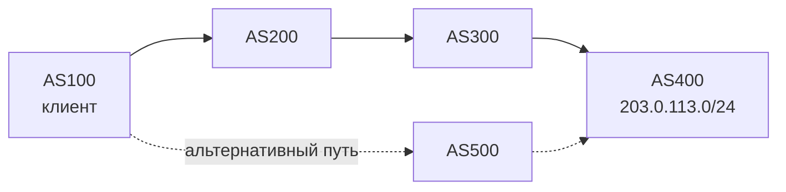

BGP учитывает не только «географически кратчайший путь», но и **сетевую политику**, AS path и другие атрибуты.

> [!important]
> **IP говорит, куда должен попасть пакет.  
> BGP помогает крупным сетям понять, через какие AS можно добраться до нужного IP-префикса.**

---

# 10. Peering, Transit и IXP

## Peering

Две сети напрямую договариваются обмениваться трафиком.

```text
ISP A ←→ ISP B
```

## Transit

Одна сеть платит другой за возможность добраться до остального Интернета.

```text
Небольшой ISP → крупный оператор → Интернет
```

## IXP

**Internet Exchange Point** — физическая инфраструктура, где множество сетей могут устанавливать пиринговые соединения.

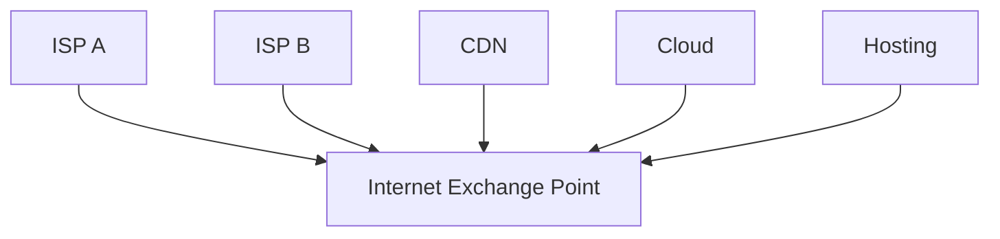

Преимущества прямого обмена:

- меньше лишних промежуточных сетей;
- ниже задержка;
- дешевле передача трафика;
- выше контроль над маршрутом.

---

# 11. DNS: человеку нужны имена, сети — IP

Пользователь хочет написать:

```text
github.com
```

а не запоминать:

```text
140.82.x.x
```

**DNS — Domain Name System** — распределённая система, которая позволяет получать данные о доменах, в том числе IP-адреса.

> [!important]
> DNS — не просто «таблица домен → IP».
>
> DNS хранит разные типы записей: `A`, `AAAA`, `CNAME`, `MX`, `TXT`, `NS` и другие.

---

# 12. Как происходит DNS-resolve

Упрощённая цепочка:

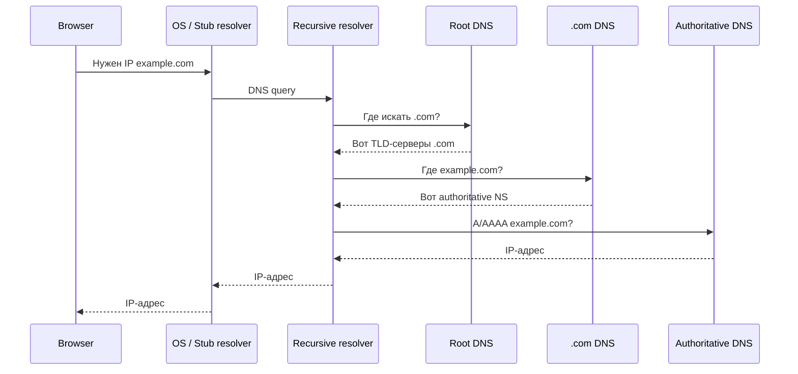

В реальности многие ответы уже находятся в кеше, поэтому полный проход по цепочке выполняется не всегда.

---

## 12.1. Основные DNS-записи

| Запись | Назначение |
|---|---|
| `A` | имя → IPv4 |
| `AAAA` | имя → IPv6 |
| `CNAME` | alias → другое доменное имя |
| `MX` | почтовые серверы домена |
| `NS` | authoritative nameservers |
| `TXT` | произвольные текстовые данные, SPF/верификации и др. |

---

## 12.2. DNS в Linux

```bash
dig example.com
```

Короткий ответ:

```bash
dig +short example.com
```

Посмотреть путь делегирования:

```bash
dig +trace example.com
```

Проверить конкретный DNS-сервер:

```bash
dig @1.1.1.1 example.com
```

> [!tip] DevOps
> Если приложение пишет:
>
> ```text
> connection refused
> ```
>
> это уже не обязательно DNS.
>
> Если:
>
> ```text
> Could not resolve host
> ```
>
> начинать надо именно с DNS-resolution.

---

# 13. Порты: одного IP недостаточно

На одном сервере могут одновременно работать десятки сетевых сервисов.

Например:

```text
22   → SSH
53   → DNS
80   → HTTP
443  → HTTPS
5432 → PostgreSQL
```

Пара:

```text
IP + port
```

позволяет обратиться к конкретному сетевому сервису.

Например:

```text
203.0.113.10:443
```

---

# 14. TCP и UDP

## TCP

TCP предоставляет приложению надёжный упорядоченный поток байтов.

Он включает:

- установление соединения;
- подтверждения;
- повторную передачу потерянных данных;
- сохранение порядка;
- управление потоком;
- механизмы контроля перегрузки.

### TCP three-way handshake

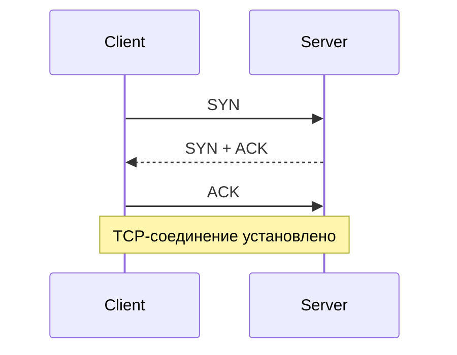

---

## UDP

UDP проще:

- соединение заранее не устанавливается;
- сам протокол не гарантирует доставку;
- не гарантирует порядок;
- меньше служебных механизмов.

Подходит там, где приложение само определяет нужную модель надёжности или где важна минимальная задержка.

Примеры:

- DNS;
- некоторые игровые протоколы;
- streaming/real-time;
- QUIC.

> [!note]
> Современный **HTTP/3** работает поверх **QUIC**, а QUIC использует UDP как транспорт.

---

# 15. Что происходит при открытии HTTPS-сайта

Представим:

```text
https://example.com
```

Высокоуровневая последовательность:

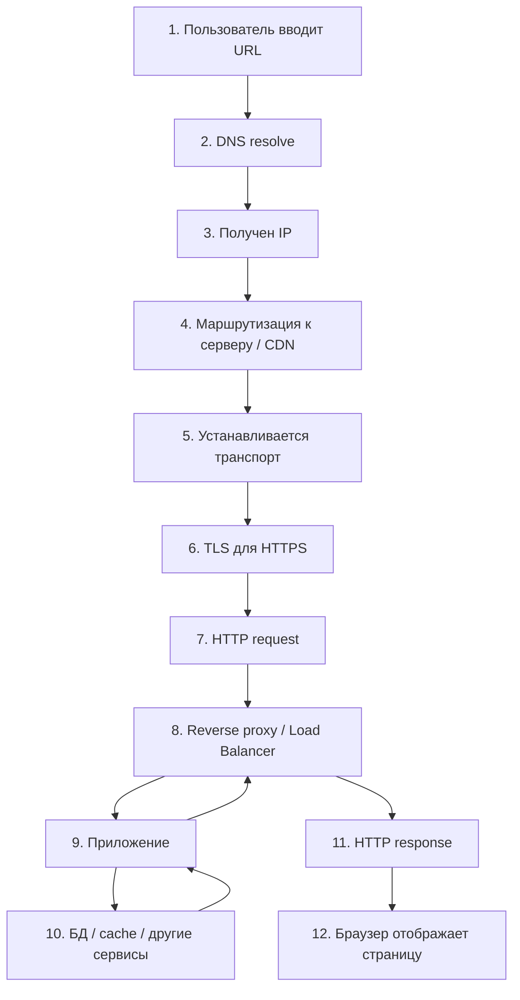

---

# 16. TLS и HTTPS

`HTTPS` — это HTTP, защищённый TLS.

TLS обеспечивает:

- **конфиденциальность** — данные шифруются;
- **целостность** — подмену данных можно обнаружить;
- **аутентификацию сервера** — сертификат позволяет клиенту проверить, с кем он устанавливает соединение.

Схематично:

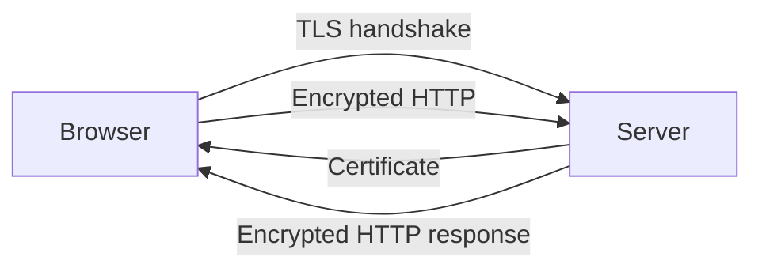

> [!warning]
> DNS-resolution обычно выполняется **до** установления HTTPS-соединения с целевым веб-сервером.
>
> Обычный DNS сам по себе не является HTTPS. Отдельно существуют DoH и DoT.

---

# 17. Где на пути появляются CDN и Load Balancer

Современное приложение редко выглядит как:

```text
браузер → один сервер
```

Чаще:

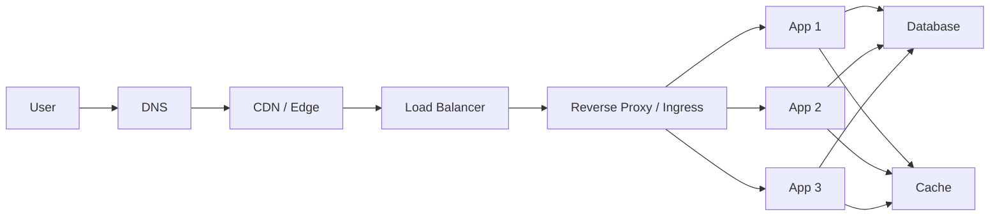

### CDN

Контент кешируется ближе к пользователю.

Плюсы:

- меньше latency;
- меньше нагрузка на origin;
- выше устойчивость;
- проще обслуживать пользователей из разных регионов.

### Load Balancer

Распределяет запросы по нескольким backend-инстансам.

---

# 18. Latency, bandwidth и packet loss

Эти понятия нельзя смешивать.

## Latency

Задержка передачи.

Пример:

```text
RTT = 40 ms
```

## Bandwidth

Сколько данных канал способен передавать за единицу времени.

Пример:

```text
1 Gbit/s
```

## Packet loss

Доля пакетов, которые не дошли до назначения.

> [!example]
> Можно иметь канал **1 Gbit/s**, но сервер на другом континенте всё равно будет отвечать с заметной задержкой.
>
> Высокая пропускная способность не означает низкую latency.

---

# 19. Полный путь запроса

Представим, что ты на ноутбуке выполняешь:

```bash
curl https://example.com
```

## Шаг 1. Определяется IP

DNS:

```text
example.com → 203.0.113.10
```

## Шаг 2. ОС проверяет маршрут

```bash
ip route get 203.0.113.10
```

Например:

```text
203.0.113.10 via 192.168.1.1 dev wlan0
```

## Шаг 3. Пакет отправляется default gateway

```text
Laptop → Router
```

## Шаг 4. Трафик попадает к ISP

```text
Router → ISP access network → ISP core
```

## Шаг 5. Между крупными сетями маршрут определяется BGP

```text
AS клиента → AS провайдера → ... → AS сервиса
```

## Шаг 6. Трафик приходит в сеть сервиса

Например:

```text
Edge/CDN → Load Balancer → Reverse Proxy → Application
```

## Шаг 7. Приложение обрабатывает запрос

Возможны обращения к:

```text
database
cache
object storage
other services
```

## Шаг 8. Ответ идёт обратно

Обратный путь **не обязан быть полностью симметричным** прямому.

---

# 20. Как уровни сети складываются друг на друга

Удобная учебная модель:

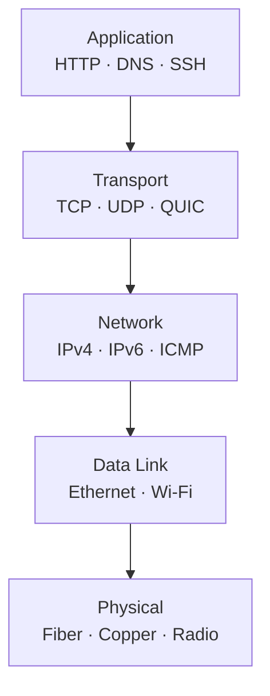

> [!important]
> При диагностике полезно идти **снизу вверх**:
>
> 1. вообще есть физическая/канальная связь?
> 2. есть IP?
> 3. есть маршрут?
> 4. работает DNS?
> 5. доступен TCP/UDP-порт?
> 6. проходит TLS?
> 7. отвечает само приложение?

---

# 21. Почему всё это должен знать DevOps

DevOps постоянно работает не с абстрактным «Интернетом», а с его конкретными слоями.

Например:

```text
Пользователь
   ↓
DNS
   ↓
CDN
   ↓
Firewall
   ↓
Load Balancer
   ↓
Reverse Proxy
   ↓
Kubernetes Ingress
   ↓
Service
   ↓
Pod
   ↓
Database
```

Ошибка может возникнуть **на любом уровне**.

---

## 21.1. Типичные сетевые проблемы DevOps

| Симптом | Где искать |
|---|---|
| `Could not resolve host` | DNS |
| `Connection refused` | процесс/порт/listen/firewall |
| `Connection timed out` | route/firewall/security group/network policy |
| `No route to host` | routing/interface/gateway |
| TLS certificate error | сертификат/SNI/дата/CA |
| 502 Bad Gateway | reverse proxy → upstream |
| 504 Gateway Timeout | upstream не ответил вовремя |
| сервис доступен по IP, но не по имени | DNS |
| сервис доступен локально, но не извне | bind/firewall/NAT/LB |
| один регион работает, другой нет | BGP/CDN/DNS/routing |

---

# 22. Практика DevOps: минимальный набор диагностических команд

## Интерфейсы

```bash
ip addr
```

или:

```bash
ip a
```

Смотрим:

- интерфейс поднят?
- есть IPv4/IPv6?
- правильная сеть?

---

## Маршруты

```bash
ip route
```

Проверить маршрут до конкретного IP:

```bash
ip route get 1.1.1.1
```

---

## Проверка доступности

```bash
ping 1.1.1.1
```

> [!warning]
> Отсутствие ответа на `ping` не доказывает, что сервер недоступен: ICMP могут фильтровать.

---

## Путь до узла

```bash
traceroute example.com
```

или:

```bash
tracepath example.com
```

---

## DNS

```bash
dig example.com
```

```bash
dig +short example.com
```

```bash
dig @1.1.1.1 example.com
```

---

## Сокеты и listening-порты

```bash
ss -tulpn
```

Только TCP-listen:

```bash
ss -ltnp
```

---

## HTTP/HTTPS

```bash
curl -v https://example.com
```

Только заголовки:

```bash
curl -I https://example.com
```

---

## Проверить TCP-порт

```bash
nc -vz example.com 443
```

---

## TLS

```bash
openssl s_client -connect example.com:443 -servername example.com
```

---

# 23. Правильный порядок диагностики

Допустим, пользователь говорит:

> «Сайт не открывается».

Не надо сразу перезапускать Nginx.

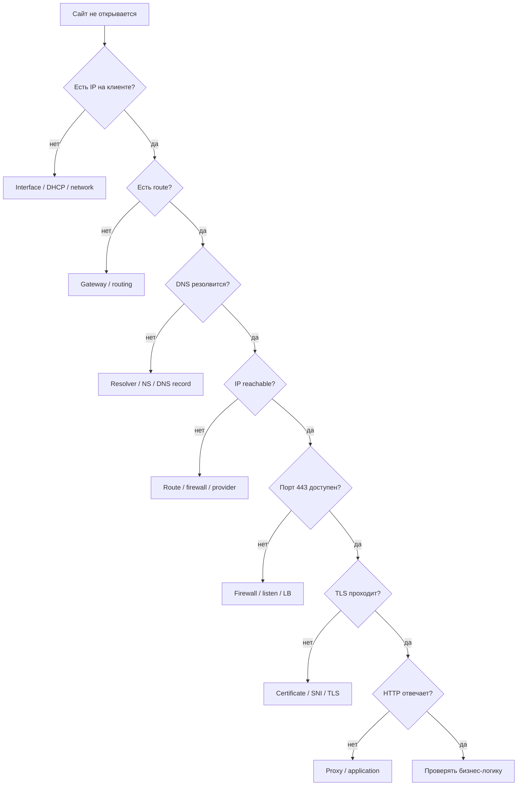

> [!important]
> **Сначала локализуем слой проблемы, потом чиним.**
>
> Это один из основных признаков хорошей инфраструктурной диагностики.

---

# 24. Вопрос с собеседования: «Что происходит после ввода URL в браузере?»

Это один из лучших интегральных вопросов по сетям.

Хороший ответ можно строить уровнями.

## Короткая версия

```text
URL
→ DNS
→ IP
→ route
→ TCP/QUIC
→ TLS
→ HTTP
→ CDN/LB/reverse proxy
→ application
→ response
→ browser render
```

## Нормальная версия

1. Браузер разбирает URL.
2. Проверяются локальные кеши.
3. Для hostname выполняется DNS-resolution.
4. Получается IPv4/IPv6 назначения.
5. ОС выбирает маршрут.
6. Пакеты отправляются через gateway.
7. Между крупными сетями маршрут формируется на основе междоменной маршрутизации, прежде всего BGP.
8. Для HTTP/1.1 или HTTP/2 обычно устанавливается TCP-соединение.
9. Для HTTPS выполняется TLS-handshake.
10. Браузер отправляет HTTP-запрос.
11. На стороне сервиса запрос может пройти CDN, load balancer и reverse proxy.
12. Приложение обрабатывает запрос.
13. Возвращается HTTP-response.
14. Браузер получает ресурсы страницы и рендерит документ.

> [!tip]
> На собеседовании не обязательно сразу уходить в детали ARP, MTU, TCP congestion control и ASN.
>
> Сначала дай правильную **сквозную картину**, а затем углубляйся туда, куда спрашивает интервьюер.

---

# 25. Вопросы для самопроверки

## 1. Что такое Интернет?

Глобальная система взаимосвязанных сетей, которые используют совместимые сетевые протоколы, прежде всего стек TCP/IP.

## 2. Чем Интернет отличается от Web?

Интернет — инфраструктура. Web — сервис поверх неё, использующий HTTP/HTTPS.

## 3. Зачем нужен маршрутизатор?

Чтобы пересылать пакеты между различными сетями.

## 4. Что такое default gateway?

Маршрутизатор, которому хост отправляет трафик к сетям, для которых нет более специфичного локального маршрута.

## 5. Для чего нужен IP?

Для адресации и доставки IP-пакетов между сетями.

## 6. Чем IPv4 отличается от IPv6?

Главное базовое отличие — размер адреса: IPv4 использует 32 бита, IPv6 — 128 бит.

## 7. Для чего нужен NAT?

В типичной IPv4-сети позволяет преобразовывать частные адреса во внешний адрес/адреса при выходе в другую сеть.

## 8. Что делает DNS?

Позволяет получать DNS-данные по доменным именам, в частности сопоставлять имена с IPv4/IPv6-адресами.

## 9. Что такое recursive DNS resolver?

DNS-сервер, который выполняет необходимые запросы к другим DNS-серверам от имени клиента и возвращает итоговый ответ.

## 10. Что такое authoritative DNS server?

Сервер, содержащий авторитетные DNS-записи для конкретной зоны.

## 11. Что такое порт?

Числовой идентификатор транспортного endpoint'а, позволяющий обращаться к конкретному сервису на хосте.

## 12. Чем TCP отличается от UDP?

TCP предоставляет надёжный упорядоченный поток и устанавливает соединение; UDP передаёт датаграммы без встроенной гарантии доставки и порядка.

## 13. Что такое AS?

Autonomous System — сеть или группа сетей под единой административной политикой маршрутизации.

## 14. Для чего нужен BGP?

Для обмена информацией о достижимости IP-префиксов между автономными системами.

## 15. Что такое IXP?

Internet Exchange Point — инфраструктура, где независимые сети могут напрямую обмениваться трафиком.

## 16. Зачем нужен CDN?

Чтобы размещать/кешировать контент ближе к пользователям, снижать задержку и нагрузку на origin.

## 17. Что делает Load Balancer?

Распределяет входящий трафик между несколькими backend-узлами.

## 18. Что обеспечивает TLS?

Шифрование, целостность и аутентификацию стороны на основе сертификатов.

## 19. Что означает `connection refused`?

Обычно IP-хост достигнут, но соединение на нужный порт было активно отклонено: например, сервис не слушает порт или соединение отклоняет сетевой компонент.

## 20. Что означает `Could not resolve host`?

Клиенту не удалось получить нужный DNS-результат для имени.

---

# 26. Что нужно запомнить в первую очередь

> [!summary] Суперкороткая шпаргалка
> **Интернет = сеть сетей.**
>
> **IP** — адресация и доставка пакетов.  
> **Router** — передача пакетов между сетями.  
> **Route** — правило, куда отправлять пакет дальше.  
> **DNS** — имена и DNS-данные, в том числе имя → IP.  
> **TCP** — надёжный поток данных.  
> **UDP** — датаграммы без встроенной надёжности TCP.  
> **Port** — конкретный сетевой сервис на хосте.  
> **AS** — крупная независимо управляемая сеть.  
> **BGP** — обмен маршрутами между AS.  
> **TLS** — защищённый канал.  
> **HTTP** — прикладной веб-протокол.  
> **CDN** — доставка контента ближе к пользователю.  
> **Load Balancer** — распределение трафика.
>
> Главная DevOps-идея:
>
> **DNS → route → transport → TLS → HTTP → proxy → application.**
>
> Если что-то сломалось — выясни, **на каком слое**, а не начинай чинить всё подряд.

---

# 27. Карточки для быстрого повторения

Можно превратить этот блок в отдельные заметки/flashcards.

```text
Q: Интернет — это?
A: Глобальная сеть взаимосвязанных сетей.

Q: DNS нужен для?
A: Получения данных о доменах, в том числе преобразования имени в IP.

Q: BGP работает между?
A: Автономными системами.

Q: Router делает что?
A: Выбирает следующий hop и пересылает пакет между сетями.

Q: Default gateway — это?
A: Шлюз для трафика к сетям, для которых нет более специфичного маршрута.

Q: TCP handshake?
A: SYN → SYN/ACK → ACK.

Q: HTTPS?
A: HTTP поверх TLS.

Q: Проверить DNS?
A: dig.

Q: Проверить маршруты Linux?
A: ip route.

Q: Проверить listening-порты?
A: ss -ltnp / ss -tulpn.

Q: Проверить HTTP?
A: curl -v.

Q: Проверить TLS?
A: openssl s_client.
```

---

# 28. Практическое мини-задание

Попробуй на своей Linux-машине:

```bash
ip addr
```

```bash
ip route
```

```bash
dig github.com
```

```bash
ip route get 1.1.1.1
```

```bash
tracepath github.com
```

```bash
curl -v https://github.com
```

```bash
ss -tulpn
```

И попробуй своими словами ответить:

> **Как пакет от моего ноутбука дошёл до GitHub?**

Если можешь объяснить цепочку:

```text
interface
→ local network
→ gateway
→ ISP
→ routing/AS/BGP
→ target network
→ TCP/TLS
→ HTTP
```

— базовая модель Интернета уже сложилась.

---

# 29. Связанные заметки для Obsidian

```text
[[Компьютерные сети]]
[[TCP-IP]]
[[IPv4]]
[[IPv6]]
[[DNS]]
[[NAT]]
[[Маршрутизация]]
[[BGP]]
[[HTTP]]
[[TLS]]
[[Nginx]]
[[Linux networking]]
[[DevOps]]
```

---

# 30. Источники для проверки и углубления

Основной ролик:

- https://www.youtube.com/watch?v=Ce-HDCrXMtQ

Авторы ролика / Просто DevOps:

- https://www.youtube.com/@prosto_devops
- https://prostodevops.ru/

История Интернета:

- Internet Society — *A Brief History of the Internet*  
  https://www.internetsociety.org/internet/history-internet/brief-history-internet/

BGP:

- IETF RFC 4271 — *A Border Gateway Protocol 4 (BGP-4)*  
  https://datatracker.ietf.org/doc/rfc4271/

DNS:

- Cloudflare Learning Center — *What is DNS?*  
  https://www.cloudflare.com/learning/dns/what-is-dns/

---

# ✅ Итог

Интернет не является единой сетью с единым владельцем или единым маршрутом.

Он работает потому, что огромное количество независимых систем умеют договариваться на нескольких уровнях:

```text
физическая связь
      ↓
Ethernet / Wi‑Fi
      ↓
IP
      ↓
маршрутизация
      ↓
TCP / UDP / QUIC
      ↓
TLS
      ↓
HTTP / DNS / SSH / ...
      ↓
приложения
```

Для DevOps это не «теория ради теории».

Когда перестаёт открываться сервис, инженер должен уметь определить:

```text
сломался DNS?
нет маршрута?
порт закрыт?
firewall?
TLS?
reverse proxy?
load balancer?
приложение?
```

Именно поэтому понимание устройства Интернета — фундамент для Linux, [[Docker]], [[Kubernetes]], облаков, CI/CD и эксплуатации production-систем.

## Связанные заметки

- [[Computer Networks]]
