# Как работает математика Free6D.3-2.150 — объяснение по этапам

> Цель этого файла — не просто перечислить формулы, а понять, **зачем каждая из них нужна**, что именно вычисляет программа и как из команды вида «сдвинь платформу по X» получаются шесть чисел, отправляемых контроллеру.

---

# 0. Самая короткая версия

У Free6D есть подвижная платформа с **6 степенями свободы**:

- перемещение по `X`;
- перемещение по `Y`;
- перемещение по `Z`;
- поворот вокруг `X`;
- поворот вокруг `Y`;
- поворот вокруг `Z`.

Но контроллеру нельзя просто сказать:

```text
X = 4 мм
Y = 0
Z = 0
Rx = 0
Ry = 0
Rz = 0
```

В исследованной программе эта желаемая поза сначала преобразуется в **шесть внутренних командных координат**:

```text
q1 q2 q3 q4 q5 q6
```

Они соответствуют трём расчётным ветвям:

```text
ветвь 1: R1, T1
ветвь 2: R2, T2
ветвь 3: R3, T3
```

Причём в исследованном пути:

```text
q = -(R1, T1, R2, T2, R3, T3)
```

Дополнительно программа вычисляет:

```text
L1 L2 L3
```

но `L` в найденной командной карте не являются ещё тремя независимыми приводами.

То есть главный математический конвейер такой:

![[1.png]]

Это и есть основная идея всей математики проекта.

---

# 1. Что именно мы пытаемся решить

Представим верхнюю подвижную площадку.

Нужно уметь задать ей любую допустимую позу:

```text
положение:
X, Y, Z

ориентация:
Rx, Ry, Rz
```

Всего получается **6 независимых величин**, поэтому говорят о **6 степенях свободы — 6DOF**.

Схематично:

![[2.png]]

Здесь важно различать две задачи.

## 1.1. Обратная кинематика — IK (Inverse Kinematics)
Мы знаем:

```text
КУДА должна приехать платформа
```

и хотим узнать:

```text
КАКИЕ значения должны получить внутренние координаты механизма
```

То есть:

```text
(X,Y,Z,Rx,Ry,Rz)
        ↓
	    IK
        ↓
(q1,q2,q3,q4,q5,q6)
```

Именно эта задача сейчас лучше всего восстановлена из программы Free6D.

---

## 1.2. Прямая кинематика — FK (Forward Kinematics)

Обратная задача:

```text
(q1,q2,q3,q4,q5,q6)
        ↓
        FK
        ↓
(X,Y,Z,Rx,Ry,Rz)
```

Она нужна, например, если известны реальные показания внутренних координат и требуется понять фактическую позу платформы.

Прямая кинематика обычно сложнее.

---

# 2. Почему это не надо считать обычной платформой Стюарта

Самая распространённая ошибка — увидеть 6DOF-платформу и сразу использовать классическую формулу гексапода:

```text
6 телескопических ног
→ считаем длину каждой ноги
```

Для обычной платформы Стюарта действительно можно писать:

```text
li = расстояние между двумя шарнирами
```

Но в разобранной программе Free6D обнаружена другая вычислительная структура:

```text
3 ветви
×
по 2 командных координаты R и T
=
6 команд
```

а также три зависимых величины:

```text
L1 L2 L3
```

Поэтому правильная исследовательская схема сейчас такая:

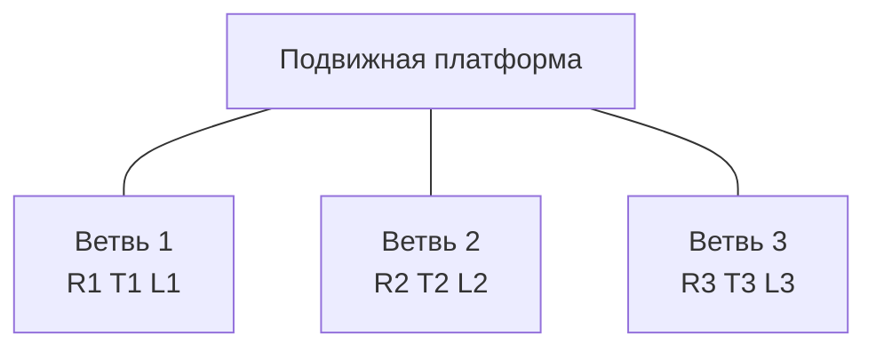

Это **расчётная схема**, найденная в программной модели. Она пока не означает, что `R`(), `T` и `L` уже полностью сопоставлены с конкретными физическими шарнирами в STEP-модели.

---

# 3. Системы координат

Сначала надо привыкнуть к одной мысли:

> Положение объекта — это не только координаты X, Y, Z. Нужно ещё знать, как объект повернут.

Поэтому поза платформы состоит из двух частей.

## 3.1. Перенос

Обозначается:

```text
t = [x, y, z]
```

Например:

```text
t = [4, 0, 0]
```

означает:

```text
сдвинуть платформу на 4 мм по X
```

---

## 3.2. Поворот

Для поворота используется матрица `Q`.

Пока можно воспринимать её как специальный объект, который отвечает на вопрос:

```text
если точка раньше была здесь,
где она окажется после поворота платформы?
```

То есть:

```text
старая точка b
      ↓ Q
повёрнутая точка Qb
```

---

## 3.3. Полная поза

Перенос `t` и поворот `Q` объединяются:

```text
P = [ Q  t ]
    [ 0  1 ]
```

Это называется **однородная матрица преобразования**.

Для понимания проекта пока достаточно помнить:

```text
P = положение + ориентация
```

---

# 4. Три расчётные ветви

В программе используются три направления, расположенные через `120°`.

```text
φ1 =   0°
φ2 = 120°
φ3 = 240°
```

Вид сверху:

![[3.png]]

Более формально:

```text
              φ1 = 0°

                 ●
                 |
                 |
        ●--------+--------●
     φ3=240°            φ2=120°
```

Для каждой ветви вычисляются:

```text
ci = cos(φi)
si = sin(φi)
```

Эти `cos` и `sin` просто задают направление конкретной ветви в плоскости XY.

---

# 5. Откуда берутся точки b1, b2, b3

В найденной программе используется радиус:

```text
r = 39.5809191
```

И три расчётные точки:

```text
bi = r * [cos φi, sin φi, 0]
```

Она говорит буквально следующее:

> Возьми окружность радиуса `r` и поставь на ней три точки через 120°.

Схема:
![[4.png]]
Именно эти три точки программа далее двигает вместе с платформой.

---

# 6. Самая важная формула геометрии

После того как платформа получила перенос `t` и поворот `Q`, каждая точка `bi` переходит в:

```text
pi = t + Q * bi
```

где:
- \(bi\) — исходное положение i-й точки в нулевой позе;
- \(Q\) — поворот платформы;
- \(t\) — перенос платформы;
- \(pi\) — новое положение этой же точки.

Вот эта формула — один из ключей ко всей математике проекта.

Она означает:

```text
1. взять точку bi;
2. повернуть её вместе с платформой;
3. после этого сдвинуть всю платформу.
```

Схема:

![[5.png]]

Если поворота нет:

```text
Q = I
```

где `I` — единичная матрица, тогда:

```text
pi = t + bi
```

То есть точка просто сдвигается.

---

# 7. Что такое R, T и L

После получения `pi = (Xi, Yi, Zi)` программа рассчитывает для каждой ветви:

```text
Ri
Ti
Li
```

Восстановленные выражения:

```text
Ri = ci*Xi + si*Yi - r - Zi*cot(α)

Ti = si*Xi - ci*Yi

Li = Zi / sin(α)
```

где:

```text
α = 30°, ci и si — это просто сокращения для косинуса и синуса угла каждой ветви.
```

Удобная таблица:

| Ветвь   | Угол `φi` | `ci = cos(φi)` |   `si = sin(φi)` |
| ------- | --------: | -------------: | ---------------: |
| Ветвь 1 |      `0°` |            `1` |              `0` |
| Ветвь 2 |    `120°` |  `-1/2 = -0.5` |   `√3/2 ≈ 0.866` |
| Ветвь 3 |    `240°` |  `-1/2 = -0.5` | `-√3/2 ≈ -0.866` |

---

# 8. Что эти формулы делают геометрически

Сами буквы `R`, `T`, `L` пока лучше не связывать жёстко с конкретным физическим шарниром.

Но математический смысл можно понять.

## 8.1. T — поперечная составляющая

Формула:

```text
Ti = si*Xi - ci*Yi
```

берёт положение точки в XY и проектирует его на одно из направлений ветви.

Условно:

```text
              локальная T
                   ↑
                   |
             ------●------→ локальная R
```

То есть глобальные:

```text
X, Y
```

преобразуются в локальные координаты конкретной ветви.

---

## 8.2. R — другая локальная составляющая плюс влияние Z

```text
Ri = ci*Xi + si*Yi - r - Zi*cot(α)
```

Здесь есть:

```text
часть от X/Y
+
часть от Z
-
нулевой радиус r
```

Поэтому вертикальное движение тоже влияет на `R`.

---

## 8.3. L — вертикальная зависимая величина

```text
Li = Zi / sin(α)
```

При:

```text
α = 30°
sin(30°) = 0.5
```

получаем:

```text
Li = 2*Zi
```

То есть если соответствующая расчётная точка поднялась на:

```text
1 мм
```

то математическое `L` изменится на:

```text
2 мм
```

---

# 9. Почему α = 30° даёт √3

Нам встречается:

```text
cot(30°)
```

Из школьной тригонометрии:

```text
tan(30°) = 1/√3
```

следовательно:

```text
cot(30°) = √3
```

Поэтому вертикальное перемещение `z` входит в `R` с коэффициентом:

```text
√3
```

Именно отсюда далее появляются значения вида:

```text
√3*d
```

---

# 10. Как R и T превращаются в реальные команды q

Исследованная карта каналов:

```text
q1 = -R1
q2 = -T1

q3 = -R2
q4 = -T2

q5 = -R3
q6 = -T3
```

То есть:

```text
q = -(R1,T1,R2,T2,R3,T3)
```

Схема:

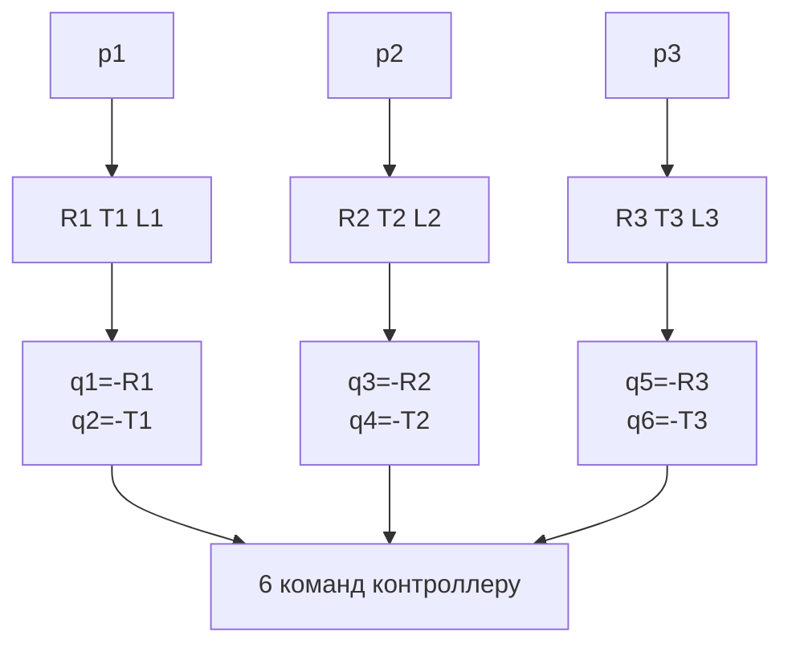

---

# 11. Полный алгоритм обратной кинематики

Теперь можно собрать всё вместе.

Вход:

```text
x, y, z
ориентация платформы
```

Алгоритм:

```text
1. Построить перенос t = [x,y,z].

2. Построить матрицу поворота Q.

3. Задать три исходные точки:
   b1, b2, b3.

4. Для каждой ветви:
   pi = t + Q*bi

5. Из pi получить:
   Ri
   Ti
   Li

6. Сформировать:
   q1=-R1
   q2=-T1
   q3=-R2
   q4=-T2
   q5=-R3
   q6=-T3

7. Проверить ограничения.

8. Передать q1...q6 в траекторию/SDK/контроллер.
```

Схема, которую можно использовать как основную для КВ:

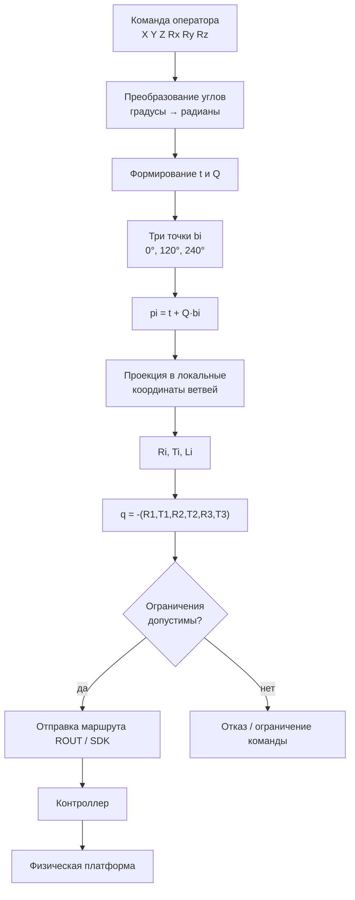

---

# 12. Первый пример: движение только по X

Пусть:

```text
x = d
y = 0
z = 0
поворота нет
```

Тогда модель даёт:

```text
q1 = -d
q2 = 0

q3 = d/2
q4 = -√3*d/2

q5 = d/2
q6 = √3*d/2
```

Для:

```text
d = 4.567 мм
```

получаем:

```text
q =
[-4.567000,
  0.000000,
  2.283500,
 -3.955138,
  2.283500,
  3.955138]
```

Это важный пример, потому что именно такой результат совпал с разобранным ROUT-фрагментом.

## Что здесь надо понять

Платформа едет **только по X**, но внутренние шесть координат двигаются по-разному.

Это нормально.

```text
команда человека:
X = +4.567 мм

не означает:

q1 = +4.567
q2 = 0
q3 = 0
...
```

Вместо этого механика должна согласованно изменить сразу несколько ветвей.

---

# 13. Почему при X двигаются сразу несколько каналов

Представь треугольник.

Если ты хочешь сдвинуть весь треугольник вправо:

```text
        ●
       / \
      /   \         → X
     ●-----●
```

три его опорных направления находятся под разными углами.

Поэтому один и тот же глобальный вектор движения раскладывается для каждой ветви по-разному.

Это обычная проекция векторов.

---

# 14. Движение по Y

Для чистого движения:

```text
x = 0
y = d
z = 0
```

модель предсказывает:

```text
q =
(0,
 d,
 -√3*d/2,
 -d/2,
 √3*d/2,
 -d/2)
```

Опять видим:

```text
одно движение платформы
→ шесть связанных команд
```

---

# 15. Движение по Z

Для:

```text
x = 0
y = 0
z = d
```

получается:

```text
q1 = √3*d
q2 = 0

q3 = √3*d
q4 = 0

q5 = √3*d
q6 = 0
```

а:

```text
L1 = L2 = L3 = 2*d
```

То есть чистое вертикальное движение симметрично относительно трёх ветвей.

Схема:

```text
            PLATFORM
         ┌────────────┐
         │            │
         └────────────┘
             ↑ Z

       branch 1 ↑
       branch 2 ↑
       branch 3 ↑

все три ветви изменяются одинаково
```

---

# 16. Повороты — почему становится сложнее

При переносе каждая точка платформы получает одинаковое смещение:

```text
p' = p + t
```

При повороте это уже не так.

Точка около центра двигается мало, точка далеко от центра — больше.

Например:

```text
        до                  после

        ●                       ●
        |                     /
        |                   /
        +────●             +────
        центр              центр
```

Поэтому при поворотах в формулах начинает играть роль радиус:

```text
r = 39.5809191
```

---

# 17. Пример: поворот вокруг Z

Если платформа только вращается вокруг Z на угол `β`, без переноса:

```text
q(нечётные) = r*(1-cos β)
q(чётные)   = r*sin β
```

для всех трёх ветвей.

То есть:

```text
q1 = q3 = q5 = r*(1-cos β)

q2 = q4 = q6 = r*sin β
```

Это очень хороший тест модели.

Если поменять:

```text
β → -β
```

то:

```text
sin(-β) = -sin(β)
cos(-β) = cos(β)
```

следовательно:

```text
q1,q3,q5 не меняют знак
q2,q4,q6 меняют знак
```

Если реальная программа ведёт себя иначе — значит где-то неверна конвенция знаков или осей.

---

# 18. Малые углы

Для очень маленьких углов:

```text
sin β ≈ β
cos β ≈ 1 - β²/2
```

Поэтому:

```text
r*(1-cos β) ≈ r*β²/2
r*sin β     ≈ r*β
```

Отсюда важное наблюдение:

при малом вращении вокруг Z:

```text
T-каналы меняются почти линейно с углом
R-каналы меняются намного слабее — квадратично
```

---

# 19. Что такое матрица поворота Q

Пусть есть точка:

```text
v = [x,y,z]
```

Матрица поворота `Q` вычисляет:

```text
v_new = Q*v
```

Например, поворот вокруг Z:

```text
Qz(β) =
[ cosβ  -sinβ   0 ]
[ sinβ   cosβ   0 ]
[  0       0    1 ]
```

Возьмём точку:

```text
[1,0,0]
```

и повернём на:

```text
90°
```

Тогда:

```text
cos 90° = 0
sin 90° = 1
```

получим:

```text
[0,1,0]
```

То есть ось X повернулась в Y.

---

# 20. Почему нельзя просто работать с Rx, Ry, Rz

Повороты не складываются так же просто, как координаты.

Например:

```text
сначала повернуть X,
потом Y
```

и:

```text
сначала Y,
потом X
```

обычно дают **разные результаты**.

Поэтому в программе важно соглашение о порядке поворотов:

```text
XYZ
ZYX
ZXY
...
```

SDK поддерживает несколько порядков.

Для одного из рассматриваемых соглашений:

```text
Q = Qz(ψ) * Qy(θ) * Qx(φ)
```

То есть итоговый поворот строится умножением матриц.

---

# 21. Почему градусы превращают в радианы

Большинство математических функций:

```text
sin
cos
```

в программировании работают с радианами.

Перевод:

```text
rad = deg * π / 180
```

Например:

```text
90° = π/2
30° = π/6
```

Поэтому найденный:

```text
α = π/6
```

это просто:

```text
30°
```

---

# 22. Tool и Platform — зачем две системы координат

Представим, что сверху на платформе закреплён инструмент.

Его рабочая точка может быть не в центре платформы:

```text
             TOOL POINT
                 ●
                 |
                 |
        ┌────────────────┐
        │    PLATFORM    │
        └────────────────┘
              center
```

Тогда пользователь может хотеть задавать движение не центра платформы, а именно Tool.

Это разные системы координат.

SDK использует:

```text
D = A⁻¹ * P * A
```

где:

```text
P — перемещение в системе Platform
D — то же смещение, выраженное для Tool
A — постоянное преобразование между нулём Platform и нулём Tool
```

---

# 23. Интуитивный смысл Tool offset

Допустим Tool находится на 100 мм правее центра.

Если вращать платформу вокруг её центра:

```text
центр почти не перемещается
```

но Tool описывает дугу.

```text
             ● Tool
           /
         /
       +
    center
```

Если же требуется повернуть инструмент **вокруг самого Tool**, центр платформы обязан одновременно сдвигаться.

Поэтому поворот Tool часто вызывает одновременно:

```text
изменение ориентации
+
изменение XYZ платформы
```

Это не ошибка.

---

# 24. Схема систем координат

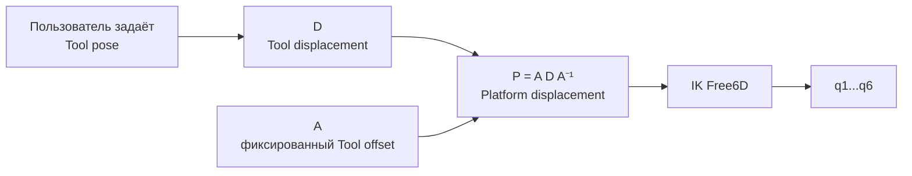

---

# 25. Поворот вокруг произвольного центра

Иногда требуется не просто:

```text
повернуть платформу
```

а:

```text
повернуть платформу вокруг конкретной точки
```

Пусть центр вращения:

```text
c
```

Тогда новая позиция начала платформы:

```text
t' = c + ΔQ*(t-c)
```

а ориентация:

```text
Q' = ΔQ*Q
```

Интуитивно:

```text
1. вычитаем c:
   считаем положение относительно центра вращения;

2. вращаем;

3. снова добавляем c.
```

Это обычная схема:

```text
перенести центр вращения в начало
→ повернуть
→ вернуть обратно
```

---

# 26. Что такое Якобиан без страшной математики

Якобиан `J` отвечает на вопрос:

> Если платформа прямо сейчас двигается с такой скоростью, с какими скоростями должны изменяться шесть внутренних координат?

То есть:

```text
скорость платформы
        ↓
        J
        ↓
скорости q1...q6
```

Формула:

```text
q_dot = J * v
```

где:

```text
v =
[x_dot,
 y_dot,
 z_dot,
 ωx,
 ωy,
 ωz]
```

---

# 27. Аналогия Якобиана с коробкой передач

Можно представить `J` как мгновенную «коробку передач».

Например:

```text
платформа хочет:
X двигать со скоростью 1 мм/с
```

Якобиан говорит:

```text
q1: -1.000
q2:  0
q3: +0.500
q4: -0.866
q5: +0.500
q6: +0.866
```

Если ориентация платформы меняется, эта «передача» тоже может меняться.

---

# 28. Якобиан в нулевой позиции

В нуле структура особенно понятная.

Три чётных строки связаны в основном с:

```text
X
Y
вращением вокруг Z
```

Три нечётных — с:

```text
Z
вращением вокруг X
вращением вокруг Y
```

Поэтому в нулевой конфигурации матрица имеет полный ранг `6`.

Это означает:

```text
локально шесть независимых движений платформы
различимы через шесть q-координат
```

Важно:

это свойство **математической модели**, а не полное доказательство физики реального устройства.

---

# 29. Что такое сингулярность

Представим механизм, попавший в такую геометрию, где разные движения становятся трудно различимыми.

В математике это проявляется как плохой Якобиан.

Очень грубо:

```text
нормальное положение:
малое изменение платформы
→ заметное и уникальное изменение q

плохое положение:
какое-то движение платформы
→ почти не изменяет q
```

Тогда восстановление позы становится чувствительным к ошибкам.

Для анализа используют:

```text
ранг
singular values
condition number
```

Но для начала достаточно понимать:

> Якобиан показывает не только скорости, но и насколько хорошо текущая конфигурация математически управляется и наблюдается.

---

# 30. Почему condition number нельзя читать бездумно

В `J` одновременно находятся:

```text
мм/с
и
рад/с
```

Сравнивать их напрямую некорректно.

Поэтому перед оценкой обусловленности вводят характерный масштаб длины, например:

```text
l* = r
```

и приводят вращение и перенос к сопоставимому масштабу.

То есть число обусловленности — не магическая кнопка:

```text
κ > N → плохо
```

Сначала должны быть определены единицы и нормировка.

---

# 31. Что такое прямая кинематика FK

IK делает:

```text
pose → q
```

FK делает:

```text
q → pose
```

Но формулы `q` нелинейно зависят от ориентации, поэтому обычно нельзя просто один раз поделить или умножить.

Используется итерационный метод.

---

# 32. Интуитивный алгоритм FK

Пусть измерены:

```text
q_measured
```

Делаем предположение:

```text
кажется, платформа сейчас вот здесь
```

Из этого предположения через IK считаем:

```text
q_predicted
```

Сравниваем:

```text
error = q_predicted - q_measured
```

Если ошибка большая — Якобиан говорит, как поправить позу.

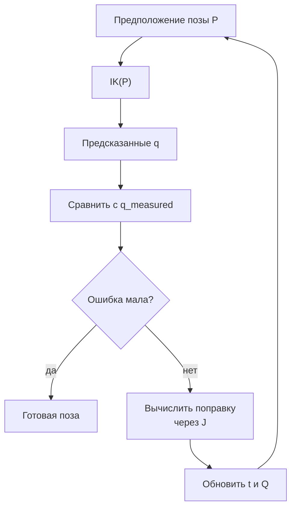

Это похоже на навигацию:

```text
угадал положение
→ посмотрел ошибку
→ сделал поправку
→ повторил
```

---

# 33. Формула поправки FK

Используется приближение:

```text
J * δξ ≈ -f
```

где:

```text
f = IK(current_pose) - q_measured
```

а:

```text
δξ
```

— маленькая поправка:

```text
δx
δy
δz
δθx
δθy
δθz
```

После этого:

```text
t_new = t + δt
```

а ориентация аккуратно обновляется через малый поворот.

---

# 34. Почему FK может иметь проблемы

Возможны:

```text
несколько математических решений;
неудачное начальное приближение;
плохая обусловленность;
выход в физически невозможную конфигурацию.
```

Поэтому недостаточно сказать:

```text
алгоритм сошёлся
```

Надо ещё проверить:

```text
поза физически допустима?
q совпадают?
нет столкновений?
не выбрана другая ветвь решения?
```

---

# 35. Рабочая область

Паспортные пределы платформы:

| Координата | Диапазон |
|---|---:|
| X | ±10 мм |
| Y | ±10 мм |
| Z | ±5 мм |
| Rotation X | ±9° |
| Rotation Y | ±8° |
| Rotation Z | ±14° |

Но есть важная тонкость.

Это **не означает**, что допустима любая комбинация:

```text
X=10
Y=10
Z=5
Rx=9°
Ry=8°
Rz=14°
```

одновременно.

Реальная рабочая область — сложная шестимерная область.

---

# 36. Что надо проверять для каждой позы

Условно:

```text
1. паспортные XYZ и углы;
2. q1...q6 не выходят за диапазоны;
3. L1...L3 не выходят за диапазоны;
4. физические звенья не сталкиваются;
5. шарниры не выходят за пределы;
6. кабели не натягиваются;
7. нагрузка допустима;
8. конфигурация не становится плохо обусловленной.
```

Схема:

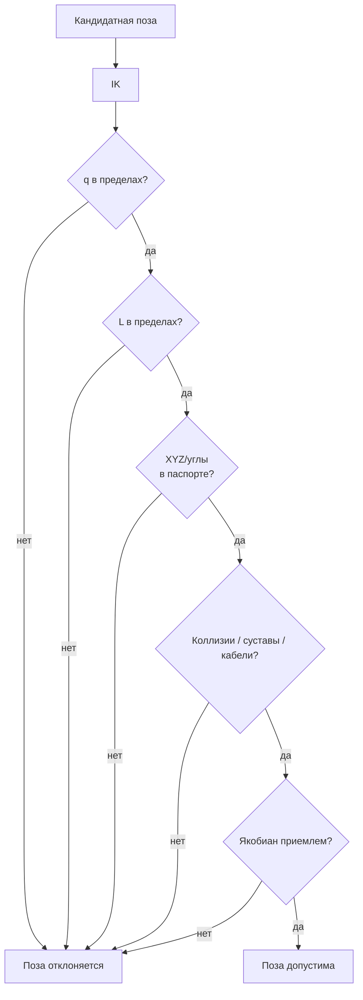

---

# 37. Почему это важно для веб-симулятора

Если веб-модель сейчас просто делает:

```text
верхняя платформа.position.z += dz
```

это ещё не симуляция контроллера.

Корректнее:

```text
пользователь задаёт pose
        ↓
IK
        ↓
R/T/L
        ↓
рассчитываются положения механических деталей
        ↓
рендер
```

То есть визуальная сцена должна быть следствием кинематической модели, а не набором независимых анимаций.

---

# 38. Как должна быть устроена веб-версия

Рекомендуемая архитектура:

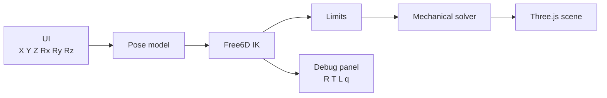

Это позволит видеть:

```text
какую позу запросили;
какие R/T/L получились;
какие q ушли бы контроллеру;
какие физические детали должны изменить положение.
```

---

# 39. Траектория — почему нельзя просто телепортировать платформу

Если задать:

```text
позиция 1
→
позиция 2
```

нужно ещё решить:

```text
как двигаться между ними
```

Иначе возможен скачок скорости.

Поэтому вводится параметр:

```text
s
```

где:

```text
s=0 — начало
s=1 — конец
```

---

# 40. Геометрический путь и закон времени

Нужно разделять:

```text
ГДЕ проходит путь
```

и:

```text
КАК БЫСТРО мы по нему идём
```

Например перенос:

```text
t(s) = t0 + s*(t1-t0)
```

Это определяет прямую линию.

Но `s(t)` определяет скорость движения по этой линии.

---

# 41. Почему обычное s=t не идеально

Если:

```text
s = t/T
```

то скорость мгновенно скачивает:

```text
0 → постоянная скорость
```

в начале и:

```text
постоянная скорость → 0
```

в конце.

Для точной мехатроники лучше плавно разгоняться и тормозить.

---

# 42. Полином пятой степени

Используется функция:

```text
s(u) = 10u³ - 15u⁴ + 6u⁵
```

где:

```text
u = t/T
```

Она устроена так, что:

```text
в начале:
скорость = 0
ускорение = 0

в конце:
скорость = 0
ускорение = 0
```

Графически:

```text
s
1 |                           ______
  |                      ____/
  |                  ___/
  |              ___/
  |          ___/
  |      ___/
0 |_____/
  +------------------------------> t
```

---

# 43. Почему после построения пути всё равно нужен IK

Нельзя просто интерполировать:

```text
q_start → q_end
```

и надеяться, что платформа пройдёт нужную геометрическую траекторию.

Корректная логика:

```text
для каждого момента времени:
    вычислить pose(t)
    затем q(t) = IK(pose(t))
```

То есть:

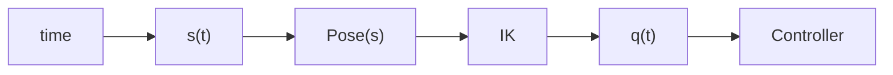

---

# 44. Скорость, ускорение и рывок

Для каждого привода желательно контролировать:

```text
q      — положение
q_dot  — скорость
q_ddot — ускорение
q'''   — jerk, рывок
```

Почему jerk важен:

даже если скорость и ускорение допустимы, резкое изменение ускорения может вызвать:

```text
вибрацию;
удар;
резонанс;
ухудшение точности.
```

---

# 45. Как Якобиан связан с траекторией

Если известна скорость платформы:

```text
v
```

то:

```text
q_dot = J*v
```

То есть Якобиан позволяет ещё до отправки траектории оценить:

```text
не слишком ли быстро должен двигаться какой-то внутренний канал
```

И это одна из главных практических причин его вычислять.

---

# 46. Калибровка

Пока используемые параметры:

```text
r = 39.5809191
α = 30°
углы ветвей = 0°,120°,240°
```

найдены в программе.

Но это ещё не означает:

```text
реальный экземпляр устройства идеально имеет именно такую геометрию
```

В реальности могут существовать:

```text
нулевые смещения;
масштабные коэффициенты;
малые ошибки углов;
разница геометрии;
offset Tool;
ошибки сборки.
```

Поэтому вводится набор параметров:

```text
η
```

и математически пишут:

```text
q = IK(P; η)
```

---

# 47. Как можно экспериментально проверять модель

Очень полезная таблица:

| Эксперимент | Что проверяет |
|---|---|
| `+X`, `-X` | карта каналов, знаки |
| `+Y`, `-Y` | карта каналов и симметрия |
| `+Z`, `-Z` | влияние `α` |
| `+Rz`, `-Rz` | радиус `r`, знаки T |
| `Rx`, `Ry` | совместная геометрия |
| `Rx+Ry+Rz` | порядок поворотов |
| Tool offset | системы координат |
| повтор одного движения | повторяемость |
| движение под нагрузкой | податливость |

---

# 48. Что уже подтверждено лучше всего

Наиболее сильное текущее подтверждение:

```text
чистый X = 4.567 мм
```

даёт через восстановленную формулу:

```text
[-4.567000,
  0.000000,
  2.283500,
 -3.955138,
  2.283500,
  3.955138]
```

и эти числа совпадают с конечными целями найденного ROUT-фрагмента.

Это хорошо подтверждает:

```text
карту каналов;
знаки;
проекции для чистого X.
```

Но этот тест **не проверяет**:

```text
радиус r;
поворотную кинематику;
Tool offset;
полную физическую модель механизма.
```

---

# 49. Что пока нельзя утверждать

На текущих данных нельзя уверенно утверждать:

```text
R — это именно такая-то физическая рейка;
T — именно такой-то шарнир;
L — именно длина конкретного звена;
вся механика вычисляется только на ПК;
вся механика вычисляется только внутри контроллера;
веб-модель уже физически полностью совпадает с устройством;
все крайние паспортные координаты можно сочетать одновременно.
```

Это надо подтверждать:

```text
STEP;
чертежом;
SDK;
логами;
экспериментом на реальном устройстве.
```

---

# 50. Схема «от кнопки до движения»

Эта схема хорошо подходит для объяснения проекта целиком.

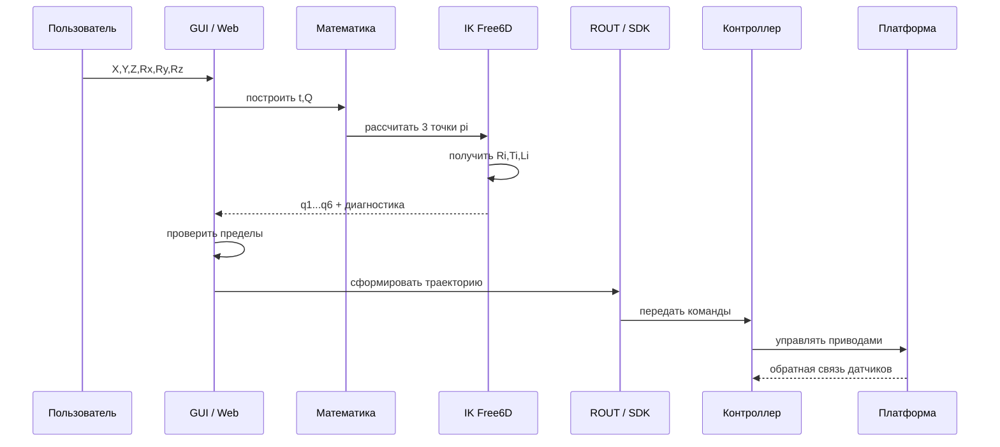

---

# 51. Схема «математика одной ветви»

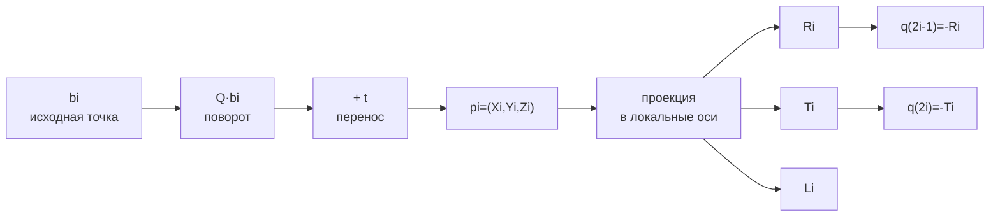

---

# 52. Схема «три ветви вокруг платформы»

Упрощённый вид сверху:

```text
                          Branch 1
                          φ = 0°
                            ↑
                            |
                            |
                         [ b1 ]
                           / \
                          /   \
                         /  O  \
                        /       \
                [ b3 ]-----------[ b2 ]

              φ = 240°           φ = 120°
               Branch 3           Branch 2
```

Где:

```text
O — расчётный центр платформы
b1,b2,b3 — три расчётные точки
|O-bi| = r
```

---

# 53. Схема механических уровней для веб-модели

Полезно разделить модель на уровни:

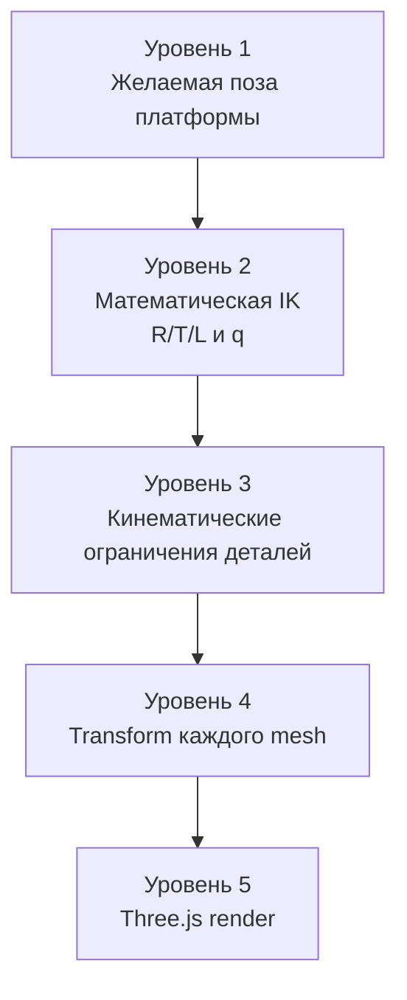

Это решает типичную проблему текущей 3D-версии:

> детали не должны независимо ехать за платформой и проходить друг через друга.

Сначала должны решаться их кинематические ограничения, и только затем обновляться `position` / `rotation` mesh-объектов.

---

# 54. Как это связано с проблемой «детали заходят друг в друга»

Если часть конструкции физически:

```text
может только выдвигаться вдоль собственной оси
```

то ей нельзя задавать:

```text
position = произвольная XYZ
```

Надо описать ограничение:

```text
position = base + axis * extension
```

где:

```text
base      — неподвижная точка;
axis      — разрешённое направление движения;
extension — одна вычисленная величина.
```

Для неподвижной детали:

```text
transform = constant
```

Для детали, которая вращается только вокруг шарнира:

```text
position = joint_position
rotation = rotation_about_allowed_axis
```

Для выдвижной:

```text
position = base + axis*s
```

Это уже мост между математикой IK и корректной 3D-анимацией.

---

# 55. Как читать исходный Python-код IK

В документе есть функция:

```python
ik_and_jacobian(t, Q)
```

Логика по строкам примерно такая:

```text
phi
```

создаёт:

```text
0°,120°,240°
```

---

```text
b
```

создаёт три исходные точки платформы.

---

```text
u = Q @ b
```

поворачивает их.

---

```text
p = u + t
```

добавляет перенос.

---

```text
R
T
L
```

вычисляют локальные координаты каждой ветви.

---

```text
q = -(R1,T1,R2,T2,R3,T3)
```

формирует шесть командных координат.

---

```text
J
```

строит Якобиан.

То есть программный код почти напрямую повторяет всю схему, разобранную выше.

---

# 56. Что я бы советовал реально выучить

Не надо сразу пытаться запомнить весь документ.

## Уровень 1 — обязательно

Понимать:

```text
6DOF
IK
FK
t
Q
три ветви
R/T/L
q1...q6
```

---

## Уровень 2 — для защиты

Уметь словами объяснить:

```text
pi = t + Q*bi
```

и:

```text
pose → три точки → R/T/L → q
```

---

## Уровень 3 — хороший уровень

Понимать:

```text
Tool vs Platform;
порядок вращений;
Якобиан;
рабочую область;
траекторию.
```

---

## Уровень 4 — уже математическая часть диссертации

Уметь работать с:

```text
SO(3);
SE(3);
экспонентой поворота;
SVD;
condition number;
численным FK;
идентификацией параметров.
```

Для понимания текущего проекта начинать с уровня 4 не требуется.

---

# 57. Минимальный набор формул, который действительно стоит запомнить

## Поза расчётной точки

```text
pi = t + Q*bi
```

Смысл:

```text
повернуть точку и затем перенести.
```

---

## Координаты ветви

```text
Ri = ci*Xi + si*Yi - r - Zi*cot(α)

Ti = si*Xi - ci*Yi

Li = Zi/sin(α)
```

---

## Командные координаты

```text
q = -(R1,T1,R2,T2,R3,T3)
```

---

## Скорости

```text
q_dot = J*v
```

---

## Tool

```text
D = A⁻¹ P A
```

---

# 58. Главное понимание всей математики одной фразой

> Математика Free6D преобразует желаемое шестикоординатное положение жёсткой платформы в согласованное движение трёх расчётных ветвей, из которых формируются шесть командных координат контроллера.

---

# 59. Что можно нарисовать для КВ

Если КВ попросил именно «схему работы контроллера», я бы подготовил **не одну**, а четыре схемы.

## Схема 1. Общая структурная

Показывает:

```text
оператор
→ GUI
→ кинематика
→ ограничения
→ ROUT/SDK
→ контроллер
→ приводы
→ платформа
```

Использовать схему из раздела 50.

---

## Схема 2. Кинематическая математическая

Показывает:

```text
pose
→ t,Q
→ b1,b2,b3
→ p1,p2,p3
→ R/T/L
→ q1...q6
```

Использовать схему из раздела 11.

---

## Схема 3. Геометрическая

Нарисовать сверху:

```text
треугольник;
центр;
три точки b1,b2,b3;
радиус r;
углы 0°,120°,240°.
```

Использовать раздел 52.

---

## Схема 4. Физическая 3D-кинематика

Её желательно строить уже по STEP-модели:

```text
неподвижное основание;
три ветви;
какие детали фиксированы;
какие перемещаются поступательно;
какие вращаются;
где шарниры;
какая деталь связана с R;
какая с T;
как интерпретировать L.
```

Именно эта схема пока требует отдельного восстановления по геометрии модели.

---

# 60. Что делать дальше именно для проекта

Следующий разумный этап исследования:

```text
1. Разобрать STEP-модель на механические узлы.

2. Для каждой детали определить:
   - fixed;
   - вращательная;
   - поступательная;
   - связанная с платформой.

3. Найти реальные оси трёх ветвей.

4. Сопоставить:
   R1/T1/L1
   R2/T2/L2
   R3/T3/L3
   с деталями STEP.

5. После этого исправить веб-симуляцию:
   не двигать детали произвольно,
   а вычислять их положение из ограничений.

6. Проверить веб-модель эталонами:
   ±X
   ±Y
   ±Z
   ±Rx
   ±Ry
   ±Rz.

7. Отдельно проверить составные движения:
   X+Z;
   X+Ry;
   Rx+Ry;
   Rx+Ry+Rz.
```

---

# 61. Итог

Сейчас проект математически можно представлять как четыре уровня:

```text
УРОВЕНЬ 1
Желаемая поза:
X Y Z Rx Ry Rz

        ↓

УРОВЕНЬ 2
Геометрия жёсткого тела:
t, Q, b1,b2,b3 → p1,p2,p3

        ↓

УРОВЕНЬ 3
Кинематика Free6D:
R1,T1,L1
R2,T2,L2
R3,T3,L3

        ↓

УРОВЕНЬ 4
Команды:
q1...q6
→ контроллер
→ реальная механика
```

Если понимать этот конвейер, дальнейшие формулы уже не выглядят отдельными непонятными выражениями: каждая из них решает конкретный этап преобразования.

---

# Примечание о достоверности

Этот учебный конспект основан на восстановленной программной модели Free6D.3-2.150. Особенно важно не смешивать:

```text
доказанное по GUI/SDK/логам;
математически выведенное из найденных формул;
предполагаемую физическую интерпретацию механических деталей.
```

Совпадение математической IK с программой подтверждает воспроизведение программной модели, но окончательное соответствие реальной механике требует привязки к STEP-модели, документации и экспериментам на устройстве.
