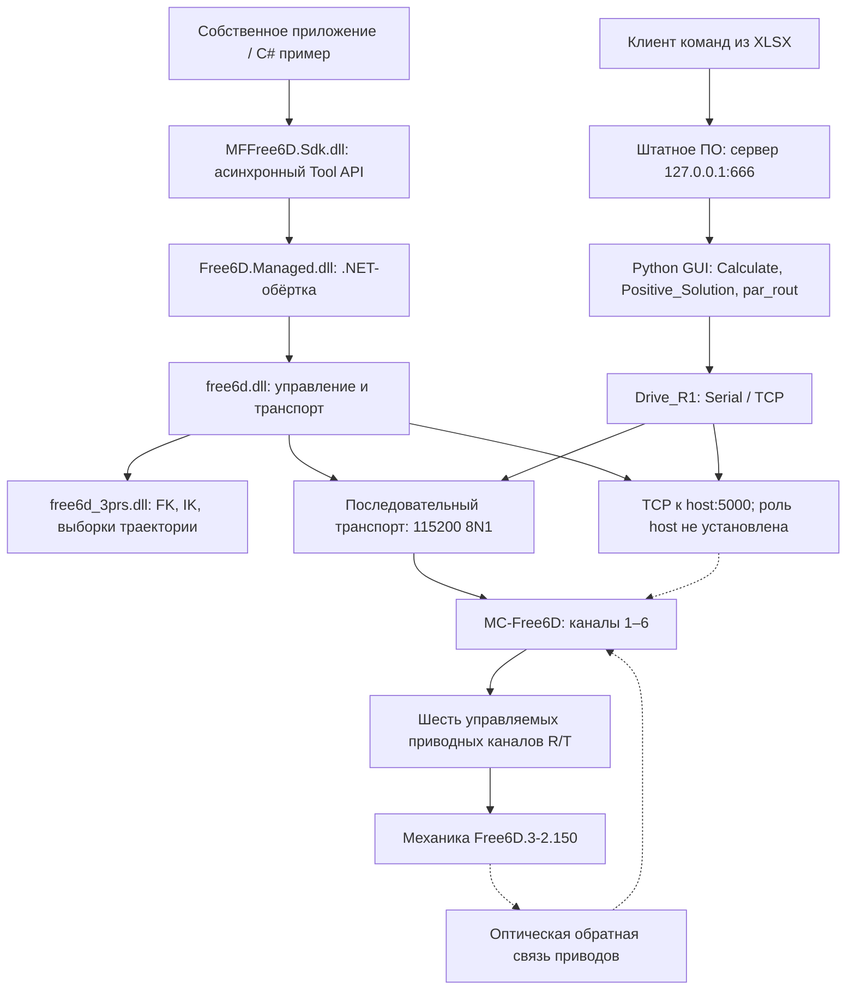

---
tags:
  - research/free6d
  - robotics/motion-control
  - reverse-engineering
---
# Технический анализ комплекта MultiFields Free6D.3-2.150 / MC-Free6D

Дата анализа: **29 сентября 2026 года**. Целевая ОС проекта: **[[Base/Computer Science/OS/Linux/Linux|Альт Линукс]]**. Объект исследования — локальные материалы, а не подключённое оборудование. Минимальная цель последующей разработки — управление из Linux; максимальная — собственное приложение, кинематика и управляемые плавные переходы.

## 1. Основные выводы

1. **Подтверждено документом:** платформа имеет шесть координат положения/ориентации, шесть нижних управляемых приводов и оптическую обратную связь. **Вывод по совокупности данных:** удобная рабочая схема — три ветви, в каждой два управляемых канала `R_i`, `T_i` и дополнительная зависимая величина `L_i`. В штатном ПО действительно рассчитываются девять величин, но передаются шесть каналов. Это существенно точнее заметки «3 движка с 3 осями = 9»: девять величин модели не доказывают девять независимых осей или три двигателя. Точная топология суставов и физический смысл R/T требуют уточнения. [R], с. 6, 9, 11; [GX], строки 241–249, 335–339; [GUI], `Calculate`, `TraX`, локаторы в §2.4 и §9.
2. **Подтверждено статическим разбором:** штатная программа содержит Python 3.10, PyQt6, NumPy, VTK и Python-функции расчёта механики. Найдены параметры `Radius = 39.5809191`, `hardware_Tilt_Angle = 30*pi/180`, расчёт `R/T/L`, формирование `PAR:ROUT` и изменение знака расчётных R/T перед отправкой. В §9 приведена восстановленная часть алгоритма с ограничениями. Это модель конкретной сборки ПО, **не измеренная геометрия данного экземпляра**. [GUI], `Main_process` wordcode 0x0000–0x005a, `Calculate` 0x049a–0x0644, `TraX` 0x00c4–0x015e.
3. **Наблюдается в записи обмена:** один COM4 обслуживает каналы 1–6; контроллер сообщает `ControllerPN:MC-Free6D`, `ControllerSN:F6DC3176B02`. Исследован весь лог: 22 083 строки, 5 189 блоков записи и 5 183 блока чтения. Видны reference, установка режимов, поканальные запросы и одна загрузка/запуск траектории. Команда в логе не является доказательством физического движения. [LOG], строки 5–22082; метод подсчёта в §7.
4. **Подтверждено статическим разбором:** существуют два разных сетевых интерфейса. Штатное приложение создаёт сервер `127.0.0.1:666` для команд вида `[Initialize]`; в его транспортном коде есть `192.168.1.101:5000`. SDK использует TCP-порт 5000 и низкоуровневые запросы контроллера. **Неизвестно**, является ли конечная точка 5000 встроенным Ethernet контроллера, преобразователем или отдельным сервером. Эти интерфейсы нельзя смешивать. [GUI], `Tcp`, `Go`; [SX], строки 260–294; [GM], строки 13–21; [XR], Sheet1, A2:D40.
5. **Подтверждено документом и PE-метаданными:** поставляемый C# комплект предназначен для Windows x64 / .NET 8 и зависит от Windows-native DLL. Простого переноса C# примера на Linux недостаточно. В комплекте нет Linux `.so`, исходников native-слоя и заголовков C ABI. [PROJ], строки 1–18; [MAN], строки 20–37; [NP], импортные таблицы; состав пакетов в §5.
6. **Вывод по совокупности данных:** наиболее обоснованный независимый путь к минимальной цели — Linux-клиент низкоуровневого последовательного протокола, сначала только чтение идентификации/состояния. Параллельно следует запросить Linux SDK и полную спецификацию у производителя. Для начала проектирования парсера материалов достаточно; для надёжного управления движением пока не хватает правил кадрирования, семантики статусов, reference, STOP и буферной траектории. §7, §10–12.
7. **Подтверждено документом:** SDK различает CLOS и ROUT, линейную и угловую скорости, число точек, период выборки и ожидание прибытия. **Неизвестно:** гарантии синхронизации, ограничения ускорения/рывка и реальная плавность. Тайм-аут, закрытие соединения и программный STOP не равны доказанному останову. [SX], строки 207–258, 499–568; [GM], строки 150–180.
8. **Вывод по сопоставлению:** Python-черновик нельзя принимать за работающий клиент: он добавляет LF, которого не видно в запросах исходного лога, ожидает голый `0/1` вместо ответа с префиксом, не дочитывает двухстрочную идентификацию и использует не наблюдавшиеся `HARD:STAT:MOVE?`, `HARD:POS?`. [PY], строки 9–23, 32–76; [LOG], строки 7–13, 27–38, 92–96.

Главные блокирующие вопросы: паспорт кинематической схемы и калибровки; физическая карта каналов; транспортная спецификация; семантика `STAT:MOVE` и `STAT:TARG`; единицы и пределы `PAR:ROUT`; проверяемый STOP; Linux-доступ к фактическому USB-адаптеру. Отдельная неопределённость — соответствие SDK, штатной программы и прошивки друг другу: совпадение названий продукта этого не доказывает.

## 2. Карта комплекта

### 2.1. Метод и фактический охват

Исходный набор содержит **261 обычный файл, 327 086 126 байт**; содержимое архивов в это число повторно не включено. Для всех 261 файла вычислены SHA-256, в отчёте сохранены существенные контрольные суммы. Проверены `AGENTS.md` в рабочем каталоге, его родителях и вложенных каталогах: не найдены. `.git`, `.agents`, `.codex` не содержат обычных файлов. Исходники и двоичные материалы не изменялись.

Использованы установленный Python со стандартной библиотекой, `pdftotext`, `pdfinfo`, `pdftoppm`, `objdump`, `7z`. Все три PDF извлечены целиком; русские с. 6 и 12 дополнительно просмотрены как изображения. Обе XLSX разобраны непосредственно как ZIP/XML, включая объединённые по смыслу строки параметров. Прочитаны все исходники примера и текстовые заметки, JSON, README и XML-документация двух NuGet-пакетов. Весь лог декодирован из **hex-колонки**, а не из обрезанной текстовой колонки. STEP исследован как STEP-текст; все 12 OBJ разобраны по вершинам и граням. Драйверы исследованы на уровне состава, INF/REG/текста, включая вложенные FTDI ZIP и INF внутри CH343SER.EXE.

EXE, установщики, пример, библиотеки, встроенный Python-байткод и команды оборудования **не выполнялись**. COM/TCP-соединения не создавались. Внешние инструменты, зависимости и сведения из интернета не загружались. Анализ переносимости ниже — условный инженерный вывод по локальному комплекту; совместимость конкретного выпуска Альт Линукс не проверялась. Временные извлечения оставлены вне исходных каталогов, в `/tmp/multifields-analysis`; отчёт не требует их для понимания результатов.

Обозначения уверенности:

- **Д — подтверждено документом:** руководство, таблица или контракт SDK; не означает независимое испытание.
- **Л — наблюдается в записи обмена:** реально представленные байты и ответы, без вывода об истинности физического состояния.
- **С — подтверждено статическим разбором:** структура файла, импорт/экспорт, константа или однозначный участок байткода.
- **В — вывод по совокупности данных:** аргументированная интерпретация перечисленных источников.
- **Г — гипотеза:** возможное объяснение, требующее проверки.
- **Н — неизвестно:** данных для вывода нет.

### 2.2. Значимые файлы и группы

| Путь относительно корня | Содержание и назначение |
|---|---|
| `FlashRUS/Руководство пользователя  Free6D.3-2.150.pdf` | 13 страниц: подключение, GUI, характеристики и размерный чертёж. Два пробела перед Free6D — часть имени. |
| `FlashRUS/Free6D.3-2._Протокол команд.xlsx` | Русская таблица верхнего интерфейса, лист Sheet1, значимые ячейки A1:D40. |
| `FlashRUS/6-Axis Motion Control Software and Manual/` | EXE 102 008 765 байт, английское руководство 12 страниц, 12 OBJ и шесть CSV. |
| `FlashChina/说明书/` | Китайское руководство 9 страниц и китайская версия таблицы команд. |
| `FlashChina/软件/F6DC3176B02.zip` | `F6DC3176B02.exe` 102 008 226 байт и те же 12 OBJ в `六轴OBJ/`. Имя совпадает с SN в логе; индивидуальная настройка сборки этим не доказана. |
| `FlashChina/驱动/` | CH343SER.EXE; архив `串口驱动.zip`; распакованный FT232RL-комплект для Windows, Windows CE, старых macOS; служебные SYS/DLL/INF/CAT/REG/CAB/PKG и инструкции. |
| `MFFree6D-Sdk-SampleProject-win-x64/` | 22 файла: две пары NuGet/symbols, исходники примера, README, manifest и готовый publish. |
| `MFFree6D-Sdk-SampleProject-win-x64.zip` | Полный дубликат 22 файлов распакованного комплекта. |
| `ReverseEngine/Прослушка гексапод..txt` | Единственный исходный лог, 22 083 строки; отдельные сценарии из заметок не имеют собственных исходных логов в комплекте. |
| `ReverseEngine/Прослушка гексапод. Список запросов.txt` | 198 строк при `splitlines()`; сценарии X/Y/Z и поворотов, часть с ошибками подписей. `wc -l` даёт 197 из-за отсутствия последнего LF. |
| `ReverseEngine/Прослушка гексапод.Толкование.txt` | 22 строки, предположения о протоколе и ошибки склейки. |
| `ReverseEngine/PythonAIExample.txt` | Python/pyserial-черновик, 84 логические строки; не проверенная реализация. |
| `Hexapod_MultiFields_Free6D.3-2.150.STEP` | 53 126 989 байт; STEP AP214, SolidWorks 2020, дата экспорта 2025-07-30. |
| `FlashRUS/System Volume Information/` | `WPSettings.dat`, `IndexerVolumeGuid`: служебные данные носителя, не конфигурация контроллера. |

CSV `R1.csv`, `T1.csv`, `R2.csv`, `T2.csv`, `R3.csv`, `T3.csv` содержат `0.0,0` и совпадают между собой. Их принадлежность экспорту данных теперь подтверждается статически: функция `Export` штатного ПО открывает эти шесть имён в режиме `w` и использует массивы `Data_R1` … `Data_T3`. Это сильнее первоначальной гипотезы «заготовки». Единицы первой колонки и связь её шага с реальным временем здесь не сертифицированы. [GUI], `Export`, исходная метка 3077, marshal 0xc3bd; [R], с. 9; CSV, строка 1.

### 2.3. Реестр источников и правила ссылок

Все пути ниже относительны корню комплекта; Markdown-ссылки рассчитаны на размещение отчёта в `docs/`. Номера строк — начиная с 1, по логическим строкам, CRLF и LF эквивалентны. Страницы PDF — порядковые страницы файла. Для архива ссылка ведёт на архив, после неё указывается внутренний путь и строки извлечённого текста. Для двоичного файла вместо вымышленных строк приведены имя экспорта, структура PE или точный внутренний объект/смещение.

| Код | Источник |
|---|---|
| [R] | `FlashRUS/Руководство пользователя  Free6D.3-2.150.pdf` |
| [E] | `FlashRUS/6-Axis Motion Control Software and Manual/Six-Axis Parallel Displacement Stage User Manual.pdf` |
| [C] | `FlashChina/说明书/六轴并联位移台使用手册.pdf` |
| [XR], [XC] | Русская и китайская XLSX соответственно; обе Sheet1. |
| [LOG], [NOTES], [INTERP], [PY] | Четыре файла ReverseEngine, перечисленные в §2.2. |
| [SDKR], [MAN], [APP], [PROJ], [NUGET] | README, release-manifest, SampleApplication.cs, csproj и NuGet.config комплекта SDK. |
| [GM] | `packages/Free6D.Managed.0.8.1-preview.1.nupkg` → `README.md`, 252 строки. |
| [GX] | Тот же пакет → `lib/net8.0-windows7.0/Free6D.Managed.xml`, 401 строка. |
| [SX] | `packages/MFFree6D.Sdk.0.1.0-preview.1.nupkg` → `lib/net8.0-windows7.0/MFFree6D.Sdk.xml`, 717 строк. |
| [NP], [KP] | `sample/publish/free6d.dll` и `free6d_3prs.dll`, PE x86-64. |
| [GUI] | `FlashRUS/6-Axis Motion Control Software and Manual/6-Axis Motion Control Software.exe`; внутренний `English-main`, подробности §2.4. |
| [CAD], [OBJ] | STEP и каталог `Six Degree OBJ/` соответственно. |
| [CH], [FT], [FT64] | CH343SER.EXE → CH343SER.INF; XP/Win7 FTDIBUS.INF; архив FTDI x64 2.12.28 → ftdibus.inf. |

### 2.4. Дополнительный статический разбор штатного EXE

`7z` не распознал английский EXE как архив. Независимый разбор хвоста файла обнаружил **PyInstaller CArchive**, cookie с сигнатурой `MEI\x0c\x0b\x0a\x0b\x0e` по файловому смещению **102008677**, версию Python **310**, имя `python310.dll`. В TOC **562 записи**, среди них `pyi_rth_pyqt6`, NumPy-модули, `vtkmodules`, Windows `.pyd`/DLL. Встроенный объект `English-main` расположен по файловому смещению **287172**, сжат zlib, размер **38652**, после распаковки **148578 байт**. SHA-256 распакованного marshal:

`1fbd6f53abf239af7dc588a20dfec27a98ab7bf020d0de0fbdc5d3ee50b9863d`.

Специальный временный читатель разобрал структуру marshal CPython 3.10 в обычные данные, **не создавая и не выполняя Python code objects**. Прочитано ровно 148578 байт, обнаружено 90 записей кода; поля `co_filename` содержат `English-main.py`. Это не полный восстановленный исходный проект. Номера ниже — сохранённые начальные номера строк оригинала, которого отдельным файлом нет; wordcode-смещения даны относительно тела соответствующей функции.

| Объект | Начальная строка из метаданных | Смещение объекта в распакованном marshal | Установленный факт |
|---|---:|---:|---|
| `Drive_R1` | 87 | 0x060c | Serial/TCP, константа 115200, поканальные запросы, очереди команд. Название R1 не означает обслуживание только первого канала. |
| `Tcp` | 717 | 0x2b32 | `bind(('127.0.0.1',666))`, `listen`, `accept`, `recv`, `gbk`, команды `[Initialize]` и другие. |
| `Main_process` | 1749 | 0x593d | Параметры геометрии, ограничения расчётных величин, функции управления GUI. |
| `Calculate` | 1839 | 0x61bc | Преобразование координат и девять величин R/T/L; возвращает 13 элементов, включая axis-angle ориентацию. |
| `par_rout` | 1967 | 0x7344 | Создаёт `index-PAR:ROUT time,node_count,...`; `max_command_length=128`; продолжения с `,0,`. |
| `TraX` | 2177 | 0x8685 | Вызывает Calculate, выбирает элементы 0,1,3,4,6,7, меняет знак, округляет до 6 знаков, отправляет каналы 1–6. |
| `Export` | 3077 | 0xc3bd | Выгружает шесть CSV. |
| `Positive_Solution` | 3157 | 0xeec1 | Структура и имена указывают на численный расчёт позы из приводных величин; полный алгоритм сходимости не восстановлен. |
| `Go` | 3146 | 0xc8c2 | Вызов socket.connect с `192.168.1.101:5000` (wordcode 0x0060–0x0068), `HARD:IDN?`, поиск COM через Windows WMI. |

**С:** расположение арифметических операций, загрузок констант и присваиваний в §9 проверено по wordcode. **В:** функциональное назначение `Positive_Solution` подкрепляется именами входов/выходов и вызовами линейной алгебры; его точность этим не доказана. Китайский EXE на таком же уровне не разбирался, перенос этих выводов на него без проверки неправомерен.

Для воспроизведения ключевых двоичных находок достаточно прочитать 88 байт cookie, определить базу CArchive как `cookie_offset + 88 - archive_length`, прочитать TOC и zlib-распаковать запись `English-main`. Константы cookie: archive_length=101738429, toc_offset=101696757, toc_length=41584. Смещения TOC считаются от базы архива; указанные выше 287172 и 102008677 — абсолютные файловые. Поля marshal разобраны как данные формата CPython 3.10, выбранные арифметические LOAD/STORE/BINARY/CALL инструкции исследованы статически. Для формул в §9 проверены также вложенные sum/zip-произведения в Calculate с метками исходных строк 1881–1883, 1893–1895, 1905–1907.

### 2.5. Дубликаты и контрольные суммы

| Файл | Байты | SHA-256 |
|---|---:|---|
| `Hexapod_MultiFields_Free6D.3-2.150.STEP` | 53126989 | `496f1f40dc3bbdc8e7a5b57a8f2beec93c75b80c19ec4ca5061e92fe2cfd23f5` |
| `ReverseEngine/Прослушка гексапод..txt` | 1295745 | `eb0789b3f014c7bd123ba5db68ebf2ee3ea7ecb1eae714bcebd2df3a7df18957` |
| `FlashRUS/6-Axis Motion Control Software and Manual/6-Axis Motion Control Software.exe` | 102008765 | `1df925122285c8eb7e3a16148ea5ef3b90348c8b4e5d8465b3740e0d74dfed75` |
| `FlashChina/软件/F6DC3176B02.zip` | 107475549 | `2d695d5c760642ed3316af599fc3f1c41e526b5468fdbffb8c67426cda20b927` |
| `FlashRUS/Free6D.3-2._Протокол команд.xlsx` | 19972 | `d2d9ae9de4912cc892b904d8a6dd8aeb3ff74637f534a25e6f5d8823f71e1612` |
| `FlashChina/说明书/二次开发指令集_Free6D_v2.xlsx` | 22251 | `5bb82501907293a3ef4851c2c87c84ac71482b57b353b20b79ea078feace38e5` |
| `MFFree6D-Sdk-SampleProject-win-x64.zip` | 426804 | `d0c2391fc5f0a15888f6a7c44d4b5a3bac5180aa48ac27703386ea25c09d0b5d` |
| `MFFree6D-Sdk-SampleProject-win-x64/packages/MFFree6D.Sdk.0.1.0-preview.1.nupkg` | 39014 | `abe6f2146a71a5922ce84564fad7d848abeadabd80c95bafd6889b27894557ea` |
| `MFFree6D-Sdk-SampleProject-win-x64/packages/Free6D.Managed.0.8.1-preview.1.nupkg` | 115578 | `109af8b8fe9c007e8951fc70001cdbf139794486a2e701b65ba68372581f8811` |
| `MFFree6D-Sdk-SampleProject-win-x64/sample/publish/free6d.dll` | 93696 | `cd3b2c23ef4a6abbb3a14541acf1c4c335133a4a778b66bc4a6ed9b42dc9669e` |
| `MFFree6D-Sdk-SampleProject-win-x64/sample/publish/free6d_3prs.dll` | 42496 | `a48fd09117666d442515308e87201c8747ab73db1765e3febe934345e34f81e2` |
| `FlashChina/驱动/串口驱动.zip` | 15073582 | `23b4c051efd95ceb65aa46473ea7a59350752f3224519a75e7f3d85ebf5d6b04` |
| `FlashChina/软件/F6DC3176B02.zip → F6DC3176B02.exe` | 102008226 | `3c4c532343e73d4f0d31f44387252da0d4faa164bd3a0d7f0623e43c65e1a026` |

Результаты сравнения:

- SDK ZIP содержит 22 файла; **22/22** совпадают по SHA-256 с распакованными файлами. `contents.files` manifest перечисляет 21 файл: размеры и SHA-256 **21/21** совпали. Сам manifest не входит в этот список.
- Все четыре DLL из двух `.nupkg` совпадают с одноимёнными DLL `sample/publish/`.
- Все **12/12 OBJ** китайского архива совпали с русским каталогом; EXE различаются размером и SHA-256.
- `串口驱动.zip` содержит 204 обычных файла: **204/204** совпали с соответствующими распакованными файлами под `FlashChina/驱动/`.
- Внутри английского EXE функция `ModelWindow.Creatobj` (исходная метка 965, marshal 0x37d2) ссылается на `六轴OBJ/...`, а распакованная русская поставка содержит `Six Degree OBJ/...`. Это потенциальное несоответствие пути ресурсов; альтернативный поиск/переименование и фактическая работоспособность визуализации не проверены.
- XLSX побайтово различаются, но все строки синтаксиса запросов/ответов в колонках **A и C** строк 2–40 совпадают. Исключение при сравнении всей области — текстовый заголовок A35 («Срабатывает при ошибке»), который переведён и командой не является. Описания B/D переведены не абсолютно буквально (§6).
- В `runtime.nativeFiles` manifest ошибочно записаны `sample/free6d.dll`, `sample/free6d_3prs.dll`; фактические и корректно перечисленные в `contents.files` пути — `sample/publish/...`. Это несогласованность метаданных, не отсутствие DLL. [MAN], строки 24–34 и 99–108.

### 2.6. Что не удалось прочитать полностью и что сознательно не исследовалось

| Материал | Доступный уровень / ограничение |
|---|---|
| `MFFree6D.Sdk.dll`, `Free6D.Managed.dll`, `MFFree6D.Sdk.Sample.dll` | PE/строки/пакетная XML-документация и исходники примера. `ilspycmd`, `monodis`, `ildasm`, `dotnet` отсутствуют; .NET-декомпиляция реализации не выполнена. |
| `free6d.dll`, `free6d_3prs.dll` | Импорты, экспорты, строки. Тела всех native-функций не восстановлены; исходников/заголовков нет. По имени экспорта нельзя восстановить точную C-сигнатуру. |
| Английский GUI EXE | PE и CArchive/часть Python wordcode разобраны; полный проект, все ветви и зависимости не декомпилированы. Ошибка 7z обойдена чтением формата данных, без запуска EXE. |
| `F6DC3176B02.exe` внутри китайского ZIP | Размер/хеш/состав поставки; реализация не декомпилирована. |
| STEP | UTF-8-декодирование не прошло на байте 12717651. ASCII-синтаксис прочитан через обратимое latin1-представление байтов; не-ASCII имена не интерпретировались. CAD-ядра OpenCascade/OCP нет: точная B-rep-сборка, оси шарниров и измерения сопряжений не восстановлены. |
| OBJ | Все координаты вершин/грани прочитаны; оси суставов и единицы не заданы явной спецификацией. |
| PDB / `.snupkg` | Состав symbols-пакетов просмотрен; отладочные базы не разобраны полностью. Наличие PDB не равно наличию исходников. |
| Драйверные SYS/DLL/CAT/CAB/PKG и дополнительные EXE, PNG-инструкция FTDI | Инвентаризация/хеши и выбранные INF; машинный код драйверов, подписи, содержимое всех macOS installer payload и изображение инструкции не анализировались. Это не материалы кинематики. |
| `WPSettings.dat`, `IndexerVolumeGuid` | Учтены, хешированы; внутренний формат не исследован. |

## 3. Аппаратная часть и механика

### 3.1. Разделение сущностей

| Сущность | Что установлено | Что нельзя заключать |
|---|---|---|
| Платформа Free6D.3-2.150 | Д: пьезоэлектрический позиционер, X/Y/Z и три поворота; размерный чертёж и паспортная таблица. [R], с. 7–12. | Что это классический шестиштанговый Stewart; что все паспортные пределы доступны одновременно. |
| Контроллер MC-Free6D | Л: PN/SN в ответе, каналы 1–6 через COM4. [LOG], 7–13, 18–24. | Версию прошивки, встроенный Ethernet, электрическую схему и тип каждого силового канала. |
| Управляемые приводы | Д/С: шесть логических R1,T1,R2,T2,R3,T3, группируемых SDK по три пары. [GX], 241–249, 335–339; [GUI], TraX. | Точное число пьезоэлементов, устройство усилителей, число физических двигателей на модуль. |
| Датчики | Д: оптический энкодер, разрешение 2 нм; Л: поканальные SENS:POS и SENS:REF. [R], с. 11; [LOG], 35–78, 92–121. | Что платформа непосредственно измеряет шесть пространственных координат отдельным метрологическим датчиком. Фактическая поза в ПО может быть результатом FK. |
| Интерфейсные адаптеры | С: драйверы семейства FTDI и WCH присутствуют. | Что именно такой чип установлен: это проверяется USB-дескрипторами конкретного устройства. |

**Противоречие количества портов:** [R], с. 6, говорит об автоматическом определении шести номеров последовательных портов; [C], с. 5, содержит аналогичный текст. В рассматриваемом [LOG] реально открыт один COM4, в запросах используются адреса 1–6. Возможно, руководство описывает другую аппаратную ревизию; это гипотеза. Для данного исследованного сеанса подтверждена однопортовая адресация, а не шесть USB-портов.

Подключение в руководстве: канал контроллера CH1 к CH1 платформы и далее по номерам, USB к компьютеру, питание контроллера. Электрические распиновки, напряжение/ток питания и исчерпывающая схема аварийного останова отсутствуют. В руководстве есть предупреждение о высоковольтных выходах. [R], с. 3–5, 10–11.

### 3.2. Характеристики

Ниже **паспортные данные**, не результаты измерения. Источник всех строк таблицы — [R], с. 11.

| Параметр | Значение |
|---|---|
| Габариты в исходном положении | Ø150 × 90 мм |
| Габариты в положении полного хода | Ø155 × 100 мм |
| Масса | 1400 г стандартное/HV/UHV; 2100 г немагнитное исполнение |
| Максимальная вертикальная нагрузка | 1000 г; допустимые моменты и зависимость от ориентации не приведены |
| Апертура | 40 мм |
| Перемещения X, Y; Z | ±10 мм; ±5 мм |
| Повороты θX; θY; θZ | ±9°; ±8°; ±14° |
| Односторонняя повторяемость X/Y; Z | ±0,25 мкм; ±0,15 мкм |
| Односторонняя повторяемость поворотов | ±5 мкрад |
| Минимальный шаг XYZ; поворотов | 10 нм; 1 мкрад |
| Датчик / разрешение | Оптический энкодер / 2 нм |
| Стандартный кабель | Экранированный, D-Sub15 |
| UHV-кабель | Kapton, PEEK D-Sub15 |
| Материалы | Алюминиевый сплав/сталь; немагнитное исполнение — титан/керамика |
| Вакуумные варианты | HV до 2×10⁻⁷ мбар; UHV до 2×10⁻¹¹ мбар |

Вариант исполнения конкретного экземпляра не определён. Разрешение датчика, минимальный шаг, повторяемость и абсолютная точность — разные характеристики; абсолютная точность таблицей не задана. Диапазоны платформы не являются допустимыми диапазонами каждого канала.

На размерном чертеже [R], с. 12, визуально читаются основание Ø150, верхняя площадка Ø100, высота 90, окружности Ø80/60/50/40 и элементы крепления. Эти окружности нельзя автоматически объявлять радиусами шарниров. Программный `Radius=39.5809191` не равен доказанному радиусу окружности отверстий Ø80.

### 3.3. R, T, L и исходная заметка про девять осей

**Д:** SDK называет пару одной ветви `rotary` и `translational`, тип `Leg` — одной из трёх 3PRS legs. **Одновременно Д:** координата каждого R/T в публичном состоянии называется `ActualPositionMillimeters`; GUI показывает положения всех шести в мм. [GM], 126–153; [GX], 247–249, 329–339; [SX], 588–618; [R], с. 6. Поэтому расшифровка R как непосредственно измеряемого угла вращательного мотора не обоснована. Возможное физическое различие вращательного узла и линейной координаты его привода требует чертежа/паспорта.

**С:** `Calculate` формирует `R1,T1,L1,R2,T2,L2,R3,T3,L3`; в рассматриваемой модели `L_i = Z_i/sin(alpha)`. `TraX` выбирает только индексы 0,1,3,4,6,7, меняет знак и отправляет каналы 1…6. L участвует в расчёте/визуализации и проверках, но отдельная команда приводу L в исследованном пути не формируется. [GUI], Calculate 0x049a–0x0644, TraX 0x00c4–0x015e, 0x0666–0x06c4.

**В:** L1–L3 — зависимые координаты наклонных звеньев/элементов ветвей; OBJ с такими именами расположены выше нижних R/T-узлов. **Г:** соответствующие перемещения реализуются пассивными кинематическими связями. Ни пассивность каждого конкретного шарнира, ни его тип только этими сведениями не доказаны.

Необходимо различать:

1. **Поза платформы:** шесть независимых параметров твёрдого тела, например XYZ + выбранное представление ориентации.
2. **Управляющий вектор:** шесть приводных координат `q1…q6`, карта R/T задаётся отдельно.
3. **Внутренние координаты механизма:** зависимые R/T/L, положения суставов, углы пассивных соединений; их число может превышать подвижность платформы.
4. **Физические двигатели/пьезоэлементы:** их количество нельзя получить сложением названий переменных.

Таким образом, исходная заметка **частично объясняется девятью расчётными величинами, но не подтверждается как описание девяти осей или трёх двигателей**. Обозначение `3PRS` в документации SDK значимо как название программной модели; одно имя DLL и даже это название не заменяют схему реального изделия.

### 3.4. Геометрия STEP/OBJ

**С:** STEP сообщает `STEP AP214`, `SolidWorks 2020` и имя `Free6D.3-2.150` ([CAD], строки 1–13, 19848). В строке 142 объявлена единица длины `.MILLI., .METRE.`; встречаются единицы угла RADIAN. В полном тексте найден один `PRODUCT`, не найдены `NEXT_ASSEMBLY_USAGE_OCCURRENCE` и `ITEM_DEFINED_TRANSFORMATION`. Поэтому явная иерархия механической сборки с сопряжениями не извлечена. Это не доказательство отсутствия множества тел в геометрии.

STEP содержит 681 904 текстовые строки; простым поиском записей `#id = TYPE` выделены 569 576 записей простых типов, включая 125 998 CARTESIAN_POINT, 64 672 ORIENTED_EDGE, 32 336 EDGE_CURVE. Сложные записи с `#id = (...)` в это последнее число не входят. Ограничивающий параллелепипед всех CARTESIAN_POINT не использовался как габарит изделия: там есть служебные геометрические точки.

OBJ экспортированы SolidWorks (строка 1 каждого файла). Ниже минимумы/максимумы именно **вершин сетки в исходных числовых единицах**, не измеренные ходы приводов. Сходство Ø150/Ø100 с паспортом позволяет предполагать мм, но сам OBJ единицы явно не объявляет.

| OBJ, путь внутри Six Degree OBJ | Вершин / граней | Минимум XYZ | Максимум XYZ | Строки вершин |
|---|---:|---|---|---|
| `L1/L1.obj` | 11607 / 23282 | (-12.0000, 24.0303, 42.2429) | (12.0000, 63.7221, 77.1074) | 3–11609 |
| `L2/L2.obj` | 11534 / 23138 | (-59.3517, -40.9784, 42.2429) | (-15.5608, -2.2724, 77.1049) | 3–11536 |
| `L3/L3.obj` | 11534 / 23138 | (15.5608, -40.9784, 42.2429) | (59.3517, -2.2723, 77.1065) | 3–11536 |
| `R1/R1.obj` | 38562 / 77216 | (-22.5000, 27.9500, 15.4000) | (17.5000, 63.0500, 32.8000) | 3–38564 |
| `R2/R2.obj` | 39445 / 78982 | (-62.7606, -46.1064, 15.4000) | (-16.0477, 0.6064, 32.8000) | 3–39447 |
| `R3/R3.obj` | 39162 / 78416 | (16.0477, -46.1064, 15.4000) | (62.7606, 0.6064, 32.8000) | 3–39164 |
| `T1/T1.obj` | 19330 / 38736 | (-17.5000, 25.3001, 27.4000) | (17.5000, 63.6999, 66.1508) | 3–19332 |
| `T2/T2.obj` | 19982 / 40040 | (-62.7606, -46.1064, 27.4000) | (-16.0477, 0.6064, 66.1508) | 3–19984 |
| `T3/T3.obj` | 19768 / 39612 | (16.0477, -46.1064, 27.4000) | (62.7606, 0.6064, 66.1508) | 3–19770 |
| `动平台/动平台.obj` | 15838 / 31728 | (-50.0000, -50.0000, 65.7720) | (50.0000, 50.0000, 86.0048) | 3–15840 |
| `工具坐标/工具坐标.obj` | 261 / 506 | (-13.0000, -1.1372, 71.0371) | (1.1575, 13.0000, 87.7121) | 3–263 |
| `底座/底座.obj` | 83102 / 166429 | (-75.0000, -75.0000, -4.0000) | (75.0000, 75.0000, 20.8000) | 3–83104 |

Из сеток можно получить взаимное расположение деталей в экспортированной позе, поверхности и ориентировочные габариты. Для полноценной модели ещё нужны оси направляющих, центры и типы суставов, активные/пассивные связи, базовые системы координат, начальные длины, нули энкодеров и соответствие геометрии реальному серийному экземпляру. Связывать произвольную ось OBJ с X платформы без проверки нельзя.

## 4. Архитектура программного обеспечения

В схеме сплошная связь подтверждается документацией, исходниками, импортами или логом; пунктир означает интерпретацию/неизвестное физическое размещение. Это схема ролей, а не доказательство аппаратной синхронности.



Основания связей: пример `[APP]`, строки 43–55, 546–565; зависимости в `.nuspec` и `.deps.json`; [GM], 3–5, 183–191; [NP], импорт `free6d_3prs_*`, WS2_32 и Win32 COM-функций; [LOG], 5–24; [R], с. 5, 9, 11; [GUI], §2.4. Замкнутая обратная связь физически ожидаема по датчикам и состояниям, но подробная аппаратная схема её реализации не предоставлена, поэтому соответствующие связи пунктирные.

**Где выполняется кинематика.** Для SDK сильное основание — экспорты `free6d_3prs_forward_kinematics`, `...inverse_kinematics`, `...evaluate`, `...result_sample_at` и фактический импорт расчётных функций библиотекой `free6d.dll`. Для GUI — восстановленные арифметические операции Calculate, вызовы из TraX, функция Positive_Solution. Следовательно, существенная часть расчёта выполняется **на компьютере**. Наличие/отсутствие дополнительной кинематики в прошивке неизвестно. [NP], [KP], импорт/экспорт; [GUI], §2.4, §9.

**Где формируется траектория.** GUI строит массивы целевых координат и передаёт `PAR:ROUT`, затем `MOVE:ROUT`; native SDK импортирует извлечение временных выборок из расчётной библиотеки. Это указывает на планирование на ПК и буферное исполнение некоторой последовательности контроллером. Интерполяция между точками, внутренний регулятор и гарантии старта относятся к неизвестной части контроллера. [LOG], 15602–15623; [GUI], par_rout, TraX; [NP], импорт `result_sample_at/count/total_time_seconds`.

## 5. SDK

### 5.1. Версии, зависимости, комплектность

| Компонент | Версия / платформа | Источник |
|---|---|---|
| Выпуск комплекта | `2026-08-28T11:24:28.2701817Z` | [MAN], строка 3 |
| MFFree6D.Sdk | `0.1.0-preview.1`; assembly/file `0.1.0.0` | [MAN], 5–8; `sample/publish/MFFree6D.Sdk.Sample.deps.json`, 36–47 |
| Free6D.Managed | `0.8.1-preview.1`; assembly/file `0.8.1.0` | [GM], 7–9; deps.json, 18–25 |
| Native ABI | `0.8.0` — заявлено manifest | [MAN], 8 |
| Исходные ревизии | `db4d3e60c777fcd8a32a9680f1640a07ead4850c`, `74d2274c56c8ba90f7fb75b6216e624450f5b5d0`, ветви SDKDotNET | [MAN], 10–18; репозитории в комплект не включены |
| Пример | `net8.0-windows`, `win-x64`, x64, C# 12, warnings as errors | [PROJ], 1–18 |
| NuGet assets | `lib/net8.0-windows7.0/`, native только `runtimes/win-x64/native/` | Состав двух `.nupkg` |
| Требования README | .NET 8 Desktop Runtime x64, Visual C++ 2015–2022 x64 v143 | [SDKR], 5–10; [MAN], 36–37 |

`MFFree6D.Sdk` точно зависит от `Free6D.Managed [0.8.1-preview.1]`. `sample/NuGet.config` направляет эти два имени в `../packages`, а семейства runtime-пакетов Microsoft — в nuget.org. Сам пример точно фиксирует `[0.1.0-preview.1]`. [PROJ], 16; [NUGET], 3–21; `MFFree6D.Sdk.nuspec` внутри пакета, dependency.

Уточнение требования runtime: `sample/publish/MFFree6D.Sdk.Sample.runtimeconfig.json`, строки 2–7, объявляет `Microsoft.NETCore.App 8.0.0`, а README требует Desktop Runtime. Это более широкое требование поставки; факт прямой зависимости примера от WindowsDesktop по данному JSON не установлен. Windows-зависимые native DLL при этом подтверждены независимо.

`Program.cs`, строки 1–6, только вызывает `SampleApplication.RunAsync`. `SampleApplication.cs` содержит 565 строк логики подключения/консоли, а не исходники SDK. `.sln` — решение Visual Studio, `.csproj` — конфигурация сборки. `Properties/AssemblyInfo.cs`, строка 3, даёт `InternalsVisibleTo("MFFree6D.Sdk.Tests")`, но самих тестов здесь нет. `sample/publish` содержит EXE-загрузчик, DLL примера, DLL SDK/Managed, две native DLL, PDB, deps.json и runtimeconfig.json. `.snupkg` содержат portable PDB, не исходные проекты. Симулятор явно исключён. [MAN], 39–47; [SDKR], раздел NuGet.

### 5.2. Управляемый и native-слои

**С/Д:** MFFree6D.Sdk.dll и Free6D.Managed.dll — .NET-сборки. Free6D.Managed скрывает P/Invoke, native handles, буферы и callback. `free6d.dll`, `free6d_3prs.dll` — PE32+ x86-64 native DLL без CLR directory. [GM], 3–5; PE Data Directory соответствующих файлов.

`free6d.dll` импортирует `free6d_3prs.dll`, `WS2_32.dll`, `WINMM.dll`, `KERNEL32.dll`, `VCRUNTIME140.dll`, CRT. Видны `CreateFileA`, `ReadFile`, `WriteFile`, `SetCommState`, `SetCommTimeouts`, `PurgeComm`, `GetAddrInfoExA`, `inet_pton`, `timeBeginPeriod`. Это Windows-реализация транспорта/таймеров; ELF-библиотек для Linux в пакете нет. [NP], PE Import Table.

Основные native-экспорты:

| Библиотека | Группы экспортов |
|---|---|
| [NP] | `free6d_config_default/init`, `connect`, `connect_with_progress_observer`, `initialize`, `initialize_with_progress_observer`, `reference`, `home`, `get_status`, `get_pose`, `get_pose_frames`, `move_absolute/relative`, `move_absolute_in_frame/relative_in_frame`, `move_drives_absolute/relative`, `stop_drives`, `verify_newtonmsx`, `destroy`, `status_string`, `pose_euler`, `move_options_default`, `drive_move_request_default` — все с префиксом `free6d_`. Всего 24. |
| [KP] | `free6d_3prs_create`, `create_with_euler_order`, `destroy`, `config_default`, `evaluate`, `evaluate_in_frame`, `forward_kinematics`, `forward_kinematics_frames`, `inverse_kinematics`, `inverse_kinematics_in_frame`, `pose_euler/quaternion`, `request_default`, `result_sample_at/count`, `result_total_time_seconds`, `result_final_jacobian`, `result_forward_kinematics`, `result_remaining_stroke`, `result_destroy`, `estimate_remaining_stroke`, `stroke_options_default`, `status_string` — общий префикс `free6d_3prs_`. Всего 23. |

Отсюда подтверждаются **имена и доступность ABI-символов**, но не точные C-структуры/сигнатуры. Нельзя безопасно вызывать эти функции через самостоятельно угаданный ctypes ABI. В [NP] по файловым смещениям 0x120b8…0x12230 имеются строки `MOVE:STOP`, `PAR:ROUT`, `MOVE:CLOS`, `MOVE:ROUT`, `MOVE:REF`, `PAR:CLOS`, `MODE:FIN`, `STAT:*`, `SENS:*`, `HARD:IDN?`. Наличие строк `HARD:REST`, `HARD:SHUT`, `COMM:` рядом не доказывает публичный разрешённый API или их исполнение.

### 5.3. Публичные контракты и сигнатуры

Ниже параметры методов извлечены из XML member identifiers; это не результат декомпиляции. Возвращаемые типы не выводятся из одного имени XML-member: где они не подтверждены исходником/примером, указано семантическое описание результата.

| API | Контракт / параметры | Источник |
|---|---|---|
| `ConnectTcpAsync(string host, MFFree6DConfiguration configuration, IProgress<MFFree6DProgress>? progress)` | `Task<IMFFree6DSession>`; ASCII host 1–255 символов; verified, ещё не referenced | [APP], 527–535, 551–556; [SX], 274–284 |
| `ConnectSerialAsync(string portName, MFFree6DConfiguration configuration, IProgress<MFFree6DProgress>? progress)` | `Task<IMFFree6DSession>`; ASCII port name 1–255 символов | [APP], 538–545, 559–565; [SX], 285–294 |
| `ReferenceAsync()` | Явный reference; возвращает структурированный результат; снимает прежнее ready при принятии попытки | [SX], 222–225 |
| `HomeAsync()` | Home после успешного reference | [SX], 226–229 |
| `MoveToolAbsoluteAsync(MFFree6DToolPose target, MFFree6DMotionProfile profile)` | Абсолютная цель относительно Tool zero, CLOS или ROUT | [SX], 230–235 |
| `MoveToolRelativeAsync(MFFree6DToolPose delta, MFFree6DMotionProfile profile)` | Приращение по локальным осям Tool | [SX], 236–241 |
| `RequestStopAsync()` | Обычный STOP всех шести каналов; результат отправки, не подтверждение покоя | [SX], 242–246 |
| `TryReadTelemetryAsync()` | До reference — status; после — также теоретическая/фактическая Tool-поза; `SkippedBusy` при занятом gate | [SX], 247–250 |
| `Snapshot` | Копия памяти session; чтение не инициирует запрос устройству | [APP], 385–396; [SX], 219–221 |
| `DisposeAsync()` | Асинхронное освобождение; в примере используется `.AsTask()`; не отправляет STOP | [SX], 251–258; [APP], 234–257 |

Возвращаемый тип пяти управляющих методов `ReferenceAsync`, `HomeAsync`, `MoveToolAbsoluteAsync`, `MoveToolRelativeAsync`, `RequestStopAsync` подтверждается передачей их в `Func<Task<MFFree6DOperationResult>>` ([APP], 158–177, 211–217, 340–347). Результат await telemetry имеет тип `MFFree6DTelemetryReadResult` ([APP], 367); один XML member identifier не определяет тип обёртки Task/ValueTask.

Доступный нижний managed API: `Free6DController.Connect(Free6DConfiguration, Action<Free6DProgress>)`, `Initialize(...)`, `VerifyNewtonMsx(uint)`, `Reference/TryReference`, `Home/TryHome`, `MoveAbsolute/MoveRelative(Pose, MoveOptions)` и перегрузки `(Pose, PoseFrame, MoveOptions)`, `TryMoveAbsolute/TryMoveRelative`, `MoveDrivesAbsolute/Relative(DriveMoveRequest)`, `MoveLegAbsolute/Relative(Leg, DriveTarget, DriveTarget, DriveMoveOptions?)`, `MoveStop()` и перегрузки с `DriveSelection`/`Leg`, `GetStatus`, `GetLegStatus`, `GetPose`, `GetPoseFrames`, `Dispose`. Отдельно документированы `PoseTransforms.PlatformToTool`, `ToolToPlatform`, `ComposeLocal`. [GX], строки 7–220; этот слой шире верхнего Tool-only API.

### 5.4. Координаты и конфигурация

| Тип | Поля / смысл | Источник |
|---|---|---|
| `MFFree6DToolPose(double,double,double,double,double,double)` | X/Y/Z в мм, RotationX/Y/Z в градусах; смещение относительно Tool zero | [SX], 460–498 |
| `MFFree6DMechanismConfiguration(double RadiusMillimeters, double HardwareTiltDegrees, MFFree6DToolPose ToolZeroTransform, MFFree6DEulerOrder EulerOrder)` | Радиус >0, наклон, фиксированное преобразование Tool zero, порядок Эйлера | [SX], 38–63 |
| `MFFree6DAxisConfiguration(slot,uint channel,bool safety,double min,double max)` | Карта канала и приводные пределы в мм | [SX], 7–37 |
| `MFFree6DConfiguration` | Mechanism, шесть Axes строго R1,T1,R2,T2,R3,T3, Reference, Home, InitialToolPoseHint | [SX], 116–141 |
| `MFFree6DReferenceProfile(uint,uint,uint)` | Максимум опросов, период мс, бюджет мс, все >0 | [SX], 64–84 |
| `MFFree6DHomeProfile(double,double,double,uint,uint)` | Скорость мм/с, ускорение/замедление, период опроса и timeout мс; единицы ускорения не раскрыты | [SX], 85–115 |
| AxisState | Slot, ChannelIndex, ActualPositionMillimeters, Initialized, Moving, OnTarget, Reached, DeviceError | [SX], 588–633 |
| Telemetry | Status, TheoreticalToolPose, ActualToolPose, ActualConverged | [SX], 668–682 |

Порядки `Zyx/Xyz/Zxy/Yxz/Yzx/Xzy`; [GM], строки 64–86, определяет правые внутренние повороты и default Zyx. У lower managed `InitialPoseHint` относится к Platform-frame FK, а у high SDK `InitialToolPoseHint` — к Tool zero. Это разные уровни контракта, не взаимозаменяемые массивы чисел. Пример берёт `CreateDefault().Build()` ([APP], 43–45); численные defaults радиуса/наклона именно этой SDK-сборки не раскрыты XML и без декомпиляции не установлены. Нельзя автоматически перенести в неё константы GUI.

В примере [GM], 26–34, R1→1, T1→2, R2→3, T2→4, R3→5, T3→6 и пределы ±20 мм. **Это пример конфигурации**, не подтверждённые паспортные пределы устройства. GUI имеет другие программные константы `Leg_Min/Max = ±10`, `L_Min/Max = ±12.5` ([GUI], Main_process 0x00f0–0x00fe); паспортные пределы XYZ вообще относятся к другому пространству (§3.2).

### 5.5. Транспорт, ошибки, жизненный цикл

**Д:** high SDK TCP фиксирован на 5000, transport и identity имеют отдельные бюджеты по 200 мс; это не жёсткий верхний предел всего async-вызова. Serial — 115200 / None / 8 / 1, проверка полным шестиканальным status. Lower managed Connect сам SCPI не отправляет; VerifyNewtonMsx запрашивает `HARD:IDN?`, принимает любую синтаксически корректную identity с ControllerPN, а не обязательно только строку MC-Free6D. Его default TCP connect timeout в README — 5000 мс. Различие 200/5000 относится к слоям настройки, не скорости устройства. [SX], 260–294; [GM], 13–21.

Публичные ошибки соединения: `TransportFailed`, `IdentityVerificationFailed`, `SerialProtocolVerificationFailed`; исключение содержит `Error`, `RelatedDiagnostics`. Строка `EndpointOpenFailed` в README — диагностический код, не доказанная Windows-причина и не один из трёх перечисленных enum-членов. [SX], 170–205; [SDKR], раздел «连接失败».

Статусы операций: `Succeeded`, `Busy`, `DependencyError`, `DeviceNotReady`, `SafetyViolation`, `DeviceBusy`, `NotConverged`, `Timeout`, `Stopped`, `Unsupported`, `ResourceUnavailable`, `Failed`. `OperationResult` содержит Operation/Status/Succeeded/DeviceEffectsMayRemain/Message. `NotConverged` показывает, что вычисление позы может не сойтись; это не тождественно ошибке транспорта. [SX], 379–417, 570–587.

Обычные конкурентные операции не ставятся в очередь; возвращают Busy. High API не принимает cancellation token и не запускает сам постоянный фоновый опрос. STOP во время операции допускается только после первого соответствующего progress; нижний managed слой допускает MoveStop параллельно блокирующей операции, но запрещает reentry из native callback. Освобождение ожидает переданные в backend вызовы; новые вызовы отвергаются. `exit` в примере не равен STOP. [SX], 207–258; [GM], 150–180; [APP], 144–147, 234–257.

`DeviceEffectsMayRemain=true` означает возможность остающихся действий, а не флаг «движется» и не доказательство безопасного состояния. Тайм-аут не отправляет STOP автоматически. [GM], 118–124, 168–180. В README перечислены прошедшие fake/ABI-тесты, но прямо сказано, что это не валидация реального оборудования; эти тесты в рамках анализа не повторялись. [GM], 219–244.

### 5.6. Что доступно без оборудования

Уже доступны документация API, схема зависимостей, структуры координат, контракты lifecycle и извлечённая часть алгоритма GUI. Можно далее проводить **офлайн** сравнение формул, создавать эталонные векторы и разбирать ABI при наличии заголовков. По экспортам есть перспективные вычислительные входы FK/IK, но они здесь не вызывались; аппаратная независимость каждого native-вызова не проверена. Нельзя узнать актуальную прошивку, нули/калибровки, карту реальных кабелей, USB VID/PID, доступность host:5000, состояние датчиков и точность платформы.

## 6. Таблицы команд

### 6.1. Адресат и полнота извлечения

В каждой XLSX один лист **Sheet1**: 42 XML-строки, но последние C50/C51 пусты; полезная область **A1:D40**. В таблице ниже **28 различных запросов и 6 кодов ошибки**. Строки 5–9 продолжают параметры SetTarg, а не задают новые команды. Источники каждой строки — одновременно [XR] и [XC] с одинаковыми адресами ячеек.

**Д/С/В:** адресат — сервер штатного приложения. Основания: Show_Window/Hide_Window/Exit, описание TCP/IP в руководстве, функция `Tcp` внутри [GUI] с разбором квадратных скобок и `bind(127.0.0.1,666)`. Это не синтаксис C# API и не наблюдённый низкоуровневый протокол контроллера. Для этой конкретной GUI-сборки статически виден GBK в decode/encode; перенос этого правила на COM-протокол не допускается. [R], с. 6, 9; [GUI], Tcp wordcode 0x0026–0x0038, 0x0088–0x00be.

### 6.2. Полная таблица запросов

| Синтаксис запроса | Аргументы, единицы и назначение | Ответ | Значение подтверждения | Источник, Sheet1 |
|---|---|---|---|---|
| `[Initialize]` | Нет; начинает инициализацию | `[Initialize]` | Запуск процесса инициализации | [XR], [XC], A2:D2 |
| `[ReturnZero]` | Нет; начинает возврат в ноль | `[ReturnZero]` | Запуск возврата в исходное положение | [XR], [XC], A3:D3 |
| `[SetTarg:a,b,c,d,e,f]` | a,b,c: смещения X,Y,Z в мм; d,e,f: повороты вокруг X,Y,Z в градусах; задаёт величины для последующих команд | `[GetTarg:a,b,c,d,e,f]` | Значение успешно установлено | [XR], [XC], A4:D9 |
| `[TraX]` | Нет; перенос X на установленную величину | `[TraX]` | Запуск перемещения по оси X | [XR], [XC], A10:D10 |
| `[TraY]` | Нет; перенос Y на установленную величину | `[TraY]` | Запуск перемещения по оси Y | [XR], [XC], A11:D11 |
| `[TraZ]` | Нет; перенос Z на установленную величину | `[TraZ]` | Запуск перемещения по оси Z | [XR], [XC], A12:D12 |
| `[RotX]` | Нет; поворот X на установленную величину | `[RotX]` | Запуск вращения вокруг оси X | [XR], [XC], A13:D13 |
| `[RotY]` | Нет; поворот Y на установленную величину | `[RotY]` | Запуск вращения вокруг оси Y | [XR], [XC], A14:D14 |
| `[RotZ]` | Нет; поворот Z на установленную величину | `[RotZ]` | Запуск вращения вокруг оси Z | [XR], [XC], A15:D15 |
| `[SetTool_X:g]` | g: абсолютное смещение Tool по X, мм | `[GetTool_X:g]` | Значение успешно установлено | [XR], [XC], A16:D16 |
| `[SetTool_Y:h]` | h: абсолютное смещение Tool по Y, мм | `[GetTool_Y:h]` | Значение успешно установлено | [XR], [XC], A17:D17 |
| `[SetTool_Z:i]` | i: абсолютное смещение Tool по Z, мм | `[GetTool_Z:i]` | Значение успешно установлено | [XR], [XC], A18:D18 |
| `[SetTool_Angle:j,k,l,m]` | (j,k,l): единичный вектор, безразмерный; m: угол вокруг него, градусы; абсолютная настройка Tool | `[GetTool_Angle:j,k,l,m]` | Значение успешно установлено | [XR], [XC], A19:D19 |
| `[Reset_Tool]` | Нет; сброс Tool (объём сброса см. §6.3) | `[Reset_Tool]` | Сброс выполнен | [XR], [XC], A20:D20 |
| `[MoveAbsTarg:n,o,p,q,r,s,t]` | n,o,p: x,y,z; q,r,s: sx,sy,sz; t: θ. Абсолютная цель; мм/градусы по общему описанию позы | `[MoveAbsTarg:n,o,p,q,r,s,t]` | Запуск перемещения в абсолютную позицию | [XR], [XC], A21:D21 |
| `[SetSpeed:s]` | s: скорость 0.1 ≤ s ≤ 5 мм/с | `[GetSpeed:s]` | Скорость успешно установлена | [XR], [XC], A22:D22 |
| `[Show_Window]` | Нет; показать окно | `[Show_Window]` | Окно отображено | [XR], [XC], A23:D23 |
| `[Hide_Window]` | Нет; скрыть окно | `[Hide_Window]` | Окно скрыто | [XR], [XC], A24:D24 |
| `[Exit]` | Нет; завершить приложение | `[Exit]` | Программа завершает работу | [XR], [XC], A25:D25 |
| `[Initialization?]` | Нет; Y — инициализация завершена, N — нет | `[Initialization:Y]/[Initialization:N]` | Y — инициализация завершена, N — не выполнена | [XR], [XC], A26:D26 |
| `[Speed?]` | Нет; ответ s — установленная скорость, мм/с | `[GetSpeed:s]` | Текущее значение скорости (мм/с) | [XR], [XC], A27:D27 |
| `[Mov?]` | Нет; Y — движение, N — остановка по таблице верхнего API | `[Mov:Y]/[Mov:N]` | Y — движение в процессе, N — остановка | [XR], [XC], A28:D28 |
| `[Rch?]` | Нет; Y — цель достигнута, N — нет | `[Rch:Y]/[Rch:N]` | Y — позиция достигнута, N — не достигнута | [XR], [XC], A29:D29 |
| `[Posture_theory?]` | Нет; x0,y0,z0 в мм; Sx,Sy,Sz безразмерны; θ в градусах; теоретическая поза | `[x0:**,y0:**,z0:**,Sx:**,Sy:**,Sz:**,θ:**]` | Теоретическая ориентация (x0,y0,z0 в мм, θ в °) | [XR], [XC], A30:D30 |
| `[Posture_real?]` | Нет; тот же формат/единицы; фактическая поза | `[x0:**,y0:**,z0:**,Sx:**,Sy:**,Sz:**,θ:**]` | Фактическая ориентация (x0,y0,z0 в мм, θ в °) | [XR], [XC], A31:D31 |
| `[Posture_error?]` | Нет; x0,y0,z0 в нм; θ в мкрад; значение Sx/Sy/Sz ошибки не определено; расхождение перевода см. §6.3 | `[x0:**,y0:**,z0:**,Sx:**,Sy:**,Sz:**,θ:**]` | Ошибка ориентации (x0,y0,z0 в нм, θ в мкрад)） | [XR], [XC], A32:D32 |
| `[Leg?]` | Нет; шесть приводных положений L1…L6 в мм; это обозначения ответа API, не OBJ L1…L3 | `[L1:**,L2:**,L3:**,L4:**,L5:**,L6:**]` | Фактические положения 6 приводов (мм) | [XR], [XC], A33:D33 |
| `[LegError?]` | Нет; шесть ошибок приводов L1…L6 в нм | `[L1:**,L2:**,L3:**,L4:**,L5:**,L6:**]` | Ошибка положения 6 приводов (нм) | [XR], [XC], A34:D34 |

Обозначение `**` в ответах оставлено как в источнике: это шаблон числового поля, не буквальные звёздочки требуемого ответа. `Sx,Sy,Sz` — компоненты единичного вектора, θ — угол вокруг него ([R], с. 9; [XC], B19/D30). В `MoveAbsTarg` единицы явно не повторены в самой строке 21: мм/градусы следуют из общего описания позы в строках 30–31. Название `s` в SetSpeed и пятый/шестой аргумент MoveAbsTarg принадлежат разным командам.

### 6.3. Ошибки и расхождения

| Ответ | Смысл | Источник обеих XLSX, Sheet1 |
|---|---|---|
| `[Error:0]` | Сбой инициализации | C35:D35 |
| `[Error:1]` | Введена недопустимая команда до инициализации | C36:D36 |
| `[Error:2]` | Введена недопустимая команда после инициализации | C37:D37 |
| `[Error:3]` | Выход за пределы рабочего диапазона при настройке перемещения. Операция запрещена. | C38:D38 |
| `[Error:4]` | Выход за пределы допустимого диапазона скорости. Операция запрещена. | C39:D39 |
| `[Error:5]` | Ошибка в задании вектора вращения. Операция запрещена. | C40:D40 |

- **С:** синтаксис запросов/ответов A/C совпадает в обеих версиях; заголовки таблицы и поясняющая A35 переведены. **Д:** в китайской D32 написано «фактическая поза», хотя B32 и имя команды говорят об ошибке; русская D32 описывает ошибку. Сохраняем противоречие, назначение окончательно проверять по спецификации/серверу.
- `Reset_Tool`: русская B20 обещает заводские настройки; китайская формулировка просто «сброс системы координат». Объём сохраняемой/заводской конфигурации не указан.
- PDF задаёт Speed Setting **1…10, default 2** ([R], с. 8; [C], с. 6), XLSX SetSpeed — **0.1…5 мм/с**, SDK profile default — **10 мм/с** ([SX], 505–514, 543–550). Внутри GUI функция SetSpeed имеет константы 0.1 и 5 ([GUI], объект marshal 0x78f0, исходная метка 2035). Это разные документы/слои; единого аппаратного предела скорости из них получить нельзя.
- Подтверждение `[TraX]`, `[Initialize]` и подобные ответы означают **начало операции**, а не достижение цели: это прямо сказано в D2/D10/D21. Для готовности/прибытия предусмотрены отдельные запросы.
- XLSX не описывает тайм-ауты, TCP-кадрирование, разделение/объединение сообщений, повторную отправку, очереди или сетевую аутентификацию. TCP recv(1024) в GUI не заменяет полноценную спецификацию потока.

## 7. Протокол из прослушки

### 7.1. Полный разбор и статистика

Лог [LOG] начинается тремя строками **комментария автора**, затем содержит сеанс **18.09.2026 09:32:53–09:33:28** по часам регистратора, два открытия и два закрытия COM4. Это диапазон отметок времени одного сеанса, не измерение временных гарантий.

Метод: выделены все заголовки `Written data`/`Read data`/события; из каждой строки данных считалась фиксированная hex-колонка (до текстового представления); все hex-токены проверены. Ошибочных строк hex не найдено. Команды сначала учитывались как блоки записи, затем распознавались известные мнемоники внутри блоков, включая пакет с `;` и слитый участок ROUT. Ответы разделялись по фактическим байтам CRLF. Направления означают **ПК→контроллер** и **контроллер→ПК** по надписям регистратора; USB/UART-физический уровень не записан.

| Метрика | Значение |
|---|---:|
| Логические строки файла | 22 083 |
| События открытия/закрытия | 4 |
| Блоки Written / Read | 5 189 / 5 183 |
| Байты в Written | 60 175 |
| Различные целые Written-блоки | 36 |
| Распознанные логические команды с учётом пакетов | 5 211 |
| Из них запросы с `?` | 5 185 |
| Различные строки логических команд, включая номера каналов | 57 |
| Семейства команд при замене номера канала на n | 12 |
| Строки ответов с CRLF | 5 184; identity занимает две строки |

Пропуски: после `2-STAT:TARG?` (9840–9841) сразу следует запрос канала 3 (9842); после `2-STAT:ERR?` (9862–9863) — запрос канала 3 (9864). В полном наборе ответов для этих двух семейств действительно на один ответ меньше. **Л:** ответ в файле отсутствует. **Н:** потеря в регистраторе, на линии или отсутствие ответа контроллера — неразличимы. При 5185 запросах двухстрочная identity дала бы 5186 строк ответов; наблюдается 5184, что согласуется с двумя пропусками.

### 7.2. Формат сообщений

- **Л:** все наблюдаемые полезные байты команд — ASCII; это совместимый поднабор ASCII/UTF-8, конкретная широкая кодировка устройства этим не установлена.
- **Л:** ни в одном из 5189 Written-блоков **нет CR или LF**. Одиночный `HARD:IDN?` состоит ровно из девяти ASCII-байтов. Ответы заканчиваются `0d 0a`. Это основание не копировать добавление LF из Python-черновика; однако правило определения конца запроса прошивкой остаётся неизвестным.
- **Л:** `;` разделяет команды в пакетах настройки CLOS/FIN/MOVE:CLOS. У ROUT-пакета явного разделителя между мнемониками нет. Границы блоков регистратора не равны гарантированным границам кадров контроллера.
- **Л:** адресация `1-`…`6-`; общие `HARD:IDN?`, `MOVE:REF`, `MOVE:ROUT` не имеют префикса. Нижний регистр `par:clos` реально отправлен, остальные мнемоники преимущественно верхнего; универсальная нечувствительность к регистру не доказана.
- **Л:** десятичная точка, необязательный минус, списки через запятую; SENS:POS в этом сеансе содержит шесть дробных знаков, включая малые ±0.000002. Это формат ответа, а не доказательство абсолютной точности/полосы измерения.
- **Л:** статусные ответы имеют вид `n-STAT:MOVE 1\r\n`, **не** один символ `1`; положение — `n-SENS:POS -4.567000\r\n`. Нет наблюдаемых checksum, length-prefix или sequence ID. Отсутствие в этом сеансе не устанавливает все возможные формы протокола.

### 7.3. Уникальные семейства команд

Частоты посчитаны по распознанным командам, а не по числу блоков. `n` — 1…6. Точные шесть ROUT-строк приведены в §7.5; вместе с таблицей и распределением по каналам это покрывает все 57 различных строк. Все наблюдения относятся к [LOG].

| Команда / пример | Ответ в логе | Частота запросов | Назначение и уверенность | Первое место |
|---|---|---:|---|---|
| `HARD:IDN?` | `ControllerPN:MC-Free6D\r\nControllerSN:F6DC3176B02\r\n` | 1 | Л: идентификация; Д: назначение подтверждено GM 13–21 | 7–13 |
| `n-par:clos 0,2` | Непосредственный ответ не наблюдается | 6 | Л: настройка перед reference; Г: параметры CLOS, значение каждого аргумента без спецификации не назначается | 18–24 |
| `MOVE:REF` | Прямого ack нет; затем STAT:MOVE/SENS:REF | 1 | Л/Д: reference; ход «от края до края» — только комментарий автора | 25–78 |
| `n-STAT:MOVE?` | `n-STAT:MOVE 0/1\r\n` | 1300 | Л: флаг; точный смысл не равен доказанной скорости/движению, см. §7.6 | 27–34 |
| `n-SENS:REF?` | `n-SENS:REF 1\r\n` | 6 | В/Д: признак reference, наблюдалось только 1 | 35–78 |
| `n-MODE:FIN 1` | Прямой ack не виден | 6 | Л: установка режима после reference; Н: точная семантика FIN | 79–84 |
| `n-MOVE:CLOS 0,2` | Прямой ack не виден; далее положения около нуля | 6 | В: движение/удержание нулевой цели в CLOS; Н: точные единицы параметров команды | 85–121 |
| `n-SENS:POS?` | `n-SENS:POS <signed decimal>\r\n` | 1292 | Л: положение канала; мм поддержаны GUI/SDK, а не единицами в самом ответе | 92–121 |
| `n-STAT:TARG?` | `n-STAT:TARG 0/1\r\n` | 1296 | В: достижение цели; порог/выдержка неизвестны | 146–169 |
| `n-STAT:ERR?` | `n-STAT:ERR 0\r\n` | 1290 | В: ошибка канала; ненулевых кодов нет | 170–193 |
| `n-PAR:ROUT 1.0,N,p1,...` | Отдельный ack загрузки не наблюдается | 6 | В: загрузка точек, подтверждённая также par_rout GUI; первый параметр в GUI называется time | 15602–15621 |
| `MOVE:ROUT` | Отдельный ack запуска не наблюдается | 1 | В: запуск загруженной последовательности; аппаратная одновременность не доказана | 15602–15621 |

| Семейство запроса | Канал 1 | 2 | 3 | 4 | 5 | 6 | Всего ответов |
|---|---:|---:|---:|---:|---:|---:|---:|
| STAT:MOVE? | 217 | 216 | 216 | 217 | 217 | 217 | 1300 |
| SENS:REF? | 1 | 1 | 1 | 1 | 1 | 1 | 6 |
| SENS:POS? | 216 | 216 | 215 | 215 | 215 | 215 | 1292 |
| STAT:TARG? | 216 | 216 | 216 | 216 | 216 | 216 | 1295 |
| STAT:ERR? | 215 | 215 | 215 | 215 | 215 | 215 | 1289 |

В PAR:CLOS, MODE:FIN, MOVE:CLOS и PAR:ROUT каждый канал встречается ровно один раз. Для STAT:MOVE получены 1294 единицы и 6 нулей; для STAT:TARG — 1042 единицы и 253 нуля; STAT:ERR — 1289 нулей; SENS:POS — 280 различных числовых строк по всем каналам. Это сводка всего файла, не описание лишь показанных фрагментов.

### 7.4. Идентификация, reference и чтение

Дословно восстановленные из hex сообщения; стрелки и `\r\n` — редакционные обозначения направления и управляющих байтов:

```text
7–13:   ПК → HARD:IDN?
        ПК ← ControllerPN:MC-Free6D\r\nControllerSN:F6DC3176B02\r\n
25–26:  ПК → MOVE:REF
27–30:  ПК → 1-STAT:MOVE?
        ПК ← 1-STAT:MOVE 1\r\n
31–34:  ПК → 1-STAT:MOVE?
        ПК ← 1-STAT:MOVE 0\r\n
35–38:  ПК → 1-SENS:REF?
        ПК ← 1-SENS:REF 1\r\n
92–96:  ПК → 1-SENS:POS?
        ПК ← 1-SENS:POS 0.000002\r\n
```

Далее аналогичные reference-проверки каналов 2–6 (39–78), пакет MODE:FIN (79–84), пакет MOVE:CLOS (85–91). **В:** процесс reference отделён от последующей установки нулевой цели; это согласуется с раздельными Reference/Home в SDK. **Н:** совпадает ли этот полный алгоритм GUI с реализацией ReferenceAsync/HomeAsync, какие датчики/упоры используются и какие условия recovery нужны. Не следует называть всю последовательность одной универсальной командой homing.

### 7.5. Загрузка траектории

Один Written-блок 15602–15621 содержит следующий непрерывный фрагмент (граница показанного отрывка соответствует буквальным байтам, без добавленных разделителей):

```text
1-PAR:ROUT 1.0,5,-1.0,-2.0,-3.0,-4.0,-4.5672-PAR:ROUT 1.0,1,0.03-PAR:ROUT
```

Позднее в том же блоке: `3.955138MOVE:ROUT4-STAT:MOVE?`. Следовательно, `MOVE:ROUT4` и число `-4.5672` нельзя читать как достоверные отдельные параметры: `4-STAT:MOVE?` и `2-PAR:ROUT` — начала следующих мнемоник. Следующая строка ответа 15622–15623 — `4-STAT:MOVE 1\r\n`.

**В:** наиболее согласованное разбиение блока, подтверждённое par_rout GUI и поканальными конечными ответами:

```text
1-PAR:ROUT 1.0,5,-1.0,-2.0,-3.0,-4.0,-4.567
2-PAR:ROUT 1.0,1,0.0
3-PAR:ROUT 1.0,5,0.5,1.0,1.5,2.0,2.2835
4-PAR:ROUT 1.0,5,-0.866025,-1.732051,-2.598076,-3.464102,-3.955138
5-PAR:ROUT 1.0,5,0.5,1.0,1.5,2.0,2.2835
6-PAR:ROUT 1.0,5,0.866025,1.732051,2.598076,3.464102,3.955138
MOVE:ROUT
4-STAT:MOVE?
```

Переносы строк в этом блоке **добавлены для анализа**, их нет в исходных Written-байтах. Второй параметр согласуется с количеством точек. Первый `1.0` в GUI поступает из `time_interval` через аргумент `time`; в исходном логе единицы не закодированы. Это не доказанный «номер траектории». Неизвестно, как контроллер распознаёт границы слитых команд, обрабатывает различные N, допускает паузы/продолжения и сообщает завершение загрузки.

### 7.6. Завершение и остановка

Последний полный набор положений, [LOG], 22004–22033:

```text
1-SENS:POS -4.567000\r\n
2-SENS:POS 0.000000\r\n
3-SENS:POS 2.283498\r\n
4-SENS:POS -3.955138\r\n
5-SENS:POS 2.283498\r\n
6-SENS:POS 3.955138\r\n
```

Это согласуется с последними переданными целями (каналы 3/5 отличаются на 0.000002 числовой единицы). Затем **все шесть STAT:MOVE остаются 1** (22034–22057), а все STAT:TARG равны 1 (22058–22081), после чего порт закрыт (22082). **Л:** эти значения реально записаны. **В:** интерпретация «STAT:MOVE=1 обязательно означает ещё движется, а завершение — только 0» не согласуется с финалом. [R], с. 9, вообще описывает Motion Status как питание двигателя; SDK при этом называет поле Moving ([SX], 622–624). Сохраняем все версии: точная связь регистра и GUI/SDK-индикатора не установлена, статус может зависеть от режима.

Весь лог **не содержит MOVE:STOP**, аппаратного emergency stop, самостоятельной команды `HOME`, `HARD:STAT:MOVE?`, `HARD:POS?`. Отсутствие команды в одном логе не доказывает, что контроллер её не поддерживает. STOP документирован в managed SDK и встречается в GUI Reset, но его физическое действие и формат подтверждения данным сеансом не проверяются. [GM], 150–165; [GUI], Reset, исходная метка 3008, marshal 0xc00f.

## 8. Проверка заметок и Python-черновика

| Фрагмент | Оценка | Основание |
|---|---|---|
| Автор: init двигает «от края до края» | Комментарий экспериментатора, не измеренный ход; лог показывает MOVE:REF и флаги | [LOG], 1, 25–78 |
| Автор: запрос +4,56 по X | Комментарий; байты конечной цели соответствуют 4.567 с преобразованием в шесть приводов | [LOG], 2, 15602–15621 |
| Список запросов: identity и шесть каналов | Подтверждается | [NOTES], 1–28; [LOG], 7–193 |
| Список: параметр ROUT 0.2 в примере X | В исходном сеансе X стоит 1.0; это другой/отредактированный сценарий, не буквальная выписка | [NOTES], 31–40; [LOG], 15602–15621 |
| Подпись «по X», но конечная координата записана по Y | Внутренняя ошибка/копирование подписи | [NOTES], строки 29 и 159 |
| Дополнительные Y/Z/угловые сценарии | Есть в заметках, исходных логов для них нет; нельзя называть наблюдёнными движениями | [NOTES], 41–198 |
| ROUT-продолжения с числом 0 | В заметках есть; статическая функция par_rout также формирует `,0,`. Семантика контроллера всё ещё нуждается в спецификации | [NOTES], 92–105; [GUI], par_rout 0x0078–0x00a0 |
| Толкование `1.0` как ID/скорости | Недостаточно оснований; аргумент GUI называется time | [INTERP], строка 9; [GUI], par_rout, TraX |
| Толкование `MOVE:ROUT4` как траектории 4/четырёх осей | Ошибка разбиения: далее идёт `4-STAT:MOVE?` | [INTERP], строка 9; [LOG], 15620–15623 |
| Толкование координаты `-4.5672`, каналов/0.03 | Ошибка склейки соседних команд; не независимые значения | [INTERP], строка 9; [LOG], 15603–15608 |

Подробно о [PY]:

1. **`HARD:IDN?` — подтверждённая команда**, но `readline()` читает лишь первую строку двухстрочного ответа. Вторая `ControllerSN:...` может попасть в ответ на следующий запрос; очистки/дочитывания протокольного сообщения нет. Строки 9–23, 32–35; [LOG], 7–13.
2. `full_command = f"{command}\n"` добавляет LF. В исследованном логе исходящих LF нет. Допустимость LF для прошивки не установлена, поэтому это неподтверждённое изменение кадрирования. [PY], 11; §7.2.
3. `HARD:STAT:MOVE?` **не встречается** в исходном логе; наблюдается `n-STAT:MOVE?`. `HARD:POS?` тоже не встречается; наблюдается `n-SENS:POS?`. Комментарий «в зависимости от прошивки» не ссылается на документ о прошивке. [PY], 60–61, 76; [LOG], все байты.
4. Даже после замены мнемоники сравнение `status == '0'/'1'` неверно для наблюдаемого ответа `n-STAT:MOVE 1`. Нужны разбор префикса, проверка номера канала, параметра и завершения строки. [PY], 64–72; [LOG], 29–34.
5. Выход по одному движенческому флагу не контролирует шесть `STAT:TARG`, ошибки и reference. Финал исходного лога показывает MOVE=1 вместе с TARG=1. [PY], 59–74; [LOG], 22034–22081.
6. Черновик загружает готовые массивы приводов, **не вычисляет кинематику** и не выполняет наблюдавшуюся последовательность reference/FIN/CLOS. Он не знает начального положения, ограничений или актуальной конфигурации. [PY], 40–55; [LOG], 18–121.
7. Задержки 0.02/0.05/0.5 с — авторские значения; они не подтверждают частоту интерполяции или минимальный интервал команд. Нет общего deadline манёвра; при постоянном `'1'` цикл может быть бесконечным. KeyboardInterrupt печатает сообщение, но не посылает STOP. [PY], 19, 50, 58–81.
8. `PythonAIExample.txt` по имени может быть AI-черновиком, однако способ его создания не устанавливается. Инженерная оценка основана на коде, а не на названии.

## 9. Кинематическая модель

### 9.1. Что необходимо моделировать

Вход — положение и ориентация платформы/инструмента относительно явно определённого нуля; выход — `q=(q1,…,q6)` в единицах контроллера. Для обратной кинематики нужна функция `q=IK(T;g,c)`, где `T` — поза, `g` — геометрия, `c` — калибровки/нулевые смещения/знаки. Прямая кинематика решает обратную задачу `T=FK(q;g,c)` и может требовать начального приближения, иметь несколько решений или не сходиться. Это общая постановка, не выбор формулы Stewart. [SX], MechanismConfiguration/InitialToolPoseHint/ActualConverged; [KP], FK/IK-экспорты.

Минимально нужны системы координат основания, нулевой платформы, текущей платформы, фиксированного Tool zero, текущего инструмента и каждой ветви/датчика; ориентация осей и handedness; порядок композиции поворотов; центр вращения; карта каналов и знаков; единицы; нули после reference; геометрические и динамические ограничения. Представление GUI axis-angle и SDK Euler нельзя передавать друг другу покомпонентно. [R], с. 9; [GM], 64–86.

### 9.2. Контракт Platform/Tool SDK

**Д:** [GM], строки 76–86, определяет фиксированное преобразование `A` от Platform zero к Tool zero и смещение платформы `P` относительно Platform zero. Tool displacement:

$$
D=A^{-1}PA,\qquad P=ADA^{-1}.
$$

Это **преобразование представления одного смещения**, а не обычное абсолютное `T_base_tool=P A`. Поэтому нулевое смещение Platform даёт нулевое Tool при любом фиксированном offset. Relative Tool translation идёт по текущим локальным осям. Это документированный программный контракт, который ещё надо сопоставить с фактическим центром вращения изделия.

### 9.3. Восстановленная часть модели штатного ПО

Ниже **С: арифметика конкретной английской GUI-сборки**, не произвольно выбранная модель робота. Она полезна как кандидат для дальнейшей математической верификации, но не является готовым разрешением на движение.

`Main_process`, wordcode 0x0000–0x005a, задаёт:

$$
r=39.5809191,\quad \alpha=30^\circ,\quad
b_1=(r,0,0),\quad b_2=(-r/2,\sqrt3r/2,0),\quad b_3=(-r/2,-\sqrt3r/2,0).
$$

Радиус здесь — **параметр программы**. Его единица по согласованию с GUI/SDK предположительно мм; абсолютное физическое соответствие точкам крепления не доказано. Направления b_i — внутренние оси этой модели, не назначенные по OBJ.

`Calculate` строит матрицу Tool из R_0/offx/offy/offz, её `numpy.linalg.pinv`, затем Motion_Matrix из текущих R и x0/y0/z0. По последовательности матрично-векторных произведений для каждой точки получается

$$
p_i=(X_i,Y_i,Z_i,1)^T=A_{GUI}^{+} M_{GUI} A_{GUI}(b_i,1)^T,
$$

где `+` — именно псевдообратная матрица в исследованном коде; для невырожденного жёсткого преобразования она совпадает с обратной. Нельзя автоматически отождествить `A_GUI/M_GUI` с одноимёнными по смыслу `A/P` SDK: направление преобразования необходимо сверить. [GUI], Calculate 0x0318–0x0324, 0x0468–0x0498 и повторения до 0x05ae.

Из p_i код вычисляет:

$$
\begin{aligned}
R_1&=X_1-r-Z_1\cot\alpha,&T_1&=-Y_1,&L_1&=Z_1/\sin\alpha,\\
R_2&=-r-X_2/2+\sqrt3Y_2/2-Z_2\cot\alpha,&T_2&=\sqrt3X_2/2+Y_2/2,&L_2&=Z_2/\sin\alpha,\\
R_3&=-r-X_3/2-\sqrt3Y_3/2-Z_3\cot\alpha,&T_3&=-\sqrt3X_3/2+Y_3/2,&L_3&=Z_3/\sin\alpha.
\end{aligned}
$$

Источник: [GUI], Calculate wordcode 0x049a–0x04d8, 0x050c–0x057c, 0x05b0–0x0622, возвращаемый порядок 0x0624–0x0644. В проверенном пути TraX перед отправкой:

$$
(q_1,q_2,q_3,q_4,q_5,q_6)=-(R_1,T_1,R_2,T_2,R_3,T_3),
$$

с округлением до шести знаков. Источник: [GUI], TraX 0x00c4–0x015e и 0x021c–0x02b6; назначения каналов в 0x0666–0x06c4. Распространение именно этой знаковой карты на каждую ветвь исполнения/все версии ПО требует дополнительной проверки.

**Проверка согласованности, а не эксперимент:** при единичном Tool transform, нулевом вращении и смещении X на d формулы дают

$$
q=(-d,0,d/2,-\sqrt3d/2,d/2,\sqrt3d/2).
$$

При d=4.567 это `(-4.567,0,2.2835,-3.955138,2.2835,3.955138)` после округления — именно последние цели в [LOG], 15602–15621. **В:** знаки и геометрические коэффициенты согласуются с одним наблюдённым сценарием. Радиус r сокращается в чистом переносе, поэтому этот сценарий **вообще не проверяет r**, угловую кинематику или калибровку.

Формула L_i объясняет зависимые величины девятикоординатной программной модели. Но она не говорит сама по себе, является ли L длиной физической штанги, ходом пассивной направляющей или смещением визуального элемента относительно нуля. Не следует выводить тип каждого шарнира из имени переменной.

### 9.4. Что требуется для математической и диссертационной верификации

1. Получить кинематическую схему с типами суставов и активными координатами; сопоставить её с восстановленными формулами.
2. Получить эталонные FK/IK-векторы для переносов, одиночных и составных поворотов, ненулевого Tool offset; сравнить GUI, SDK и независимую модель.
3. Зафиксировать все направления преобразований и порядок поворотов. На малых углах разные соглашения похожи; проверка только одной оси недостаточна.
4. Проверить нулевую позу и `IK(FK(q))`, `FK(IK(T))` на области допустимых конфигураций; отдельно исследовать несколько решений, сингулярности и обусловленность Якобиана.
5. Разделить программные ограничения, геометрические столкновения, реальные ходы и динамические ограничения. Паспортный прямоугольник XYZ/углов не является доказанной совместной рабочей областью.
6. Оценивать ошибку модели по независимой метрологии платформы, а не только по совпадению энкодеров приводов с отправленными числами.

Общие формулы однородного преобразования `p'=Rp+t` допустимы при предпосылке жёстких звеньев и явно заданных систем координат. Формула длины шести штанг классической Stewart здесь не вводится: конструкция и число активных поступательных пар этим комплектом так не установлены.

## 10. Перенос на Альт Линукс

### 10.1. Сравнение путей

Оценки — **В**, основаны на локальных зависимостях. Ни установленный выпуск Альт, ни Wine, ни его пакетная база и драйверы не проверялись.

| Вариант | Подтверждённые зависимости | Неизвестное / ограничение | Следующая проверка |
|---|---|---|---|
| Штатный EXE через слой совместимости Windows | GUI — Windows Python 3.10, PyQt6, VTK, NumPy; в Go — WMI/COM, в GUI — Win32-встраивание окна | Работа WMI-обнаружения портов, Windows .pyd/DLL, графики и Serial/TCP в целевом окружении; отсутствие native Linux-приложения | Только после отдельного согласования — изолированная проверка запуска без оборудования; затем отдельная проверка транспорта. Не считать это уже работающим решением |
| Перенос C# SDK | .NET 8 managed-слои + native Win32 DLL, зависимости от WS2_32/KERNEL32/WINMM/VC runtime | Нет native исходников/ELF, C ABI headers, build scripts и условий распространения | Запросить portable source/Linux build; проверить target frameworks/PInvoke и пересобрать native providers; простая смена csproj недостаточна |
| Linux-библиотеки производителя | В локальном наборе отсутствуют | Существование, архитектура CPU, glibc/ABI, поддержка Альт, лицензия, версия прошивки | Запросить Linux SDK, headers, примеры, матрицу ОС и golden vectors |
| Собственный Linux-клиент Serial | Наблюдены ASCII-команды, COM4 и каналы 1–6; SDK задаёт 115200 8N1 | Фактический USB-чип, драйвер целевого ядра, кадрирование, тайм-ауты, STOP и ROUT | Получить протокол; отдельно проверить USB-дескрипторы/права; затем только идентификация и чтение состояния |
| Собственный TCP-клиент | SDK/GUI имеют транспорт к порту 5000; локальный сервер GUI 666 отделён | Кто слушает 5000, тот ли это протокол, сетевые параметры и надёжность | Получить сетевую схему/паспорт контроллера; не подставлять порт 666 вместо 5000 |

**Предварительный выбор:** собственный Serial-клиент как минимальный путь с наибольшим объёмом наблюдаемых доказательств, параллельно запрос Linux SDK. Для максимальной цели — отдельный модуль проверенной кинематики и траектории, транспортный модуль с протокольным состоянием и UI. Это архитектурное направление, не созданная реализация. Если производитель даст поддерживаемый Linux-native SDK с геометрией и тестовыми векторами, приоритет может измениться.

### 10.2. VID/PID из поставки драйверов

**С:** это список поддерживаемых идентификаторов в файлах, **не идентификация подключённого устройства**. Текст INF прочитан статически; CH343SER.EXE не запускался — извлечён CH343SER.INF из вложенного RAR посредством 7z.

| Семейство / VID | PID и модель по INF | Источник |
|---|---|---|
| WCH `1A86` | `55D2` CH342 (MI_00/02); `55D3` CH343; `55D5` CH344 (MI_00/02/04/06) | [CH] → CH343SER.INF, 43–49, 323–329 |
| WCH `1A86` | `55D8` CH9101; `55D4` CH9102; `55D7` CH9103 (MI_00/02); `55DF` CH9104 (MI_00/02/04/06); `55D6` CH9143 | Там же, 50–58, 334–342 |
| WCH `1A86` | `55DA` CH347 (MI_00/02), `55DB`/`55DD` CH347 (MI_00), `55DE` CH347F (MI_00/02) | Там же, 59–64, 330–333 |
| FTDI `0403` — XP/Win7 | `8372`, `6001`, `6007`, `6008`, `6009`, `0232` | [FT], 38–43. Описания 151–156 неожиданно `AVRVi MKii`; это универсальный/изменённый комплект, не паспорт Free6D |
| FTDI `0403` — Windows CE | `6001`, `6010`, `6011`, `6014`; в CE 2013 также `6015` | `FlashChina/驱动/FT232RL系列驱动/Windows CE/Windows CE 6.0_7.0/MIPSII_VCPDriver60/FTDIPORT.INF`, 12–15; `Windows CE/Windows CE 2013/X86_VCPDriver2013/FTDIPORT.INF` под тем же FT232RL-каталогом, строка 16 |
| FTDI `0403` — CDM 2.12.28 x64/x86 | `6001`, `6010`, `6011`, `6014`, `6015`, `601B`, `601C`, `0FEC`, `0000`, `6031`–`6039`, `603A`, `603E` | [FT64] → ftdibus.inf, 255–372, 443–500; x86 имеет тот же набор |

В CE-инструкциях дополнительно встречаются примеры `VID_1234&PID_4321` и `VID_0403&PID_6012`; их нельзя автоматически включать в перечень реально установленных или поддерживаемых данным устройством чипов. Источник: `FlashChina/驱动/FT232RL系列驱动/Windows CE/Windows CE 6.0_7.0/SH4_VCPDriver60/INF FILES/README.txt`, строки 32, 41. CH343 INF содержит `DriverVer=09/09/2023,1.8.2023.09` (строка 12). В имени FT232RL-каталога нет гарантии, что именно FT232RL стоит в контроллере.

После получения доступа к целевой Linux-машине отдельный разрешённый этап должен зафиксировать USB VID/PID, серийный номер USB, связанные интерфейсы, выбранный модуль ядра и устойчивый путь устройства. В этом исследовании даже перечисление подключённых устройств не выполнялось. Windows SYS/INF не являются Linux-драйверами; наличие их в поставке не говорит о поддержке конкретным ядром Альт.

## 11. Плавные перемещения

### 11.1. Уже видимые возможности

| Уровень | Что известно | Что это не гарантирует |
|---|---|---|
| SDK CLOS | `linearVelocity` >0, default 10 мм/с; `angularVelocity` >0, default 1°/с; `samplePeriodSeconds` >0, default 0.5 с; acceleration/deceleration ≥0, default 1; wait=true; опрос 20 мс; timeout 30000 мс | Единицы acceleration/deceleration, допустимые физические значения, jerk и аппаратную синхронность. [SX], 505–538 |
| SDK ROUT | Скорости default 10 мм/с и 1°/с; `RoutePointCount` >0, default 11; ожидание/20 мс/30000 мс | Частоту аппаратного сервопривода и закон интерполяции. [SX], 543–568 |
| Native planner | Экспорты выборок, полного времени, Якобиана и остаточного хода | Что расчёт учитывает столкновения, нагрузку, ускорение/рывок. [KP], Export Table |
| GUI ROUT | Формирование поканальных массивов, формат времени `%.1f`, программное разбиение строк около лимита 128; продолжения с N=0 | Что 128 — аппаратная ёмкость буфера или максимальное число точек. Это именно константа формирования строк в GUI. [GUI], par_rout 0x0000–0x0140, TraX 0x0666–0x06c4 |
| Контроллер в логе | Один пакет шести массивов + общий MOVE:ROUT; канал 2 имеет одну постоянную точку, остальные по пять | Общий аппаратный такт, эквивалентность разной длины массивов, гарантированное одновременное начало. [LOG], 15602–15621 |

Код GUI и заметки намекают на time interval и дозагрузку, но полный native time-mapping не восстановлен. Нельзя считать число `1.0` достоверно установленным периодом в секундах **только по логу**. SDK имеет явно документированные секунды в CLOS и время расчётного результата, однако соответствие этих величин конкретному полю ROUT требует спецификации/разбора реализации.

### 11.2. Три отдельные задачи

1. **Интерполяция позы:** выбрать путь положения и ориентации, время, граничные скорости/ускорения. При предпосылке жёсткого тела можно интерполировать перенос и ориентацию на SO(3); линейная интерполяция трёх углов без учёта соглашения и переходов через ±180° не является универсальным решением.
2. **Преобразование в приводы:** вычислить `q(t)=IK(T(t))`, проверить всю траекторию, ограничения координат и обусловленность. Гладкость T не гарантирует ограниченных приводных скоростей рядом с сингулярностью. Общая дифференциальная связь при выбранной конвенции Якобиана: `q_dot = J_IK(T) * v`, а ускорение также зависит от производной J. Это общая математическая предпосылка, не установленная реализация DLL.
3. **Исполнение:** обеспечить доставку/подтверждение буфера, единый запуск, обратную связь, управляемый останов и реакцию на потерю связи. Последовательные `write` с Linux-ПК сами по себе не дают детерминированного многоканального движения.

Документ lower managed прямо предупреждает: при **direct-drive/leg control** старты R/T последовательны, не аппаратно одновременны. Это не следует автоматически распространять на общий ROUT, но и считать ROUT синхронным без документа нельзя. [GM], 150–157. Во встроенном комментарии GUI также есть историческая жалоба на несинхронное достижение цели; это комментарий автора кода, не количественное измерение текущей версии ([GUI], корневой code object, const[0]).

### 11.3. Неизвестные параметры для исследования плавности

Необходимы ёмкость общего/поканального буфера, максимальная длина команды, правила N=0, очистка/перезапись траектории, единицы первого аргумента, допустимый шаг/частота, округление, интерполяция между узлами, работа с неодинаковым N, start skew, ограничения скорости/ускорения/рывка, период регулятора и датчиков, tracking error, поведение при underflow/обрыве, приоритет STOP, остаточный путь и время останова. Для каждого нужны спецификация и отдельно спланированные измерения. Задержки единственного сеанса и 6 знаков после запятой этих характеристик не определяют.

## 12. Дальнейший план и открытые вопросы

### 12.1. Последовательность работ

| Этап | Действие в следующей работе | Проверяемый результат / условие перехода |
|---|---|---|
| 1. Документы | Получить паспорт серийного экземпляра, прошивку, полную спецификацию MC-Free6D, схему механики и карту каналов, правила STOP/reference, условия лицензии | Устранены противоречия интерфейсов, единиц и пределов; определён ответственный источник |
| 2. Связь | После отдельного разрешения проверить USB/сетевую топологию и драйвер на целевом Альт; затем только идентификацию | Зафиксированы чип/VID/PID, путь порта, кадрирование и полный identity; без автоматического reference |
| 3. Только состояние | Проверить ответы шести каналов, порядок строк, timeout/missing replies и восстановление parser state | Воспроизводимый read-only протокол; известна семантика REF/MOVE/TARG/ERR |
| 4. Офлайн-модель | Формализовать восстановленную модель, сверить с чертежами/калибровкой и эталонными FK/IK-векторами | Карта координат/знаков/нулей подтверждена; тесты составных поворотов и Tool offset |
| 5. Отдельные аппаратные эксперименты | Только после утверждения ограничений: reference, малая одиночная цель, контролируемый STOP, оценка точности; затем буферные траектории | Независимо измерены перемещения, останов и ошибки; составлен журнал условий |
| 6. Плавность | Проверить синхронизацию, tracking error, влияние шага/скорости/нагрузки и потери связи | Измеренные пределы и критерии качества траектории |
| 7. Приложение | Разделить UI, state machine, транспорт, модель, планировщик, журналирование; добавить воспроизводимые офлайн-проверки | Инженерно проверяемое приложение; действия с оборудованием явные |

Ни один из перечисленных экспериментов в рамках этого задания не выполнялся. Для диссертации полезно отдельно вести три набора доказательств: паспортные данные; программные/численные результаты; экспериментальные измерения с независимой метрологией и оценкой неопределённости.

### 12.2. Открытые вопросы и способы закрытия

| Вопрос | Почему важен | Чем закрыть |
|---|---|---|
| Точная схема ветви, число активных/пассивных суставов | Выбор кинематических уравнений и объяснение «9/6» | Кинематический чертёж, спецификация узлов, согласование R/T/L с изготовителем |
| R — rotary, radial или линейный эквивалент вращательного узла? | Единицы и физический смысл q | Паспорт канала и связь энкодера с механикой; GUI/SDK используют мм |
| Что означает L и предел ±12.5 | Ограничение зависимых координат, столкновения | Чертёж направляющих/звеньев и описание Calculate |
| Применимы ли radius 39.5809191 и tilt 30° к экземпляру | Точность угловой кинематики | Заводская конфигурация, серийная калибровка, измерения; чистый X-тест радиус не проверяет |
| Совпадают ли схемы и defaults GUI/SDK | Возможны одинаковые названия при разных соглашениях | Исходники/конфигурация SDK, golden vectors, версия модели |
| Что слушает порт 5000 | Выбор Linux-транспорта | Паспорт MC-Free6D, сетевая схема и конфигурация фактического устройства |
| Как заканчивается запрос без CR/LF | Надёжность кадрирования и буферизации | Спецификация parser/transport и независимый захват байтов |
| Семантика STAT:MOVE и TARG, thresholds | Правильное определение готовности/прибытия | Регистровое описание, пояснение различий питания/движения/дохода, контролируемые измерения |
| Почему отсутствуют два ответа канала 2 | Обработка потерь/timeout | Повторяемые read-only сеансы, исходный формат регистратора, анализ ошибок линии |
| Reference, MODE:FIN, CLOS-параметры | Предотвращение неверных начальных условий | Полное руководство команд с единицами и sequence diagrams |
| ROUT time, N=0, предел 128 | Корректная загрузка больших траекторий | Спецификация буфера и подтверждений; размер строки GUI не равен размеру буфера |
| Стоп, отключение питания/связи, Dispose | Управляемая реакция на отказ | Описание watchdog/emergency stop и отдельно измеренный stop response |
| Общая рабочая область и нагрузка | Геометрическая/динамическая допустимость пути | Ограничения производителя по сочетаниям координат, моментам и скорости |
| Linux SDK/драйвер и лицензия | Реализуемость и воспроизводимость проекта | Официальный Linux-пакет или исходники, матрица ОС/CPU/ABI и письменные условия использования |

### 12.3. Вопросы производителю

1. Есть ли поддерживаемый Linux SDK для MC-Free6D / Free6D.3-2.150, включая x86-64, исходники транспорта/математики, `.so`, C/C++ headers, примеры и требования к glibc? Проверялся ли Альт Линукс?
2. Какой интерфейсный чип/VID/PID у данного SN F6DC3176B02? Один USB-порт мультиплексирует шесть каналов? Что представляет TCP 5000, как задаются IP и порт?
3. Предоставьте полный контроллерный протокол отдельно от API GUI: кодировка, окончания запросов, пакетирование, допустимые паузы, ответы, ошибки, timeout и recovery. Разрешён ли LF? Что означает отсутствие ack?
4. Как точно интерпретировать `STAT:MOVE`, `STAT:TARG`, `SENS:REF`, `STAT:ERR`, `MODE:FIN`, аргументы PAR:CLOS/MOVE:CLOS? Почему в финале записи MOVE=1 при TARG=1?
5. Каков правильный алгоритм reference/home, какие ходы он выполняет, какие параметры хранятся в энергонезависимой памяти и как подтверждается успешное завершение?
6. Предоставьте кинематическую схему трёх ветвей, физический смысл R/T/L, геометрию и заводские калибровки; объясните единицы R и значения radius/tilt в штатном ПО.
7. Совпадают ли координатные соглашения GUI axis-angle и SDK Euler/Tool zero? Нужны эталонные прямые/обратные решения с составными поворотами и ненулевым Tool transform.
8. Каковы параметры ROUT: единицы time, N и N=0, размер буфера, подтверждение загрузки, различное число точек, частота/закон интерполяции, синхронизация, ускорение/рывок, допустимое обновление на ходу?
9. Что гарантирует MOVE:STOP, каков аппаратный emergency stop/watchdog, что происходит при timeout, обрыве USB/TCP и завершении приложения?
10. Уточните пределы скорости: PDF 1–10, XLSX 0.1–5 мм/с, SDK default 10 мм/с; какие величины относятся к платформе, приводам и разным версиям?
11. Каковы допустимые совместные перемещения/повороты, нагрузка/моменты, абсолютная точность, метод калибровки, метрологические условия и правила оценки ошибки?
12. Разрешены ли использование/адаптация SDK и восстановленных алгоритмов в исследовании, публикация уравнений/результатов и распространение собственной программы?

### 12.4. Наиболее полезные файлы для следующего анализа

- [GUI] — новый существенный источник: встроенные Calculate, Positive_Solution, парсер GUI и генератор ROUT; ориентиры §2.4/§9 позволяют продолжить статическое восстановление без запуска.
- [LOG] — первичные байты единственного сеанса; особенно 7–193, 9840–9867, 15602–15623, 22004–22082.
- [R] — с. 6, 9, 11–12: интерфейс, трактовка статусов, паспорт, чертёж.
- [GM], [GX], [SX] — контракты систем координат, lifecycle, профилей и прямого управления ветвями.
- [NP], [KP] — переносимость native-слоя, экспортные функции кинематики; нужны заголовки и исходники.
- [XR], [XC] — полный верхний интерфейс; использовать отдельно от контроллерного протокола.
- [CAD], [OBJ] — привязка программной модели к механике после получения системы координат/сопряжений.
- [APP], [MAN] — воспроизводимая версия комплекта и пример интеграции, без подтверждения реального поведения оборудования.

[R]: <../FlashRUS/Руководство пользователя  Free6D.3-2.150.pdf>
[E]: <../FlashRUS/6-Axis Motion Control Software and Manual/Six-Axis Parallel Displacement Stage User Manual.pdf>
[C]: <../FlashChina/说明书/六轴并联位移台使用手册.pdf>
[XR]: <../FlashRUS/Free6D.3-2._Протокол команд.xlsx>
[XC]: <../FlashChina/说明书/二次开发指令集_Free6D_v2.xlsx>
[LOG]: <../ReverseEngine/Прослушка гексапод..txt>
[NOTES]: <../ReverseEngine/Прослушка гексапод. Список запросов.txt>
[INTERP]: <../ReverseEngine/Прослушка гексапод.Толкование.txt>
[PY]: <../ReverseEngine/PythonAIExample.txt>
[SDKR]: <../MFFree6D-Sdk-SampleProject-win-x64/README.md>
[MAN]: <../MFFree6D-Sdk-SampleProject-win-x64/release-manifest.json>
[APP]: <../MFFree6D-Sdk-SampleProject-win-x64/sample/SampleApplication.cs>
[PROJ]: <../MFFree6D-Sdk-SampleProject-win-x64/sample/MFFree6D.Sdk.Sample.csproj>
[NUGET]: <../MFFree6D-Sdk-SampleProject-win-x64/sample/NuGet.config>
[GM]: <../MFFree6D-Sdk-SampleProject-win-x64/packages/Free6D.Managed.0.8.1-preview.1.nupkg>
[GX]: <../MFFree6D-Sdk-SampleProject-win-x64/packages/Free6D.Managed.0.8.1-preview.1.nupkg>
[SX]: <../MFFree6D-Sdk-SampleProject-win-x64/packages/MFFree6D.Sdk.0.1.0-preview.1.nupkg>
[NP]: <../MFFree6D-Sdk-SampleProject-win-x64/sample/publish/free6d.dll>
[KP]: <../MFFree6D-Sdk-SampleProject-win-x64/sample/publish/free6d_3prs.dll>
[GUI]: <../FlashRUS/6-Axis Motion Control Software and Manual/6-Axis Motion Control Software.exe>
[CAD]: <../Hexapod_MultiFields_Free6D.3-2.150.STEP>
[OBJ]: <../FlashRUS/6-Axis Motion Control Software and Manual/Six Degree OBJ>
[CH]: <../FlashChina/驱动/CH343SER.EXE>
[FT]: <../FlashChina/驱动/FT232RL系列驱动/Windows/Windows_XP_Win7/inf/FTDIBUS.INF>
[FT64]: <../FlashChina/驱动/FT232RL系列驱动/Windows/Windows_Win8_Win10/CDM v2.12.28 WHQL Certified_X64-64位电脑导入安装.zip>
