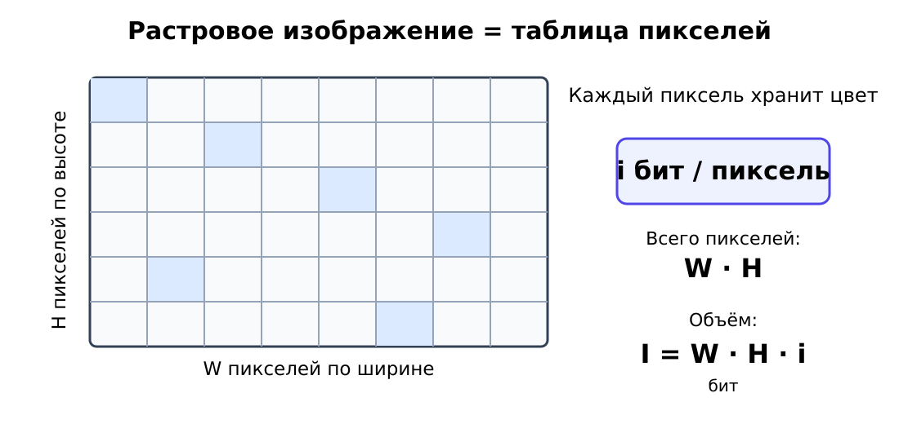
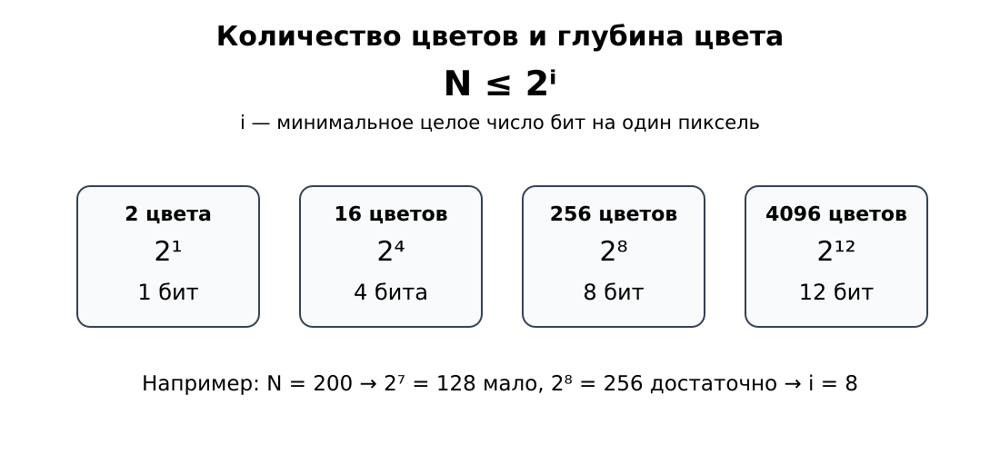
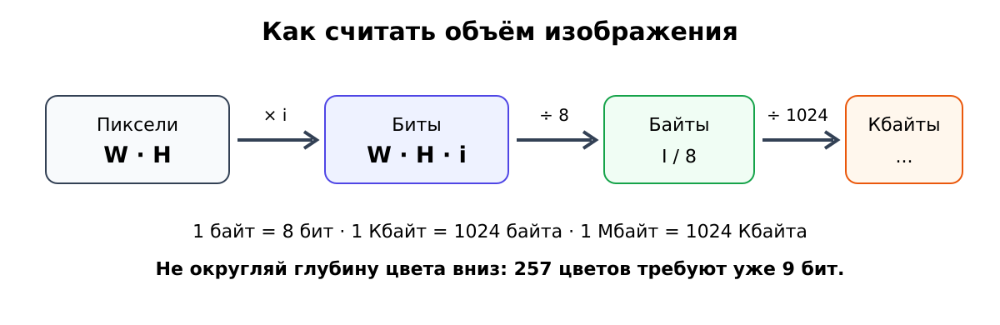
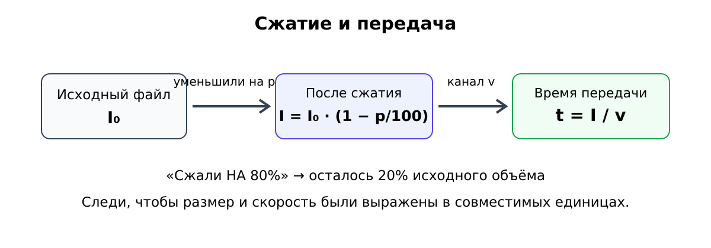
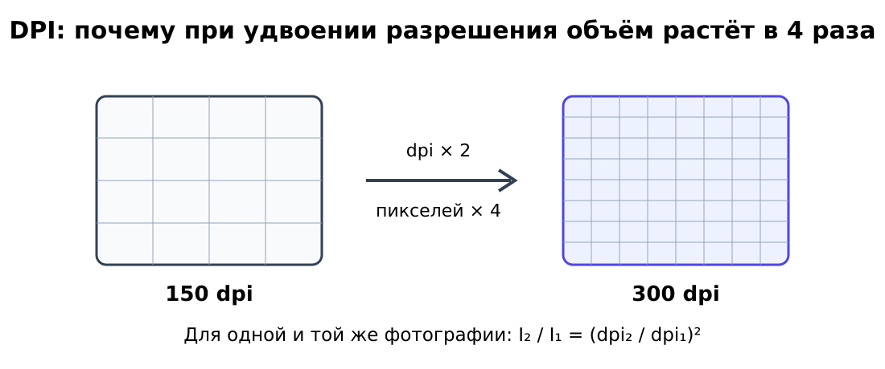
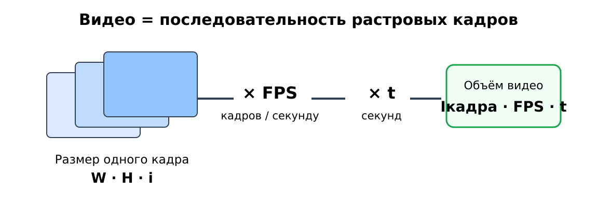

# Занятие 5. Кодирование растровых изображений

**ЕГЭ по информатике — задание №7**

Цель занятия: понять несколько базовых зависимостей настолько хорошо, чтобы решать не только прямые задачи на объём картинки, но и задачи ЕГЭ со сжатием, передачей, сериями фотографий, DPI и видеопотоком.

---

## 1. Что такое растровое изображение

Растровое изображение состоит из **пикселей**.



Если изображение имеет размер:

```text
W × H
```

то количество пикселей:

```text
K = W · H
```

Например:

```text
1024 × 768
```

содержит:

```text
1024 · 768 = 786432 пикселя
```

---

# 2. Глубина цвета

Каждый пиксель нужно закодировать.

Если на один пиксель выделяется `i` бит, то максимально можно закодировать:

```text
N = 2^i
```

цветов.

В задачах чаще нужна обратная зависимость:

```text
2^i ≥ N
```

Нужно найти **минимальное целое** `i`.



Примеры:

```text
2 цвета       → 1 бит
16 цветов     → 4 бита
256 цветов    → 8 бит
4096 цветов   → 12 бит
65536 цветов  → 16 бит
```

### Важный пример

Палитра содержит:

```text
200 цветов
```

Проверяем:

```text
2^7 = 128     — мало
2^8 = 256     — достаточно
```

Следовательно:

```text
i = 8 бит
```

### Главная ловушка

Если цветов `257`, нельзя взять `8 бит`.

```text
2^8 = 256 < 257
```

Поэтому:

```text
i = 9 бит
```

---

# 3. Главная формула

Объём **несжатого** растрового изображения:

```text
I = W · H · i
```

где:

```text
W — ширина в пикселях
H — высота в пикселях
i — бит на один пиксель
I — объём в битах
```



---

# 4. Единицы измерения

```text
1 байт = 8 бит

1 Кбайт = 1024 байта

1 Мбайт = 1024 Кбайта

1 Гбайт = 1024 Мбайта
```

Поэтому:

```text
бит → байт      делим на 8

байт → Кбайт    делим на 1024

Кбайт → Мбайт   делим на 1024
```

---

# 5. Пример обычной задачи

Изображение:

```text
1024 × 768 пикселей
256 цветов
```

### Шаг 1. Находим глубину цвета

```text
256 = 2^8
```

Следовательно:

```text
i = 8 бит
```

### Шаг 2. Находим объём

```text
I = 1024 · 768 · 8
```

```text
I = 6291456 бит
```

### Шаг 3. Переводим в Кбайты

```text
6291456 / 8 / 1024 = 768 Кбайт
```

**Ответ: 768 Кбайт.**

---

# 6. Если дан размер файла и нужно найти глубину

Используем ту же формулу:

```text
I = W · H · i
```

Отсюда:

```text
i = I / (W · H)
```

Важно сначала привести `I` к **битам**.

После нахождения `i` можно найти максимальное количество цветов:

```text
N = 2^i
```

---

# 7. Как меняется размер изображения

При одинаковой глубине цвета:

```text
I ∝ W · H
```

Если ширину и высоту увеличить в 2 раза:

```text
W → 2W
H → 2H
```

то:

```text
I → 4I
```

Потому что:

```text
2 · 2 = 4
```

Если ширина увеличилась в 3 раза, а высота в 2:

```text
I увеличится в 6 раз
```

---

# 8. Изменение глубины цвета

Размер также прямо пропорционален глубине:

```text
I ∝ i
```

Например:

```text
16 бит → 24 бита
```

даёт увеличение:

```text
24 / 16 = 1.5 раза
```

Если одновременно меняются разрешение и глубина:

```text
I2 / I1 =
(W2 / W1) ·
(H2 / H1) ·
(i2 / i1)
```

---

# 9. Сжатие изображения



Если файл **уменьшили на 80%**, то осталось:

```text
20%
```

То есть:

```text
Iсжат = Iисх · 0.2
```

Если уменьшили на `p%`:

```text
Iсжат = Iисх · (1 - p/100)
```

### Не путать

```text
уменьшили НА 80% → осталось 20%

уменьшили ДО 80% → осталось 80%
```

---

# 10. Передача изображения

Если файл передаётся по каналу:

```text
t = I / v
```

где:

```text
I — размер файла
v — скорость передачи
t — время
```

Следи за единицами.

Например:

```text
размер = Кбайт
скорость = Кбайт/с
```

тогда:

```text
время = секунды
```

---

# 11. Серия фотографий

Если одна фотография занимает:

```text
Iфото
```

а фотографий:

```text
n
```

то:

```text
Iобщ = Iфото · n
```

Если затем весь пакет сжимается:

```text
Iсжат = Iобщ · коэффициент_остатка
```

---

# 12. DPI

`DPI` — количество точек на один дюйм.

В ЕГЭ встречаются задачи, где одну и ту же физическую фотографию сканируют с разным DPI.



Если линейное разрешение изменилось:

```text
150 dpi → 300 dpi
```

то оно выросло:

```text
в 2 раза
```

Но количество пикселей растёт **по двум измерениям**:

```text
2² = 4 раза
```

Поэтому для одной и той же фотографии при одинаковой глубине цвета:

```text
I2 / I1 = (dpi2 / dpi1)^2
```

Например:

```text
200 dpi → 300 dpi
```

```text
I2 / I1 = (300 / 200)^2 = 2.25
```

---

# 13. Видео как последовательность изображений

Современная задача №7 может быть сформулирована через видеопоток.

Видео можно представить как последовательность растровых кадров.



Если один кадр занимает:

```text
Iкадр
```

а видео снимается с частотой:

```text
FPS кадров/с
```

то за `t` секунд:

```text
Iвидео = Iкадр · FPS · t
```

Если используется сжатие:

```text
Iсжат = Iвидео · коэффициент_остатка
```

Для непрерывной передачи:

```text
Iкадр · FPS · коэффициент_остатка ≤ скорость_канала
```

---

# 14. Палитра

В большинстве задач ЕГЭ размер самой палитры **не учитывается**, если в условии прямо не сказано обратное.

Но в усложнённых задачах могут дать:

```text
N цветов
на описание каждого цвета — 3 байта
```

Тогда:

```text
Iпалитры = N · 3 байта
```

И полный объём:

```text
I = Iпикселей + Iпалитры
```

---

# 15. Минимальный Python для проверки

```python
width = 1920
height = 1080
depth = 24

bits = width * height * depth
kb = bits / 8 / 1024

print(kb)
```

Найти глубину цвета для `N` цветов:

```python
N = 158543

i = 0

while 2 ** i < N:
    i += 1

print(i)
```

Или:

```python
from math import ceil, log2

i = ceil(log2(N))
```

---

# 16. Главная шпаргалка

```text
Количество пикселей:

K = W · H
```

```text
Количество цветов:

N ≤ 2^i
```

```text
Объём изображения:

I = W · H · i
```

```text
После сжатия на p%:

I2 = I1 · (1 - p/100)
```

```text
Передача:

t = I / v
```

```text
DPI:

I2 / I1 = (dpi2 / dpi1)^2
```

```text
Видео:

I = Iкадра · FPS · t
```

---

# 17. Типичные ошибки

## Ошибка 1. Использовать количество цветов вместо глубины

Нельзя:

```text
800 · 600 · 256
```

если дано 256 цветов.

Нужно:

```text
256 цветов = 8 бит
```

и затем:

```text
800 · 600 · 8
```

---

## Ошибка 2. Забывать квадрат при DPI

```text
150 dpi → 300 dpi
```

Объём увеличивается не в 2, а в:

```text
2² = 4 раза
```

---

## Ошибка 3. Перепутать проценты

```text
сжали на 70%
```

значит осталось:

```text
30%
```

---

## Ошибка 4. Смешать биты и байты

```text
512 Кбит/с ≠ 512 Кбайт/с
```

```text
512 Кбит/с = 64 Кбайт/с
```

---

# Задачи

# Уровень 1 — прямые задачи

## 1

Растровое изображение имеет размер:

```text
1024 × 768 пикселей
```

и использует палитру из `256 цветов`.

Определите объём изображения в Кбайтах.

---

## 2

Изображение размером:

```text
1280 × 720
```

использует `65536 цветов`.

Определите объём в Кбайтах.

---

## 3

Изображение:

```text
1920 × 1080
```

кодируется с глубиной `24 бита`.

Определите объём в Кбайтах.

---

## 4

Изображение:

```text
640 × 480
```

использует `16 цветов`.

Определите объём в Кбайтах.

---

## 5

Изображение:

```text
2048 × 1024
```

использует палитру из `4096 цветов`.

Определите объём в Кбайтах.

---

## 6

Изображение размером:

```text
1024 × 768
```

занимает `384 Кбайт`.

Сжатие отсутствует.

Определите максимальное количество цветов в палитре.

---

## 7

Изображение размером:

```text
800 × 600
```

занимает `937.5 Кбайт`.

Определите максимальное количество цветов.

---

## 8

Изображение:

```text
1600 × 1200
```

использует палитру из `200 цветов`.

Определите объём в Кбайтах.

---

## 9

Изображение:

```text
2560 × 1440
```

использует палитру из `1 000 000 цветов`.

Определите объём в Кбайтах.

---

## 10

Изображение:

```text
4096 × 2160
```

имеет глубину цвета `30 бит`.

Определите объём в Кбайтах.

---

# Уровень 2 — изменение параметров

## 11

У изображения глубину цвета изменили:

```text
8 бит → 16 бит
```

Разрешение не менялось.

Во сколько раз увеличился объём?

---

## 12

Ширину и высоту изображения увеличили в `2 раза`.

Глубина цвета не изменилась.

Во сколько раз увеличился объём?

---

## 13

Ширину и высоту изображения уменьшили в `2 раза`, а глубину цвета:

```text
24 бита → 16 бит
```

Во сколько раз уменьшился объём файла?

---

## 14

Исходное изображение:

```text
1600 × 1200
24 бита
```

преобразовали в:

```text
800 × 600
8 бит
```

Во сколько раз уменьшился объём?

---

## 15

Исходный файл занимает `48 Мбайт`.

Разрешение не меняется, глубина цвета:

```text
24 бита → 16 бит
```

Определите новый размер файла.

---

## 16

Файл занимает `30 Мбайт`.

Ширину и высоту изображения увеличили в `1.5 раза`.

Глубина цвета не изменилась.

Определите новый размер.

---

## 17

Файл занимает `96 Мбайт`.

Ширину изображения уменьшили в `2 раза`, высота не изменилась.

Глубина:

```text
32 бита → 16 бит
```

Определите новый размер.

---

## 18

Фотограф сделал `300` снимков.

Каждый снимок:

```text
1920 × 1080
24 бита
```

Сжатие отсутствует.

Определите общий объём в Кбайтах.

---

## 19

Карта памяти имеет свободный объём:

```text
512 Мбайт
```

Одна фотография:

```text
1024 × 768
24 бита
```

Сжатие отсутствует.

Какое максимальное количество полных фотографий можно сохранить?

---

## 20

Камера каждые `10 секунд` создаёт изображение:

```text
800 × 600
256 цветов
```

Сжатие отсутствует.

Определите общий объём изображений в Кбайтах, созданных за `1 час`.

---

# Уровень 3 — сжатие и передача

## 21

Изображение:

```text
1024 × 768
4096 цветов
```

после сохранения уменьшается сжатием на `25%`.

Определите размер сжатого файла в Кбайтах.

---

## 22

Изображение:

```text
1920 × 1080
24 бита
```

сжимается на `60%`.

Определите размер после сжатия в Кбайтах.

---

## 23

Файл размером `2430 Кбайт` передаётся со скоростью:

```text
81 Кбайт/с
```

Сколько секунд длится передача?

---

## 24

Изображение:

```text
1024 × 768
256 цветов
```

передаётся без сжатия со скоростью:

```text
256 Кбит/с = 32 Кбайт/с
```

Сколько секунд потребуется?

---

## 25

Передаются `10` изображений:

```text
800 × 600
24 бита
```

Весь пакет уменьшается сжатием на `80%`.

Скорость передачи:

```text
93.75 Кбайт/с
```

Сколько секунд займёт передача?

---

## 26

Пакет содержит `30` изображений:

```text
1024 × 768
4096 цветов
```

Сжатие уменьшает общий объём на `75%`.

Скорость:

```text
288 Кбайт/с
```

Определите время передачи.

---

## 27

После сжатия на `75%` файл занимает:

```text
20 Мбайт
```

Каков был исходный размер?

---

## 28

После сжатия на `60%` файл занимает:

```text
12 Мбайт
```

Каков был исходный размер?

---

## 29

Исходный файл имеет размер:

```text
40 Мбайт
```

После сжатия:

```text
10 Мбайт
```

На сколько процентов уменьшился объём?

---

## 30

Файл размером:

```text
12800 Кбайт
```

нужно передать за `50 секунд`.

Канал передаёт:

```text
64 Кбайт/с
```

На сколько процентов минимум нужно уменьшить исходный файл?

---

# Уровень 4 — DPI и видео

## 31

Одну фотографию отсканировали сначала с разрешением:

```text
150 dpi
```

а затем:

```text
300 dpi
```

Цветовой режим не менялся.

Во сколько раз увеличится объём несжатого изображения?

---

## 32

Фотографию сначала отсканировали с:

```text
300 dpi
```

а затем с:

```text
150 dpi
```

Во сколько раз уменьшится объём?

---

## 33

Фотографию отсканировали с разрешением `150 dpi`.

После сжатия на `40%` файл занял:

```text
6 Мбайт
```

Ту же фотографию в том же цветовом режиме отсканировали с разрешением:

```text
300 dpi
```

На сколько процентов нужно сжать второй файл, чтобы он занимал:

```text
12 Мбайт
```

---

## 34

Несжатый скан фотографии при `200 dpi` занимает:

```text
8 Мбайт
```

Определите объём той же фотографии при `300 dpi`, если глубина цвета не меняется.

---

## 35

При `600 dpi` несжатый файл занимает:

```text
36 Мбайт
```

Какой объём займёт та же фотография при `300 dpi`?

---

## 36

Видео:

```text
640 × 480
256 цветов
10 кадров/с
20 секунд
```

Сжатие отсутствует.

Определите объём видео в Кбайтах.

---

## 37

Видео:

```text
1280 × 720
24 бита
25 кадров/с
10 секунд
```

Сжатие отсутствует.

Определите объём в Кбайтах.

---

## 38

Камера передаёт видео:

```text
1024 × 768
256 цветов
```

Сжатие уменьшает каждый кадр на `85%`.

Пропускная способность канала:

```text
750 Кбайт/с
```

Определите максимальное целое количество кадров в секунду.

---

## 39

Видео:

```text
1920 × 1080
24 бита
```

сжимается на `90%`.

Канал:

```text
1 Мбайт/с = 1024 Кбайт/с
```

Какое максимальное целое число кадров в секунду можно передавать непрерывно?

---

## 40

Видео:

```text
800 × 600
16 цветов
12 кадров/с
60 секунд
```

Сжатие уменьшает объём на `80%`.

Определите итоговый объём в Кбайтах.

---

# Уровень 5 — сложные и выше уровня обычного ЕГЭ

## 41

Фотограф сделал `200` снимков.

Каждый снимок:

```text
4096 × 3072
4096 цветов
```

После сохранения каждый файл уменьшается на `75%`.

Определите общий объём всех фотографий в Мбайтах.

---

## 42

Пакет фотографий из предыдущей задачи занимает:

```text
900 Мбайт
```

и передаётся со скоростью:

```text
1.25 Мбайт/с
```

Сколько секунд займёт передача?

---

## 43

Изображение:

```text
4096 × 2048
```

кодируется с глубиной:

```text
18 бит
```

Дополнительно в файл записывается палитра из:

```text
2^18 цветов
```

На описание каждого цвета палитры используется `3 байта`.

Определите полный объём файла в Мбайтах.

---

## 44

При сканировании фотографии с разрешением `200 dpi` и глубиной `24 бита` получен несжатый файл размером:

```text
18 Мбайт
```

Ту же фотографию сканируют:

```text
300 dpi
16 бит
```

после чего уменьшают объём сжатием на `50%`.

Определите размер итогового файла.

---

## 45

Видео:

```text
1280 × 720
16 бит
10 кадров/с
30 секунд
```

сжимается на `90%`.

После сжатия к файлу добавляется служебный блок размером:

```text
1 Мбайт
```

Определите полный объём в Кбайтах.

---

## 46

Камера передаёт видео:

```text
640 × 480
24 бита
```

Каждый кадр уменьшается сжатием на `80%`.

Служебные данные протокола дополнительно увеличивают уже сжатый объём каждого кадра на `10%`.

Канал:

```text
1 Мбайт/с = 1024 Кбайт/с
```

Определите максимальное целое число кадров в секунду.

---

## 47

Карта памяти имеет объём:

```text
2 Гбайт
```

Каждая фотография:

```text
4096 × 3072
24 бита
```

после сохранения уменьшается сжатием на `75%`.

Какое максимальное количество фотографий можно сохранить?

---

## 48

Камера снимает видео:

```text
640 × 480
10 кадров/с
```

Глубина цвета неизвестна.

Сжатие уменьшает каждый кадр на `75%`.

Канал:

```text
750 Кбайт/с
```

Какова максимальная целая глубина цвета в битах, при которой видео можно передавать непрерывно?

---

## 49

Исходный скан фотографии:

```text
150 dpi
8 бит
```

занимает:

```text
16 Мбайт
```

Новое сканирование:

```text
300 dpi
24 бита
```

После него файл уменьшается сжатием на `90%`.

Определите размер итогового файла.

---

## 50

Нужно передать `50` фотографий.

Каждая:

```text
4096 × 3072
4096 цветов
```

После сжатия весь пакет передаётся со скоростью:

```text
5 Мбайт/с
```

Передача занимает ровно:

```text
45 секунд
```

На сколько процентов был уменьшен исходный объём пакета?

---

# Ответы

|   № |          Ответ |   № |          Ответ |
| --: | -------------: | --: | -------------: |
|   1 |      768 Кбайт |  26 |           30 с |
|   2 |     1800 Кбайт |  27 |       80 Мбайт |
|   3 |     6075 Кбайт |  28 |       30 Мбайт |
|   4 |      150 Кбайт |  29 |            75% |
|   5 |     3072 Кбайт |  30 |            75% |
|   6 |      16 цветов |  31 |         4 раза |
|   7 |   65536 цветов |  32 |         4 раза |
|   8 |     1875 Кбайт |  33 |            70% |
|   9 |     9000 Кбайт |  34 |       18 Мбайт |
|  10 |    32400 Кбайт |  35 |        9 Мбайт |
|  11 |         2 раза |  36 |    60000 Кбайт |
|  12 |         4 раза |  37 |   675000 Кбайт |
|  13 |          6 раз |  38 |     6 кадров/с |
|  14 |         12 раз |  39 |       1 кадр/с |
|  15 |       32 Мбайт |  40 |    33750 Кбайт |
|  16 |     67.5 Мбайт |  41 |      900 Мбайт |
|  17 |       24 Мбайт |  42 |          720 с |
|  18 |  1822500 Кбайт |  43 |    18.75 Мбайт |
|  19 | 227 фотографий |  44 |     13.5 Мбайт |
|  20 |   168750 Кбайт |  45 |    55024 Кбайт |
|  21 |      864 Кбайт |  46 |     5 кадров/с |
|  22 |     2430 Кбайт |  47 | 227 фотографий |
|  23 |           30 с |  48 |          8 бит |
|  24 |           24 с |  49 |     19.2 Мбайт |
|  25 |           30 с |  50 |            75% |

---

# Решения сложных задач 41–50

## 41

Палитра:

```text
4096 = 2^12
```

Следовательно:

```text
i = 12 бит
```

Один снимок:

```text
4096 · 3072 · 12 / 8
```

```text
= 18 Мбайт
```

После уменьшения на `75%` остаётся:

```text
25%
```

```text
18 · 0.25 = 4.5 Мбайт
```

Для 200 снимков:

```text
4.5 · 200 = 900 Мбайт
```

**Ответ: 900 Мбайт.**

---

## 42

```text
t = I / v
```

```text
t = 900 / 1.25
```

```text
t = 720 секунд
```

**Ответ: 720.**

---

## 43

Пиксельные данные:

```text
4096 · 2048 · 18 / 8
```

```text
= 18 Мбайт
```

Палитра:

```text
2^18 · 3 байта
```

```text
= 786432 байта
```

```text
= 0.75 Мбайт
```

Итого:

```text
18 + 0.75 = 18.75 Мбайт
```

**Ответ: 18.75 Мбайт.**

---

## 44

Изменение DPI:

```text
(300 / 200)^2 = 2.25
```

Изменение глубины:

```text
16 / 24 = 2/3
```

После сжатия на 50% остаётся:

```text
0.5
```

Итог:

```text
18 · 2.25 · 2/3 · 0.5
```

```text
= 13.5 Мбайт
```

**Ответ: 13.5 Мбайт.**

---

## 45

Один кадр:

```text
1280 · 720 · 16 / 8 / 1024
```

```text
= 1800 Кбайт
```

Количество кадров:

```text
10 · 30 = 300
```

Несжатый объём:

```text
1800 · 300 = 540000 Кбайт
```

После сжатия на 90%:

```text
540000 · 0.1 = 54000 Кбайт
```

Служебный блок:

```text
1 Мбайт = 1024 Кбайт
```

Итого:

```text
54000 + 1024 = 55024 Кбайт
```

**Ответ: 55024 Кбайт.**

---

## 46

Размер несжатого кадра:

```text
640 · 480 · 24 / 8 / 1024
```

```text
= 900 Кбайт
```

После сжатия остаётся:

```text
20%
```

```text
900 · 0.2 = 180 Кбайт
```

Протокол добавляет 10%:

```text
180 · 1.1 = 198 Кбайт
```

Канал:

```text
1024 Кбайт/с
```

Количество кадров:

```text
1024 / 198 ≈ 5.17
```

Нужно целое число кадров:

```text
5
```

**Ответ: 5 кадров/с.**

---

## 47

Одна фотография без сжатия:

```text
4096 · 3072 · 24 / 8
```

```text
= 36 Мбайт
```

После уменьшения на 75%:

```text
36 · 0.25 = 9 Мбайт
```

Карта:

```text
2 Гбайт = 2048 Мбайт
```

```text
2048 / 9 ≈ 227.55
```

Можно записать только целое количество полных фотографий:

```text
227
```

**Ответ: 227.**

---

## 48

Для глубины `1 бит` размер одного кадра:

```text
640 · 480 · 1 / 8 / 1024
```

```text
= 37.5 Кбайт
```

Для глубины `i`:

```text
37.5 · i
```

За секунду при `10 кадрах/с`:

```text
37.5 · i · 10
```

После сжатия на 75% остаётся 25%:

```text
37.5 · i · 10 · 0.25
```

```text
= 93.75 · i
```

Канал:

```text
750 Кбайт/с
```

Следовательно:

```text
93.75 · i ≤ 750
```

```text
i ≤ 8
```

**Ответ: 8 бит.**

---

## 49

DPI:

```text
300 / 150 = 2
```

Количество пикселей:

```text
2² = 4 раза
```

Глубина:

```text
24 / 8 = 3 раза
```

До сжатия:

```text
16 · 4 · 3 = 192 Мбайт
```

После уменьшения на 90% остаётся:

```text
10%
```

```text
192 · 0.1 = 19.2 Мбайт
```

**Ответ: 19.2 Мбайт.**

---

## 50

Одна фотография:

```text
4096 × 3072
4096 цветов
```

```text
4096 цветов = 12 бит
```

Размер:

```text
18 Мбайт
```

50 фотографий:

```text
18 · 50 = 900 Мбайт
```

За 45 секунд по каналу `5 Мбайт/с` передано:

```text
5 · 45 = 225 Мбайт
```

Осталось:

```text
225 / 900 = 0.25 = 25%
```

Значит объём уменьшили на:

```text
100% - 25% = 75%
```

**Ответ: 75%.**

---

# Как провести занятие

Для одной пары около 90 минут:

```text
0–10 мин   — что такое пиксель, W × H, глубина цвета
10–25 мин  — N ≤ 2^i и I = W · H · i
25–35 мин  — 2–3 задачи вместе
35–45 мин  — изменение параметров и сжатие
45–75 мин  — самостоятельная работа
75–90 мин  — разбор ошибок
```

### Слабые / начинающие

Начать с:

```text
1–10
```

затем:

```text
11–15
21–24
```

### Средние

```text
8–30
```

### Сильные

После общей теории:

```text
21–50
```

Особенно:

```text
31–40 — форматы, встречающиеся в сложных вариантах №7
41–50 — тренировка выше обычного уровня
```

---

# Что ученик обязан понять

Если после занятия ученик помнит только пять вещей, это должны быть:

```text
1. I = W · H · i

2. N ≤ 2^i

3. 1 байт = 8 бит

4. после уменьшения на 80% остаётся 20%

5. при удвоении DPI объём растёт в 4 раза
```

Всё остальное строится на этих зависимостях.
